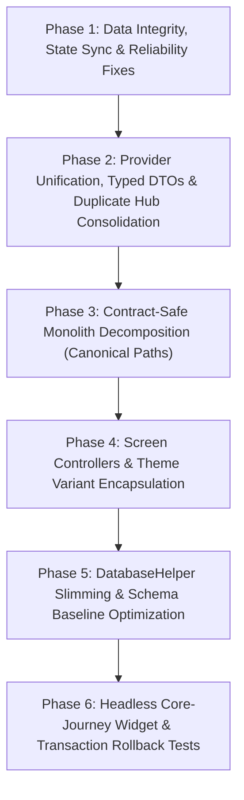

# Tonos (`env_test` / `com.tonos`) — Comprehensive Codebase Review & Refactoring Blueprint

- **Date of Review**: October 29, 2026
- **Repository**: `E:\projects\env_test` (baseline `HEAD 6331ccd` on `feature/expressive-visual-polish`; implementation branch `codex/codebase-maintainability`)
- **Pinned Toolchain**: Flutter `3.47.5` (`E:\tools\flutter_sdks\3.47.5\flutter`) · Dart SDK `^3.13.0` (`material_ui: ^1.5.0`)
- **Primary Stack**: Flutter, SQLite (`sqflite` / `sqflite_common_ffi` / `sqlite3`), `provider`, `fl_chart`, `mobile_scanner`
- **Audit Scope**: Readability, Simplicity, Maintainability, Structural Architecture, Reliability, Safety/Privacy, Test Strategy, and Contract-Safe Execution Roadmap.

> [!NOTE]
> **Execution Progress (`codex/codebase-maintainability`, October 29, 2026)**:
> - **Pass 1 (`9bd2fa9..c703947`, [Pass 1 Audit Report](maintenance/20261029-codebase-maintainability/README.md))**: Repaired checkpoint guardrails; extracted `FoodPortionPayload` and `FoodCustomizationDao`; removed the 236-line commented legacy block from `active_session.dart`; isolated `AutomaticSettingsSheet` drafts; serialized preference writes via `PreferenceWriter` / `SerialAsyncQueue`; guarded `SelectedProfile` against stale equipment responses; verified `PRAGMA quick_check` rows; made food customization/logging saves atomic; and fixed portion transaction deadlocks and barcode check-digit validation.
> - **Pass 2 (`18a0aee..HEAD`, [Pass 2 Audit Report](maintenance/20261029-pass2-reliability-and-structure/README.md))**: Extracted `FlowDefaultsDao` and `OptimizedWorkoutPreferences`; made default/preset flow rule upserts, renames, and deletions atomic inside single SQLite transactions; refactored `PresetSession` onto a single `List<_PresetExerciseEntry>` with reload-version/disposal/`SafeFailure` guards; migrated `DiagnosticsService` stores onto `SerialAsyncQueue` + `writePreferences` and evicted failed `ExerciseContentLocalizer` bundle futures; hardened `BarcodeScannerPage` camera switching/lifecycle handling and fixed `Train2Page` settings + edit-mode parity; synchronized `SelectedProfile` ↔ `NutritionProfile` via `ChangeNotifierProxyProvider` (eliminating duplicate cold-start `'General'` profiles) and serialized `toggleEquipment`; hoisted `PRAGMA table_info` outside the per-row backup import loop (`O(1)` per table); cleared `AppRepository` static exercise analysis caches on import; and coordinated `ActiveSession`, `SelectedProfile`, and `NutritionProfile` pause/reload across database replacement.
> - **Remaining Roadmap**: Phases 3–6 below (monolith decomposition under canonical paths, screen presentation controllers/style resolvers, further `DatabaseHelper` slimming/schema baseline optimization, and additional journey tests) remain the active follow-up backlog.

---

## Executive Summary & Codebase Health Scorecard

Tonos is a feature-rich, offline-first strength training, body measurement, and nutrition tracking application. Several foundational subsystems are engineered to a remarkably high standard: its domain models in `lib/models/`, sanitized error boundary (`SafeFailure`), lifecycle-durable active workout persistence (`DurableActiveSession`), SQLite bind-parameter chunking (`sqliteChunks`), SHA-256/HTTPS-enforced media caching (`TrustedMediaCacheService`), and CI contract enforcement are genuinely strong.

At the same time, rapid feature and multi-theme visual expansion have produced **acute monolith bloat, entangled UI/state/data responsibilities, silent state-synchronization bugs across providers, non-transactional multi-step writes, and a heavily skewed unit/widget test suite**:

- **Source Footprint (`lib/`)**: **305 hand-authored `.dart` files totaling 157,165 lines** (plus 7 generated localization files in `lib/l10n/generated/`, 312 files overall). **19 files exceed 2,000 lines**, and **35+ files exceed 1,170 lines**, topped by `lib/db/database_helper.dart` (**5,812 lines**), `lib/screens/onboarding_flow.dart` (**4,553 lines**), `lib/widgets/exercise_detail_sheet.dart` (**4,400 lines**), and `lib/widgets/health_trends_section.dart` (**4,255 lines**).
- **Test Footprint (`test/` + `integration_test/`)**: **322 files / 101,312 lines** in `test/`, plus **3 files / 1,867 lines** in `integration_test/`. Within `test/`, **68.8% of all test lines (`69,702` lines across 190 files)** live in `test/theme/`, whereas `test/screens/` contains **only 2 files (`1,143` lines)** and `test/providers/` contains **only 3 files (`885` lines)**. Meanwhile, `integration_test/core_flows_test.dart` covers end-to-end journeys on Android devices, so it **does not execute in PR CI** (`.github/workflows/ci.yml`).

### Health Scorecard

| Dimension | Grade | Ground-Truth Assessment |
| :--- | :---: | :--- |
| **Domain Models & Type Contracts** | **A-** | Clean entities in `lib/models/` with explicit invariants, though 37 raw `Map<String, dynamic>` leaks still reach 13 UI files. |
| **Safety, Privacy & Error Hygiene** | **A-** | Local-first data, parameterized SQL, 25 MB/schema-validated DB imports, `TrustedContentPolicy`, and CI-enforced `SafeFailure`. Minor camera error/pause edge cases remain. |
| **Reliability & State Consistency** | **B-** | Strong workout draft durability (`DurableActiveSession`), but undermined by post-DB-import provider/cache staleness, split-brain `GymProfile` providers, and non-transactional multi-step writes. |
| **Simplicity & Theme Ergonomics** | **C-** | Three intentional product theme families (Classic, Expressive, Neo) are wired via 249 inline UI token/family checks and 31-param constructors; `TrainPage` and `Train2Page` duplicate logic and have silently drifted. |
| **Structural Architecture** | **C-** | Incomplete DAO migration leaves a 3-layer pass-through (`AppRepository` → `DatabaseHelper` → ~30 DAOs) and triple schema maintenance (`schema.dart` + open-time repairs + `schema_latest.sql`). |
| **Readability & Maintainability** | **D+** | 19 monolith files >2,000 lines; giant `State<T>` classes mix UI layout, debounce timers, local `Future` caches, arithmetic, and persistence; 236 lines of dead commented code in `active_session.dart`. |
| **Headless Journey Test Balance** | **D+** | Exceptional theme/token/contract regression coverage, but critical workout, nutrition, backup-restore, and provider synchronization paths lack headless PR-CI widget/unit coverage. |

---

## 1. Mandatory Guardrails & CI Contracts (Read Before Modifying Any File)

> [!IMPORTANT]
> This repository enforces strict source-scanning, lexical-scope, localization, toolchain, and visual-parity contracts in `.github/workflows/ci.yml` and `test/`. Any automated agent or developer refactoring this codebase **must** obey the seven invariants below or CI will fail immediately.

### 1.1 Use the Pinned Flutter `3.47.5` / Dart `^3.13.0` Toolchain — Never Downgrade `pubspec.yaml`
- `pubspec.yaml` intentionally targets `sdk: ^3.13.0` because `material_ui: ^1.5.0` requires it.
- Both `.github/workflows/ci.yml` (`FLUTTER_VERSION: 3.47.5`) and `android/local.properties` (`flutter.sdk=E:\\tools\\flutter_sdks\\3.47.5\\flutter`) target Flutter `3.47.5`.
- On Windows workstations where the default system `PATH` points to an older Flutter/Dart installation, **do not alter `pubspec.yaml`**. Invoke the pinned SDK directly:
  - `E:\tools\flutter_sdks\3.47.5\flutter\bin\flutter.bat`
  - `E:\tools\flutter_sdks\3.47.5\flutter\bin\dart.bat`
- **Analyzer Baseline Note (`dart analyze` vs `flutter analyze`)**: `.github/workflows/ci.yml` gates analysis via `dart analyze lib test integration_test test_driver` (**0 errors, 0 warnings**). `lib/` currently carries **51 `info`-level lints** under Flutter `3.47.5` (47 `deprecated_member_use` notices for Flutter 3.32–3.41 API migrations—`RadioGroup`, `TickerMode.valuesOf`, `ReorderableListView.onReorderItem`—plus 4 `prefer_initializing_formals` infos). Because `flutter analyze` treats `info`s as fatal by default (`exit 1`) whereas `dart analyze` only fails on warnings/errors (`exit 0`), always use `dart analyze` (matching CI) or `flutter analyze --no-pub --no-fatal-infos` unless specifically migrating those deprecated widget APIs.

### 1.2 Preserve All Three Product Theme Families & Frozen Visual Baselines
- **Classic**, **Expressive**, and **Neo-Brutalism** (`lib/theme/app_theme_family.dart`, `lib/theme/app_theme_capabilities.dart`) are **intentional product theme families**, not throwaway experiments:
  - **Expressive**: Has **49 visually approved and frozen page archetypes (`A49 / B0`)** documented in `docs/proposals/tonos-expressive-combined-unapproved-review/README.md`.
  - **Neo-Brutalism**: Supports 21 accepted surfaces, is compile-time gated in release builds via `--dart-define=TONOS_ENABLE_NEO_RELEASE=true`, and is explicitly built and tested in `.github/workflows/ci.yml`.
  - **Classic**: Serves as the permanent baseline and automatic fallback for non-accepted Neo surfaces (`resolveEffectiveThemeFamily`).
- **Rule**: Refactoring must target **internal implementation ergonomics** (encapsulating variant resolution, splitting huge widgets, extracting controllers) while keeping rendered visual output, spacing, typography, and theme capabilities **pixel- and behavior-equivalent**. Never delete or archive a theme family.

### 1.3 Respect the Lexical-Scope Theme Style Ratchet & Style Inventory
- CI executes two custom static analyzers on every PR:
  1. `dart run tools/theme_style_inventory.dart --check` (verifies `docs/theme-style-inventory.json`)
  2. `dart run tools/theme_style_ratchet.dart docs/theme-style-ratchet.json`
- `tools/theme_style_ratchet.dart` computes SHA-256 fingerprints over `(enclosing class/method lexical scope chain + normalized statement text)` for raw color, shadow, font-size, and spacing tokens across **18 enrolled widget files**, including several prime refactoring targets:
  - `lib/widgets/exercise_detail_sheet.dart`
  - `lib/widgets/health_trends_section.dart`
  - `lib/widgets/exercise_progress_section.dart`
  - `lib/widgets/workout_metric_chart_card.dart`
  - `lib/widgets/workout_history_calendar.dart`
  - `lib/widgets/weight_card.dart`
  - `lib/widgets/preset_weight_card.dart`, `cardio_card.dart`, `stretch_card.dart`, `session_card.dart`, `ongoing_session_fab.dart`, `measurement_chart.dart`, `bodypart_heatmap.dart`, `muscle_heatmap.dart`, etc.
- **Rule**: Renaming a method, extracting a helper widget, or moving styled code out of any of those 18 files changes its lexical scope chain and **trips the ratchet**. Whenever decomposing an enrolled file, either preserve its tokenized primitives cleanly or update `docs/theme-style-ratchet.json` and `docs/theme-style-inventory.json` in lockstep in the same commit and re-run both `--check` scripts.

### 1.4 Preserve Canonical File Paths Required by Source-Scanning Contract Tests
Do **not** execute a naive wholesale `lib/core/` + `lib/features/` folder migration. Multiple contract tests scan hardcoded directory trees and assert exact file locations:
- `test/compatibility_cleanup_contract_test.dart`:
  - Asserts `lib/widgets/dashboard_sections.dart` and `lib/screens/nutrition/measured_items_page.dart` exist at those exact paths.
  - Forbids recreating 20 deleted legacy forwarding files (e.g., `lib/screens/train_page.dart`, `lib/screens/food_logging_page.dart`).
  - Forbids adding `@Deprecated` annotations anywhere in `lib/repositories/app_repository.dart`.
- `test/repository_injection_contract_test.dart`:
  - Only `lib/main.dart` and `lib/repositories/app_repository.dart` may call `AppRepository(...)`.
  - No file under `lib/screens/`, `lib/widgets/`, `lib/providers/`, or `lib/services/` may instantiate `DatabaseHelper()`.
- `docs/screen-routing-map.md`: Documents canonical screen entrypoints.
- **Rule**: Keep top-level layer roots (`lib/db/`, `lib/models/`, `lib/providers/`, `lib/repositories/`, `lib/screens/`, `lib/services/`, `lib/theme/`, `lib/widgets/`) intact, keep canonical screen/widget entry files in place, and extract cohesive sub-components into subdirectories underneath their owning domain (e.g., `lib/screens/onboarding/`, `lib/screens/nutrition/food_logging/`, `lib/widgets/exercise_detail/`).

### 1.5 Obey Deferred Localization Surface Rules & Generated L10n Formatting
- `test/localization/hardcoded_ui_copy_contract_test.dart` scans `lib/screens/` and `lib/widgets/` and fails on hardcoded English UI copy **outside** `_isDeferredSurface(path)`:
  - Deferred path patterns: `/nutrition/`, `/cardio_`, `/stretch_`, `/meal_plan_`, `/nutrition_`, `/combined_history_page.dart`, `/form_posing_page.dart`, `/train2_page.dart`.
- **Trap to Avoid**: If you extract a sub-widget out of `lib/screens/nutrition/food_logging_page.dart` (deferred) and place it into `lib/widgets/food_plate_card.dart` (non-deferred!), CI will immediately fail on every English string in that widget. Keep extracted nutrition sub-widgets inside `lib/screens/nutrition/...` until their strings are localized across all 7 ARB files (`app_en.arb`, `app_de.arb`, `app_es.arb`, `app_fr.arb`, `app_ja.arb`, `app_pt.arb`, `app_zh.arb`).
- **Generated Files Rule**: CI checks `git diff --exit-code -- lib/l10n/generated` right after `flutter gen-l10n` and excludes `lib/l10n/generated` from `dart format`. **Never run `dart format` on `lib/l10n/generated/`**.

### 1.6 Obey Safe Error Handling & Database Schema Contracts
- `test/localization/safe_error_handling_contract_test.dart`: Forbids `.toString()` on caught errors, `$e` / `$error` interpolation outside `debugPrint(...)`, and raw `String?` or `Object?` fields named `*loadError`, `*saveError`, or `*restoreError` in `lib/screens/`, `lib/widgets/`, and `lib/providers/`. Always route user-facing failure state through `SafeFailure` (`lib/services/safe_failure.dart`).
- `test/database_schema_contract_test.dart`: Asserts `_kDbVersion` in `lib/db/database_helper.dart` has matching `await migrateV$version(db);` in `Schema.createV1` and `if (oldVersion < $version) await migrateV$version(db);` in `Schema.onUpgrade` (`lib/db/schema.dart`), and checks `lib/db/schema_latest.sql`. Any schema-baseline optimization must update this contract test and `schema_latest.sql` deliberately.

### 1.7 Preserve Compile-Time Gated Experimental Tabs
- `lib/screens/combined_history_page.dart`, `lib/screens/form_posing_page.dart`, and `lib/screens/nutrition/nutrition_log_page.dart` are **intentionally gated** behind `TONOS_ENABLE_EXPERIMENTAL_TABS` (`AppConfiguration.experimentalTabsEnabled`, forced `false` in `kReleaseMode` and verified in `test/app_configuration_test.dart`). Do **not** delete these files or remove their `TabItem` / `NavBarConfig` entries unless product requirements explicitly retire those tabs.

---

## 2. Readability & Code Ergonomics

### 2.1 Monolithic "God Files" & Private Inner-Class Crowding
Across 305 non-generated files in `lib/` (157,165 lines), code concentration in the top tier severely impedes comprehension, code review, and safe modification:

| Rank | File Path | Total Lines | Primary Responsibility Mix |
| :---: | :--- | ---: | :--- |
| 1 | `lib/db/database_helper.dart` | **5,812** | DB open/upgrade, schema repairs, backup/import, raw SQL, + ~30 DAO pass-throughs |
| 2 | `lib/screens/onboarding_flow.dart` | **4,553** | Multi-step wizard state, plan preview, DB writes, + 25+ private UI widget classes |
| 3 | `lib/widgets/exercise_detail_sheet.dart` | **4,400** | Modal sheet UI, 5 local `Future` caches, history pagination, charts, tutorial flow |
| 4 | `lib/widgets/health_trends_section.dart` | **4,255** | Multi-metric health aggregation, range filtering, interactive charts, card layouts |
| 5 | `lib/db/schema.dart` | **3,672** | `createV1` + sequential `migrateV2`..`migrateV62` DDL/DML scripts |
| 6 | `lib/widgets/exercise_progress_section.dart` | **3,550** | Analytics bucketing, 1RM/volume calculations, muscle filters, Expressive/Classic UI |
| 7 | `lib/screens/profile/settings/exercise_editor_screen.dart` | **3,415** | Exercise CRUD, muscle/bodypart allocation sliders, media attachments, validation |
| 8 | `lib/widgets/workout_metric_chart_card.dart` | **3,397** | Metric bucket computation, touch scrubbing, insight grids, multi-theme chart styling |
| 9 | `lib/screens/profile/settings/flow_methods_page.dart` | **2,691** | Progression flowchart method editor, parameter forms, graph reference updates |
| 10 | `lib/db/nutrition_dao.dart` | **2,479** | Food/portion/recipe/diary/macro/FTS SQLite queries and cache recalculations |
| 11 | `lib/screens/exercise/premade_plans_page.dart` | **2,464** | Catalog browsing, plan previews, equipment adaptation, activation workflows |
| 12 | `lib/db/seed.dart` | **2,409** | Bundled catalog seeding, lookup reconciliation, and media/catalog sync helpers |
| 13 | `lib/services/preset_generation_service.dart` | **2,358** | Candidate scoring, muscle volume allocation, starter load math, preset DB writes |
| 14 | `lib/widgets/workout_history_calendar.dart` | **2,284** | Calendar grid math, streak/summary stats, session badges, sheet triggers |
| 15 | `lib/screens/exercise/train_page.dart` | **2,237** | Workout hub, active plan carousel, optimized workout prefs, session launch logic |
| 16 | `lib/screens/exercise/session_detail_screen.dart` | **2,209** | Historical session editor, record badges, Save-as-plan flow, set mutation |
| 17 | `lib/screens/nutrition/food_logging_page.dart` | **2,170** | Search, barcode scan handoff, `_portionCache`, plate macro math, meal heuristics |
| 18 | `lib/widgets/weight_card.dart` | **2,148** | Set table editing, drop-sets, controller sync, 31 constructor params, 5 mode flags |
| 19 | `lib/screens/exercise/auto_preset_flow_screen.dart` | **2,029** | Node/edge progression flowchart canvas, rule editors, preset auto-settings |
| 20 | `lib/screens/exercise/exercise_catalog_page.dart` | **1,977** | Search, multi-axis equipment/muscle/bodypart filters, localized catalog sorting |
| 21 | `lib/repositories/app_repository.dart` | **1,954** | Application-wide data facade, static LRU `Future` caches, sub-repository wrappers |

**Why this hurts day-to-day engineering:**
1. **Private-Class Lock-In**: Dozens of cohesive domain/UI helpers (`_PlateItem`, `_MacroPreview`, `_ReportBucketSet`, `_ExerciseRecordPoint`, `_IntentTile`, `_GymSpaceTemplate`) are file-private inside 2,000–4,500 line files. They cannot be unit-tested in isolation or reused across sister screens without copy-pasting.
2. **State/UI Tangling**: Classes such as `_ExerciseDetailSheetState` (`lib/widgets/exercise_detail_sheet.dart:290-360`) and `_FoodLoggingPageState` (`lib/screens/nutrition/food_logging_page.dart:58-145`) simultaneously own text controllers, debounce timers, pagination cursors, local `Map<int, Future<...>>` caches, domain math, and 15-level-deep widget builders.

### 2.2 Constructor Flag Explosion (`WeightCard` Case Study)
`WeightCard` (`lib/widgets/weight_card.dart:34-94`) accepts **31 constructor parameters**, including **five caller-specific presentation mode flags**:
- `expressiveWorkoutMode`
- `expressivePresetEditorMode`
- `expressiveDetailViewMode`
- `expressiveShowEquipmentLabel`
- `expressiveActionMenuOnly`

Whenever a widget accumulates boolean flags named after its parent screens (`WorkoutMode`, `PresetEditorMode`, `DetailViewMode`), every internal layout method turns into a combinatorial `if / else if` matrix, making visual regressions easy to introduce and hard to reason about.

### 2.3 Dead Commented Code & Reachable Mock Surfaces
- **Retained Legacy Block**: `lib/providers/active_session.dart` retains **236 lines** of commented-out legacy implementation at the bottom of the file. Git history already preserves this; keeping it in source adds pure noise.
- **Reachable Mock Screen**: `lib/screens/nutrition/default_trend_page.dart` (reachable from nutrition dashboard routes) still renders hardcoded placeholder `FlSpot` coordinates and `itemCount: 5` under `// TODO: wire these to real data` and `// TODO: use real measurement count`. Either wire it to `AppRepository` measurement/nutrition series or hide its navigation entry behind a feature gate until complete.
- **Minor Header Drift**: Stale file-path banner comments appear in older files (e.g., `lib/providers/selected_profile.dart:1` reads `// lib/models/selected_profile.dart`).

---

## 3. Simplicity & Multi-Theme Implementation Debt

### 3.1 Separating Product Intent from Implementation Complexity
Supporting Classic, Expressive, and Neo-Brutalism is a valid product decision—and the token infrastructure in `lib/theme/` (`AppThemeFamily`, `AppThemeCapabilities`, `AppExpressiveDestinationTokens`, `ThemeLabPage`) is well structured. The simplicity problem is **not** that three themes exist; it is **how theme variations leak into feature business widgets**:

- **249 inline references** to `AppExpressiveDestinationTokens` or `isExpressive` are spread across **49 screen and widget files** (heaviest in `exercise_progress_section.dart` [32], `workout_history_calendar.dart` [15], `health_trends_section.dart` [13], `exercise_detail_sheet.dart` [13], `ui_appearance_settings_page.dart` [12], `flow_methods_page.dart` [12], `exercise_catalog_page.dart` [11], and `catalog_page.dart` [11]), alongside 48 direct `AppThemeFamily` / Neo checks.
- Feature widgets repeatedly resolve destination tokens mid-`build()`, branch padding/border/typography inline, and mix those branches directly with async state and SQLite data transformations.
- **Fix Direction**: Keep all three theme families and tokens intact, but resolve a single immutable `*SurfaceStyle` / `*CardVariantStyle` value object at the top of a widget's `build(BuildContext context)` (or via a small presenter helper), leaving the widget tree declarative and branch-light.

### 3.2 Duplicated Screens & Confirmed Behavioral Drift (`TrainPage` vs `Train2Page`)
`lib/screens/exercise/train_page.dart` (2,237 lines) and `lib/screens/exercise/train2_page.dart` (experimental/alternate training hub) copy-paste raw `SharedPreferences` keys (`opt_workout_*`) and workout-launch orchestration instead of sharing a controller or settings store. **They have already silently drifted**:

1. **Ignored User Settings in `Train2Page`**:
   - `TrainPage._loadOptSettings()` (`lib/screens/exercise/train_page.dart:61-95`) loads **6** persisted user preferences: `opt_workout_minutes`, `opt_workout_min_sets`, `opt_workout_max_sets`, `opt_workout_rep_weight_mode`, `opt_workout_target_reps`, and `opt_workout_starter_intensity`.
   - `Train2Page._loadOptSettings()` (`lib/screens/exercise/train2_page.dart:83-94`) only loads **2** (`opt_workout_minutes` and `opt_workout_max_sets`), leaving the other 4 preferences ignored when generating an optimized workout from `Train2Page`.
2. **Dead Parameter Bug in `Train2Page`**:
   - `Train2Page._openPreset(int presetId, {bool edit = false})` (`lib/screens/exercise/train2_page.dart:123-131`) accepts `{bool edit = false}` and **never passes `edit` or branches on it**, always pushing `PresetDetailScreen(presetId: presetId)` in read mode even when callers request edit mode.

### 3.3 `lib/main.dart` Bootstrap & Preview Harness Coupling
`lib/main.dart` combines production startup (`WidgetsFlutterBinding`, `AppRepository` creation, `MultiProvider` registration, localization/theme wiring) with `TONOS_EXPRESSIVE_PREVIEW_SCENARIO` screenshot/preview harness routing and startup benchmark hooks. Extracting the preview scenario registry and provider-list builder into dedicated helpers under `lib/screens/preview/` or `lib/services/`—while keeping the single `AppRepository()` root instantiation inside `lib/main.dart` to satisfy `test/repository_injection_contract_test.dart`—will make app startup substantially cleaner.

---

## 4. Structural Architecture & Layer Boundaries

### 4.1 Incomplete DAO Extraction ("Three Data Layers at Once")
```text
UI / Providers / Services
   └──> AppRepository (1,954 lines; 200+ methods + static analysis caches + ContentRepository + FoodCatalogRepository)
           └──> DatabaseHelper (5,812 lines; connection + schema repairs + backup/import + inline SQL + DAO forwarders)
                   └──> ~30 Domain DAOs in lib/db/*_dao.dart (e.g., NutritionDao: 2,479 lines)
```
- Adding or changing a single query frequently requires touching **three files** (`*_dao.dart`, `database_helper.dart`, and `app_repository.dart`) with near-identical method signatures.
- While `ContentRepository` and `FoodCatalogRepository` (`app_repository.dart:33-36`) demonstrate a cleaner sub-repository composition pattern, `AppRepository` still re-exposes dozens of one-line forwarding methods around them (`app_repository.dart:483-566, 1739-1863`) alongside ~150 direct `_dbHelper.*` pass-throughs.

### 4.2 Triple Schema Maintenance & 62-Step Fresh-Install Replay
Database schema state (currently `_kDbVersion = 62` in `lib/db/database_helper.dart`) is maintained across **three overlapping places**:
1. **`lib/db/schema.dart` (3,672 lines)**: `Schema.createV1` creates the ancient V1 tables and then **invokes `migrateV3` through `migrateV62` sequentially on every fresh install**! Every new user or `sqflite_common_ffi` test database executes ~60 incremental `ALTER TABLE`, table-rebuild, and backfill routines just to reach the current empty schema.
2. **Open-time `_ensure*` / `ensureSchemaRepairs` routines in `lib/db/database_helper.dart` (lines 260–1425)**: Hundreds of lines of idempotent `CREATE TABLE IF NOT EXISTS` / column-existence checks run during database open to heal historical drift.
3. **`lib/db/schema_latest.sql`**: Canonical SQL snapshot validated by `test/database_schema_contract_test.dart`.

### 4.3 Raw `Map<String, dynamic>` Leakage into Presentation
Although `lib/models/` is well-typed, **37 raw `Map<String, dynamic>` usages remain across 13 files in `lib/screens/` and `lib/widgets/`**. Methods on `AppRepository` such as `fetchExercises`, `fetchMeasurementDefinitions`, `fetchMeasurementsForDefinition`, `fetchUsedMeasurementDefinitions`, `fetchRecentWeightExerciseHistoryRows`, `fetchExerciseOneRmTrendRows`, `fetchEquipmentForProfile`, and `fetchPresetAutoSettings` return untyped SQLite row maps directly to UI widgets, forcing stringly-typed key lookups (`row['completed_at']`, `row['exercise_def_id']`) inside presentation code.

### 4.4 Fragile Parallel-Array State in `PresetSession`
`PresetSession` (`lib/providers/preset_session.dart:28-39`) models an editable workout preset using **six separate positional lists** that must stay index-aligned at all times:
- `List<Exercise> exercises`
- `List<String> cardTypes`
- `List<int?> _originalDefIds`
- `List<int?> _presetExerciseIds`
- `List<List<int?>> _presetParentSetIds`
- `List<Map<int, List<int?>>> _presetChildSetIds`

Any off-by-one bug during exercise insertion, replacement, drop-set editing, or drag-reordering silently corrupts preset-set ID associations used by automatic progression rules. Replacing these six parallel collections with a single `List<PresetExerciseEntry>` value object eliminates an entire class of index-skew bugs.

### 4.5 Procedural Domain Monolith (`PresetGenerationService`)
`lib/services/preset_generation_service.dart` (2,358 lines) combines equipment/catalog filtering, muscle-priority ranking, set/volume allocation, historical 1RM starter-weight estimation, rest-time heuristics, and database persistence in one procedural service. Splitting pure planning/scoring calculators from persistence orchestration will make the workout generator trivial to unit-test and profile.

---

## 5. Reliability, Concurrency, State Consistency & Performance

### 5.1 Verified Reliability Strengths (Preserve During Refactoring)
- **Crash-Resilient Active Workouts (`DurableActiveSession`, `lib/providers/durable_active_session.dart`)**: Observes `AppLifecycleState`, debounces SQLite draft snapshots (`active_workout_draft`), retries transient write failures with backoff, and persists a `pending_workout_progression` outbox so progression updates survive app termination mid-completion.
- **SQLite Bind-Limit Chunking (`sqliteChunks`, `lib/db/db_query_utils.dart`)**: Safely partitions `IN (...)` queries into 800-item batches well below SQLite's 999 host-parameter limit.
- **Bounded LRU Analysis Caches with Error Eviction (`lib/repositories/app_repository.dart:927-1034`)**: `_musclePercentCache`, `_bodyPartPercentCache`, and `_exerciseAllocationCache` are capped at 256 entries (`_trimExerciseAnalysisCache`) and already evict rejected `Future`s inside `.catchError(...)`.

### 5.2 Confirmed Bugs & High-Priority Reliability Risks

#### 1. [HIGH — Bug] Post-Import In-Memory Provider & Static Cache Desynchronization
- **Where**: `lib/screens/profile/settings/database_settings_page.dart:297-303` and `lib/repositories/app_repository.dart:748-749`.
- **Mechanism**:
  1. `AppRepository.importDatabase` delegates directly to `_dbHelper.importDatabase(jsonStr, clearFirst: clearFirst)` **without calling `AppRepository.clearExerciseAnalysisCache()`** (even though `reseedLookupData()`, `createBodyPart()`, and `createMuscle()` all clear it). Static exercise muscle/bodypart/allocation `Future` caches continue serving pre-import database results!
  2. `DatabaseSettingsPage._importDatabase` awaits `_repo.importDatabase(picked.contents, clearFirst: true)` and then **only calls `await _refreshHealth()`**. It never reloads `SelectedProfile`, `NutritionProfile`, `ActiveSession` (which may now have a restored `active_workout_draft` or invalidated in-memory workout), or `ActivePlanStore`.
- **Impact**: Immediately after importing a backup, the running app holds stale or nonexistent `profileId`s in `SelectedProfile` and `NutritionProfile`, stale active workout/plan state, and stale static exercise allocation caches until the user force-closes and restarts the app.

#### 2. [HIGH — Bug] Split-Brain `GymProfile` Ownership & First-Boot Race (`SelectedProfile` vs `NutritionProfile`)
- **Where**: `lib/providers/selected_profile.dart:15-61` and `lib/providers/nutrition_profile.dart:20-21, 129-147`.
- **Mechanism**:
  - Both `SelectedProfile` and `NutritionProfile` are instantiated independently at app startup in `MultiProvider` (`lib/main.dart`).
  - Both call `_repo.fetchAllProfiles()` concurrently on boot, maintain separate in-memory profile caches, and **both independently call `_repo.createProfile('General')` if `fetchAllProfiles()` returns empty**!
  - On a clean install before onboarding completes, this creates a startup race that can insert duplicate `'General'` profiles.
  - Worse, `NutritionProfile` never listens to `SelectedProfile` (`ChangeNotifierProxyProvider` is not used). Creating, renaming, switching, or deleting a gym profile in training/settings updates `SelectedProfile` while leaving `NutritionProfile.currentProfileId` out of sync—or pointing at a deleted profile row.

#### 3. [HIGH — Data Integrity] Non-Transactional Multi-Step Writes
- **`DatabaseHelper.updateFoodFromCustomizationPayload` (`lib/db/database_helper.dart:5332-5411`)**: Executes five sequential database mutations (`updateFoodBasics`, `db.update('foods')`, a loop of `addBarcode` calls, `savePer100gFromLabelPayload`, and `replacePortions`) **outside `db.transaction(...)`**. Because `replacePortions` and nutrient updates delete existing child rows before inserting replacements, any mid-flight exception leaves the food record partially overwritten or missing its portions/macros.
- **`DatabaseHelper.upsertDefaultFlowMethod` (`lib/db/database_helper.dart:4951-4998`) & `AppRepository.renameFlowMethodReferences` / `deleteFlowMethodAndReferences` (`lib/repositories/app_repository.dart:1550-1607`)**: Perform multi-query read-modify-write sequences across `flow_defaults` and `flow_default_methods` without wrapping the sequence in a single SQLite transaction.

#### 4. [MEDIUM-HIGH — Performance/Jank] Per-Row `PRAGMA table_info` N+1 Inside Backup Import Transaction
- **Where**: `lib/db/database_helper.dart:3270-3278` calling `_sanitizeRowForTable` (`lib/db/database_helper.dart:5779-5806`).
- **Mechanism**: Inside `importDatabase`'s transaction, for every table and **for every single row** in `rows`, `_sanitizeRowForTable(txn, table, row)` executes `await ex.rawQuery('PRAGMA table_info($table)')` and rebuilds the column metadata map from scratch.
- **Impact**: Importing a multi-year backup with 25,000 sets, diary entries, and measurements executes **25,000 redundant `PRAGMA table_info` queries** serially on the database isolate while holding a write transaction, causing multi-second UI freezes. Caching the `PRAGMA table_info($table)` map once per table before iterating `rows` reduces 25,000 pragma queries to ~40.

#### 5. [MEDIUM — Bug/Perf] `PresetSession._loadPreset` N+1 Queries, Unhandled Failures & Missing Disposal Guards
- **Where**: `lib/providers/preset_session.dart:107-165`.
- **Mechanism**:
  - Loops over `presetExercises` issuing sequential `await _repo.fetchDefinitionInfo(defId)` and `await _repo.fetchPresetSets(...)` queries per exercise instead of batch-loading definitions and sets with `IN (...)` queries.
  - Has no `_disposed` guard or request generation token before mutating lists and calling `notifyListeners()`.
  - Does not catch exceptions into a `SafeFailure` property, risking unhandled async errors if preset loading fails.

#### 6. [MEDIUM — Bug/Perf] Poisoned `_writeQueue` Chains in `DiagnosticsService` & Eager 986 KB Bundle Parse in `ExerciseContentLocalizer`
- **`DiagnosticsService` (`lib/services/diagnostics_service.dart:85, 112-126, 139, 167-182`)**: Both `SyncDiagnosticsStore` and `DiagnosticsRelayReceiptStore` serialize writes via `_writeQueue = _writeQueue.then((_) async { ... })` with no `.catchError(...)` recovery on the queue link. If a single `SharedPreferences` write throws once, `_writeQueue` stays permanently in a rejected state and **every subsequent diagnostics write fails for the rest of the app session**.
- **`ExerciseContentLocalizer` (`lib/services/exercise_content_localizer.dart:47, 59, 92`)**:
  1. Caches `_bundleFuture ??= _loadBundle()` without evicting `_bundleFuture` on error.
  2. Parses the entire **`assets/exercise_content_localizations.json` (~986 KB)** across all 6 non-English locales into Dart maps on the UI isolate even when only one locale (or English, which needs zero asset translations if short-circuited cleanly) is active. Parsing via `Isolate.run` / `compute` or splitting per-locale asset files (`exercise_content_es.json`, etc.) eliminates main-thread jank and cuts memory overhead by ~80%.

#### 7. [MEDIUM — State Fragility] In-Place Mutation of Shared `WeightExercise` Models in `WeightCard`
- **Where**: `lib/widgets/weight_card.dart`.
- **Mechanism**: `WeightCard` mutates `WeightExercise` set lists and fields directly in place while simultaneously maintaining parallel `TextEditingController` arrays and child-set shadow maps. Mutating provider-owned domain objects directly from child widget callbacks bypasses unidirectional state flow and complicates dirty-checking and undo/cancel semantics.

---

## 6. Safety, Privacy & Security Review

### 6.1 Verified Strengths (Already Production-Grade)
1. **Strict Local-First Data Ownership**: Workouts, body measurements, personal info, and nutrition diaries stay on-device in SQLite. Diagnostics telemetry (`lib/services/diagnostics_service.dart` + `services/diagnostics_relay/`) is explicitly opt-in and scrubbed through `DiagnosticsPayloadSanitizer`.
2. **CI-Enforced `SafeFailure` Error Boundary**: `lib/services/safe_failure.dart` + `test/localization/safe_error_handling_contract_test.dart` prevent raw SQL errors, filesystem paths, and stack traces from leaking into UI widgets.
3. **Hardened Remote Media Cache (`TrustedMediaCacheService`, `lib/services/trusted_media_cache_service.dart`)**: Enforces `https` scheme, explicit host allowlists (`TrustedContentPolicy`), maximum payload byte caps, cryptographic SHA-256 digest verification before promotion, atomic temp-file renames, and strict cache-directory path-traversal checks.
4. **Hardened Backup Import Pipeline (`DatabaseSettingsPage._pickJsonFile` + `DatabaseMaintenance.inspectDatabaseImport`)**:
   - `lib/screens/profile/settings/database_settings_page.dart:213-241` restricts picks to `.json`, enforces `maxDatabaseImportBytes` (25 MB) before reading, and performs strict UTF-8 decoding.
   - `lib/db/database_maintenance.dart:154-180` enforces schema version bounds, table allowlists, per-table row caps, and column filtering before touching SQLite.
5. **Parameterized SQL Queries**: Dynamic `IN (...)` clauses interpolate only `?` placeholders generated from list lengths while passing user values strictly via bind arguments.

### 6.2 Concrete Safety & Resource Edge Cases to Fix
1. **Unhandled Camera Switch Failure & Pre-Permission Pause Race in `BarcodeScannerPage`**:
   - In `lib/screens/nutrition/barcode_scanner_page.dart:108-112`, `IconButton(onPressed: () => _controller.switchCamera(), ...)` is unawaited and lacks `try/catch` (unlike `_toggleTorch()` right below it at lines 119–127, which properly catches scanner errors). On single-camera devices or tablets/emulators, tapping switch-camera can surface an unhandled async `MobileScannerException`.
   - In `didChangeAppLifecycleState` (`lib/screens/nutrition/barcode_scanner_page.dart:50-65`), `AppLifecycleState.inactive` / `paused` checks `if (!_controller.value.hasPermission) return;` before calling `_stopScanner()`. If `_startScanner()` is mid-flight or permission state just transitioned when the app backgrounds, guarding solely on `hasPermission` can skip stopping an initializing controller.
2. **Plaintext Health Data in Exported Backups**:
   - `exportDatabase()` writes unencrypted JSON containing body weight, body-fat measurements, personal notes, and nutrition logs. Because local JSON export is intentional for user portability, preserve JSON compatibility, ensure temporary export files (if any) are cleaned up promptly, and consider an optional passphrase-encrypted `.tonos.enc` export mode in the future if cloud-share sheets are emphasized.

---

## 7. Test Suite Strategy & Coverage Audit

### 7.1 Ground-Truth Test Distribution (October 29, 2026)

| Test Directory | Files | Lines of Code | Share of `test/` LoC | What It Actually Covers |
| :--- | ---: | ---: | ---: | :--- |
| `test/theme/` | 190 | 69,702 | **68.8%** | Token invariants, Expressive/Neo/Classic surface contracts, contrast/typography/layout rules |
| `test/` *(root)* | 47 | 15,484 | **15.3%** | Source/CI contracts (DI, schema, l10n, safe errors, cleanup) + ~21 Expressive widget/a11y tests |
| `test/db/` | 21 | 5,007 | **4.9%** | Schema migrations, backup/import validation, workout durability, FTS/nutrition DAO queries |
| `test/widgets/` | 15 | 3,851 | **3.8%** | Targeted widget behavior (`WeightCard`, heatmaps, charts, exercise detail interactions) |
| `test/services/` | 26 | 3,598 | **3.6%** | `FlowExecutor`, `AutoIncrementService`, media cache security, diagnostics sanitization, presets |
| `test/screens/` | 2 | 1,143 | **1.1%** | Only `measured_items_page_test.dart` and `onboarding_and_plan_flow_test.dart` |
| `test/localization/` | 7 | 899 | **0.9%** | Hardcoded copy ratchet, `SafeFailure` contract, ARB completeness, exercise localizer |
| `test/providers/` | 3 | 885 | **0.9%** | `active_session_persistence_test.dart`, `theme_provider_test.dart`, `workout_save_as_plan_flow_test.dart` |
| `test/utils/` | 7 | 368 | **0.4%** | Unit conversions, formatting, math helpers |
| `test/models/` | 3 | 326 | **0.3%** | Model serialization and domain invariants |
| `test/integration/` | 1 | 49 | **<0.1%** | Minimal smoke stub |
| **Total `test/` (Runs in PR CI)** | **322** | **101,312** | **100.0%** | **Fast headless `flutter test` suite gated in `.github/workflows/ci.yml`** |
| `integration_test/` *(Device-only)* | 3 | 1,867 | *(Separate)* | `core_flows_test.dart` (692 lines: onboarding, workout, Save-as-plan, DB export/import) + perf/preview |

### 7.2 Accurate Diagnosis of the Testing Gap
1. **Do NOT Delete `test/theme/` or Root Contract Tests**: Those 190 `test/theme/` files and root Expressive tests are what keep `A49 / B0` Expressive and Neo surfaces regression-free without maintaining brittle pixel-golden PNGs across platforms. Treat them as a protective asset during decomposition.
2. **The Real Vulnerability**:
   - `integration_test/core_flows_test.dart` exercises real user journeys, **but `.github/workflows/ci.yml` cannot run `integration_test/` on PRs** because no Android emulator/device is provisioned in the GitHub Actions workflow.
   - Meanwhile, headless PR-CI coverage in `test/screens/` (2 files) and `test/providers/` (3 files) leaves major stateful workflows—`FoodLoggingPage` plate/portion/barcode logging, `DatabaseSettingsPage` backup import + provider reload, `SelectedProfile` ↔ `NutritionProfile` switching, `PresetSession` editing/reordering, and `TrainPage` vs `Train2Page` optimized-workout generation—untested on pull requests.

---

## 8. Contract-Safe Phased Refactoring Roadmap



> [!TIP]
> Execute each phase as small, independently verifiable commits. After **every** slice, run the verification suite in **Section 9** with `E:\tools\flutter_sdks\3.47.5\flutter\bin\flutter.bat` before moving to the next file.

---

### Phase 1: Data Integrity, State Sync & Reliability Bug Fixes (Immediate / Highest ROI)
**Objective**: Eliminate confirmed data-corruption, stale-provider, and UI-jank bugs with surgical diffs and zero visual changes.

1. **Fix Post-Import Cache & Provider Synchronization**:
   - In `AppRepository.importDatabase` (`lib/repositories/app_repository.dart:748-749`), call `clearExerciseAnalysisCache()` immediately after `_dbHelper.importDatabase(...)` succeeds.
   - Introduce a clean reload method on `SelectedProfile`, `NutritionProfile`, `ActiveSession` (`reloadFromDatabase()`), and `ActivePlanStore`, and invoke all of them inside `DatabaseSettingsPage._importDatabase` (`lib/screens/profile/settings/database_settings_page.dart:297-305`) before `_refreshHealth()`.
2. **Eliminate Split-Brain `GymProfile` State (`SelectedProfile` ↔ `NutritionProfile`)**:
   - Make `SelectedProfile` the **single owner** of gym profile bootstrap (`createProfile('General')`), active profile selection, creation, rename, and deletion.
   - Wire `NutritionProfile` in `lib/main.dart` via `ChangeNotifierProxyProvider<SelectedProfile, NutritionProfile>` (or listen to `SelectedProfile`) so switching/editing profiles updates nutrition diary state deterministically and eliminates the first-boot duplicate `'General'` profile race.
3. **Wrap Multi-Step Mutations in SQLite Transactions**:
   - Wrap `DatabaseHelper.updateFoodFromCustomizationPayload` (`lib/db/database_helper.dart:5332-5411`) in `await db.transaction((txn) async { ... })` using transaction-aware helper calls so food basics, barcodes, nutrients, and portions commit or roll back atomically.
   - Wrap `DatabaseHelper.upsertDefaultFlowMethod` (`lib/db/database_helper.dart:4951-4998`) and flow-method rename/delete reference updates (`lib/repositories/app_repository.dart:1550-1607`) inside transactions.
4. **Eliminate Per-Row `PRAGMA table_info` N+1 in Backup Import**:
   - In `DatabaseHelper.importDatabase` (`lib/db/database_helper.dart:3268-3281`), query `PRAGMA table_info($table)` **once per table** prior to `for (final row in rows)` and pass the precomputed column-info map into `_sanitizeRowForTable`.
5. **Harden Async Queues, Localizer Loading & Scanner Controls**:
   - In `SyncDiagnosticsStore` and `DiagnosticsRelayReceiptStore` (`lib/services/diagnostics_service.dart:112-126, 167-182`), recover prior queue errors (`_writeQueue = _writeQueue.catchError((_) {}).then(...)`) while propagating the current call's `Future` to the caller so one failed write never bricks subsequent writes.
   - In `ExerciseContentLocalizer` (`lib/services/exercise_content_localizer.dart:47-95`), evict `_bundleFuture` on load failure, short-circuit English (`en`) before loading the 986 KB asset if no overrides exist, and decode JSON off the main isolate (`Isolate.run`) or split per-locale JSON assets.
   - In `BarcodeScannerPage` (`lib/screens/nutrition/barcode_scanner_page.dart:54, 110`), wrap `_controller.switchCamera()` in an async helper with `try/catch` (matching `_toggleTorch`), and stop the controller cleanly on pause/inactive whenever `_controller.value.isRunning || _isStarting` rather than gating solely on `hasPermission`.
   - Delete the 236 lines of commented-out legacy code at the bottom of `lib/providers/active_session.dart`.

---

### Phase 2: Shared State, Typed DTOs & Duplicate Hub Consolidation
**Objective**: Remove duplicated business state, untyped row maps, and parallel-array fragility.

1. **Unify `TrainPage` and `Train2Page` Optimized-Workout State**:
   - Extract `OptimizedWorkoutPreferences` + `TrainHubController` under `lib/screens/exercise/train/` to own all 6 `opt_workout_*` `SharedPreferences` keys, preset launching (honoring `{bool edit = false}` in `Train2Page._openPreset`!), and workout generation.
2. **Refactor `PresetSession` (`lib/providers/preset_session.dart`)**:
   - Replace the 6 parallel positional lists with `List<PresetExerciseEntry>` (encapsulating `Exercise`, `cardType`, `originalDefId`, `presetExerciseId`, `parentSetIds`, `childSetIds`).
   - Batch-fetch `fetchDefinitionInfo` and `fetchPresetSets` during `_loadPreset` to eliminate N+1 queries, add a `_loadGeneration` / `_disposed` check before `notifyListeners()`, and expose `SafeFailure? loadFailure`.
3. **Eliminate the 37 Raw `Map<String, dynamic>` UI Leaks**:
   - Introduce small typed read models in `lib/models/` (e.g., `SessionExerciseRow`, `ExerciseHistorySessionSummary`, `OneRmTrendPoint`, `PresetAutoSettings`) and migrate the 13 affected screen/widget files off raw map indexing.
4. **Slim `lib/main.dart` Without Breaking DI Contracts**:
   - Keep `final repo = AppRepository(...)` inside `lib/main.dart` (required by `test/repository_injection_contract_test.dart`), while extracting preview scenario lookup (`TONOS_EXPRESSIVE_PREVIEW_SCENARIO`) and provider list assembly into focused helper modules.
5. **Resolve `DefaultTrendPage` (`lib/screens/nutrition/default_trend_page.dart`)**:
   - Either wire its chart series and measurement list to real `AppRepository` data or gate navigation to it until implemented so users never see fake placeholder points.

---

### Phase 3: Contract-Safe Monolith Decomposition (Target: <650 Lines per File)
**Objective**: Break apart the 2,000–4,500 line UI and service monoliths **while keeping canonical entry paths, deferred l10n boundaries, and style-ratchet manifests green**.

| Monolith Entrypoint (Keep Canonical File!) | Target Subdirectory for Extracted Parts | Key Extractions & Contract Notes |
| :--- | :--- | :--- |
| `lib/screens/onboarding_flow.dart` (4,553L) | `lib/screens/onboarding/` | Extract step pages (`welcome_step.dart`, `profile_metrics_step.dart`, `gym_equipment_step.dart`, `plan_preview_step.dart`), shared tiles (`gym_space_tile.dart`, `body_fat_tile.dart`), and `onboarding_controller.dart`. *(Non-deferred l10n: keep `AppLocalizations` usage.)* |
| `lib/widgets/exercise_detail_sheet.dart` (4,400L) | `lib/widgets/exercise_detail/` | Extract `exercise_detail_controller.dart` (replaces 5 local `Future` maps + pagination state), `exercise_media_header.dart`, `exercise_history_tab.dart`, `exercise_records_tab.dart`, `exercise_muscle_allocation_tab.dart`. **Update `docs/theme-style-ratchet.json` & inventory!** |
| `lib/widgets/health_trends_section.dart` (4,255L) | `lib/widgets/health_trends/` | Extract series aggregators (`health_trend_aggregator.dart` into `lib/services/`), metric selector chips, trend chart card, and summary stat tiles. **Update style ratchet & inventory!** |
| `lib/widgets/exercise_progress_section.dart` (3,550L) | `lib/widgets/exercise_progress/` | Extract pure bucket/1RM/volume series calculators, filter bar, and Expressive/Classic chart cards. **Update style ratchet & inventory!** |
| `lib/screens/profile/settings/exercise_editor_screen.dart` (3,415L) | `lib/screens/profile/settings/exercise_editor/` | Extract `exercise_editor_controller.dart`, basics form, muscle/bodypart credit sliders, and media picker section. |
| `lib/widgets/workout_metric_chart_card.dart` (3,397L) | `lib/widgets/workout_metrics/` | Extract report bucket math, interactive touch line/bar chart, and insight summary grid. **Update style ratchet & inventory!** |
| `lib/screens/nutrition/food_logging_page.dart` (2,170L) | `lib/screens/nutrition/food_logging/` | **MUST stay under `/nutrition/`** until strings are localized! Extract `food_logging_controller.dart`, `plate_summary_card.dart`, `food_search_results_list.dart`, `portion_selector_sheet.dart`. |
| `lib/widgets/weight_card.dart` (2,148L) | `lib/widgets/weight_card/` | Replace 31 params + 5 Expressive booleans with `WeightCardVariant` enum (`activeWorkout`, `presetEditor`, `historyDetail`) + callbacks instead of in-place `WeightExercise` mutation. **Update style ratchet & inventory!** |
| `lib/services/preset_generation_service.dart` (2,358L) | `lib/services/preset_generation/` | Split into pure testable stages: `exercise_candidate_scorer.dart`, `muscle_volume_allocator.dart`, `starter_load_estimator.dart`, and `preset_persistence_writer.dart` behind the existing `PresetGenerationService` facade. |

---

### Phase 4: Presentation Controllers & Theme Variant Encapsulation
**Objective**: Decouple async orchestration from `State<T>` classes and tame the 249 inline destination-token checks without changing visual output.

1. **Screen/Sheet `ChangeNotifier` Controllers**:
   - Standardize complex screens (`FoodLoggingController`, `ExerciseDetailController`, `ExerciseEditorController`, `FlowMethodsController`, `SessionDetailController`) so debounce timers, SQLite calls, pagination, optimistic updates, and `SafeFailure` error states are unit-testable in pure Dart without pumping widget trees.
2. **Destination Style Resolvers (Zero Visual Change)**:
   - Replace scattered inline `final isExpressive = ...; isExpressive ? AppExpressiveDestinationTokens... : ...` ternaries inside 500-line `build()` methods with destination-scoped style resolvers (e.g., `AnalyticsSurfaceStyle.resolve(context)`), centralizing Classic / Expressive / Neo token selection once at the top of each component while keeping all rendered widgets, keys, and tokens identical.

---

### Phase 5: `DatabaseHelper` Slimming & Contract-Compatible Schema Baseline
**Objective**: Finish the half-completed DAO migration and eliminate the 60-step migration replay on fresh installs.

1. **Finish Moving Inline SQL Out of `DatabaseHelper` (`lib/db/database_helper.dart`)**:
   - Move remaining inline food customization, flow-default, backup sanitization, and session/stat queries into focused DAOs under `lib/db/` (`flow_dao.dart`, `food_customization_dao.dart`, `backup_import_dao.dart`).
   - Reduce `DatabaseHelper` from 5,812 lines to a ~500-line lifecycle coordinator responsible strictly for connection opening, pragmas, schema migration/repair orchestration, transactions, and DAO composition.
   - Group `AppRepository` domain APIs via typed sub-repositories (mirroring `repo.content` and `repo.foodCatalog`) while keeping existing top-level methods only where widely called (remember: **no `@Deprecated` annotations on `AppRepository`** per `test/compatibility_cleanup_contract_test.dart`).
2. **Fast Fresh-Install Schema Baseline (Lockstep with `database_schema_contract_test.dart`)**:
   - Instead of executing `createV1` + 60 sequential `migrateV*` scripts on every fresh install (`Schema.onCreate`), execute a verified V62 DDL baseline derived from `lib/db/schema_latest.sql` on fresh installs (`onCreate`), while **preserving the full `Schema.onUpgrade(db, oldVersion, newVersion)` chain** so existing users on any prior schema version upgrade seamlessly.
   - Update `test/database_schema_contract_test.dart` in the same PR to assert equivalence between a fresh `onCreate` database and a `V1 -> V62` upgraded database! (This both speeds up every `sqflite_common_ffi` test and mathematically proves zero schema drift.)

---

### Phase 6: Rebalance Headless PR-CI Tests Toward Core User Journeys
**Objective**: Give pull requests fast, deterministic `flutter test` coverage over business-critical flows without relying on manual Android emulator runs.

Add the following headless `sqflite_common_ffi`-backed tests to `test/screens/`, `test/providers/`, and `test/db/`:
1. **`test/db/database_import_atomicity_and_perf_test.dart`**: Verifies per-table `PRAGMA table_info` caching, rollback on malformed mid-import rows, and `AppRepository.clearExerciseAnalysisCache()` invalidation on import.
2. **`test/db/transactional_writes_test.dart`**: Injects mid-operation failures into `updateFoodFromCustomizationPayload` and `upsertDefaultFlowMethod` to prove zero partial writes occur.
3. **`test/providers/profile_sync_and_post_import_reload_test.dart`**: Verifies single `'General'` profile creation on empty DB startup, live propagation of profile switch/rename/delete from `SelectedProfile` to `NutritionProfile`, and full provider state refresh after `importDatabase`.
4. **`test/providers/preset_session_test.dart`**: Exercises `PresetSession` load, add, replace, drop-set mutation, reorder, and disposal safety.
5. **`test/screens/workout_execution_journey_test.dart`**: Headless widget test covering start preset → log/edit weight & drop sets → swap exercise → complete workout → verify persisted session & record badges.
6. **`test/screens/food_logging_journey_test.dart`**: Headless widget test covering food search → portion selection → plate macro calculation → meal diary save → `DayTotals` verification.
7. **`test/screens/train_hub_settings_parity_test.dart`**: Verifies all 6 `opt_workout_*` preferences and preset view/edit navigation across `TrainPage` and `Train2Page`.

---

## 9. Contract-Safe Target Directory Blueprint & Verification Checklist

### 9.1 Target Layout (Preserves Every CI Path Contract)
```text
lib/
├── main.dart                                # Thin bootstrap + root AppRepository() (satisfies DI contract)
├── db/
│   ├── database_helper.dart                 # Connection, transactions, open repairs (~500 lines)
│   ├── schema.dart                          # Fast V62 fresh baseline + preserved onUpgrade(v1..v62)
│   ├── schema_latest.sql                    # Canonical SQL snapshot (verified equal to upgraded DB)
│   ├── db_query_utils.dart                  # sqliteChunks & transaction helpers
│   └── *_dao.dart                           # Cohesive domain DAOs (all SQL lives here)
├── l10n/
│   ├── app_*.arb                            # 7 locale ARB catalogs
│   └── generated/                           # flutter gen-l10n output (NEVER run dart format here)
├── models/                                  # Immutable domain entities & typed query DTOs (zero raw Maps in UI)
├── providers/                               # App-scoped state (SelectedProfile -> NutritionProfile, DurableActiveSession, PresetSession)
├── repositories/
│   ├── app_repository.dart                  # Clean facade + sub-repositories (no @Deprecated annotations)
│   ├── content_repository.dart
│   └── food_catalog_repository.dart
├── screens/
│   ├── onboarding_flow.dart                 # Canonical entry -> delegates to lib/screens/onboarding/*
│   ├── onboarding/                          # Wizard controller + step widgets (<400 lines each)
│   ├── exercise/
│   │   ├── train_page.dart                  # Canonical entry -> shares lib/screens/exercise/train/*
│   │   ├── train2_page.dart                 # Shares TrainHubController & OptimizedWorkoutPreferences
│   │   └── ...                              # Feature subdirectories for exercise_editor, auto_preset_flow, etc.
│   ├── nutrition/                           # Keeps /nutrition/ path prefix until strings localized across 7 ARBs
│   │   ├── food_logging_page.dart           # Canonical entry -> delegates to lib/screens/nutrition/food_logging/*
│   │   ├── measured_items_page.dart         # Canonical path preserved
│   │   └── food_logging/                    # FoodLoggingController + plate/search/portion widgets
│   └── profile/settings/                    # Canonical settings screens + sub-folders for large editors
├── services/
│   ├── safe_failure.dart                    # Sanitized error classification
│   ├── preset_generation_service.dart       # Facade -> delegates to lib/services/preset_generation/*
│   └── preset_generation/                   # Pure scorer, volume allocator, starter load estimator
├── theme/                                   # Classic, Expressive (A49/B0), & Neo-Brutalism tokens + destination resolvers
└── widgets/
    ├── dashboard_sections.dart              # Canonical path preserved
    ├── exercise_detail_sheet.dart           # Canonical entry -> delegates to lib/widgets/exercise_detail/*
    ├── exercise_detail/                     # Controller + tab widgets (ratchet & inventory updated in lockstep)
    ├── weight_card.dart                     # Canonical entry -> WeightCardVariant + lib/widgets/weight_card/*
    └── ...                                  # Cohesive subdirectories for health_trends, exercise_progress, workout_metrics
```

### 9.2 Mandatory Verification Commands After Each Refactoring Slice
Run all commands from `E:\projects\env_test` in PowerShell using the pinned Flutter `3.47.5` SDK:

```powershell
$Flutter = "E:\tools\flutter_sdks\3.47.5\flutter\bin\flutter.bat"
$Dart    = "E:\tools\flutter_sdks\3.47.5\flutter\bin\dart.bat"

# 1. Localization generation check (only if ARB files changed; NEVER dart format lib/l10n/generated)
& $Flutter gen-l10n
git status --porcelain -- lib/l10n/generated

# 2. Format ONLY modified Dart files (preserve unrelated files; never format lib/l10n/generated) & run CI static analysis
& $Dart analyze lib test integration_test test_driver
& $Dart analyze tools/content_environment_check.dart tools/content_pipeline.dart tools/shared_media_pipeline.dart tools/theme_style_inventory.dart tools/theme_style_ratchet.dart

# 3. Verify theme style inventory & lexical-scope style ratchet
& $Dart run tools/theme_style_inventory.dart --check
& $Dart run tools/theme_style_ratchet.dart docs/theme-style-ratchet.json

# 4. Run architectural, DI, schema, localization, compile-time, and safe-error contract tests first (fast fail)
& $Flutter test `
  test/repository_injection_contract_test.dart `
  test/compatibility_cleanup_contract_test.dart `
  test/database_schema_contract_test.dart `
  test/app_configuration_test.dart `
  test/catalog_contract_test.dart `
  test/localization/

& $Flutter test test/theme/app_theme_compile_time_test.dart `
  --dart-define=TONOS_ENABLE_NEO_RELEASE=true `
  --dart-define=TONOS_EXPECT_NEO_RELEASE=true `
  --dart-define=TONOS_ENABLE_EXPERIMENTAL_THEMES=false

# 5. Run the full unit & widget test suite
& $Flutter test
```
