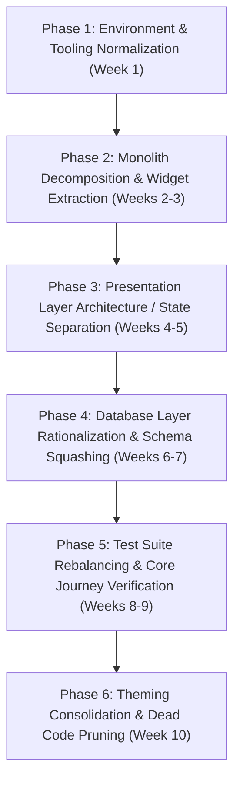

# Tonos (Fitness Tracker) — Comprehensive Codebase Review & Architecture Roadmap

**Date of Review**: October 20, 2026  
**Repository**: `E:\projects\env_test`  
**Internal Identity**: `env_test` / `com.tonos` (Tonos)  
**Primary Tech Stack**: Flutter (Dart 3.x), SQLite (`sqflite` / `sqlite3`), `provider`, `fl_chart`, `mobile_scanner`  
**Scope**: Readability, Simplicity, Maintainability, Structure, Reliability, Safety, and Long-Term Evolution.

---

## Executive Summary & Codebase Health Scorecard

Tonos is an ambitious, local-first fitness tracking and nutrition application. It demonstrates exceptional engineering discipline in domain modeling, error handling (`SafeFailure`), offline database chunking, and theme token mechanics. 

However, the codebase currently suffers from **severe structural debt, acute file bloat, tightly coupled UI/business logic, and a radical misallocation of testing resources**. 

### Health Scorecard

| Dimension | Grade | Core Observation |
| :--- | :---: | :--- |
| **Domain Modeling & Types** | **A** | Strongly typed, clear nullability, rich docstrings, clean entity contracts. |
| **Safety & Privacy** | **A-** | Strictly local-first, parameterized SQL queries, sanitized `SafeFailure` error boundaries. |
| **Reliability & Durability** | **B+** | Lifecycle-aware draft saving (`DurableActiveSession`), robust parameter chunking (`sqliteChunks`). |
| **Simplicity (KISS / YAGNI)** | **D+** | Massive over-engineering in multi-theme engines vs. neglected stub screens and inline calculations. |
| **Maintainability** | **D** | 20+ files between 1,500 and 5,800 lines; 62 sequential database migrations in a single file. |
| **Readability & Ergonomics**| **D** | Thousands of lines of nested `StatefulWidget` trees with 10–25 private inner classes per file. |
| **Test Distribution** | **F** | 58% of tests (172 files) test theme tokens; <1% of tests (2 files) test core screens or user journeys. |

---

## 1. Readability & Code Ergonomics

### 1.1 The "God File" and Inner-Class Crowding Anti-Pattern
The most immediate impediment to readability is the staggering size of single `.dart` files. Standard Flutter best practices recommend files between 150 and 500 lines. In this repository, over 20 files exceed 1,500 lines, with the largest topping 5,800 lines.

```text
lib/db/database_helper.dart                              ─── 5,261 lines (5,811 total with comments)
lib/widgets/exercise_detail_sheet.dart                   ─── 4,183 lines
lib/widgets/health_trends_section.dart                   ─── 3,926 lines
lib/screens/onboarding_flow.dart                         ─── 3,914 lines
lib/db/schema.dart                                       ─── 3,431 lines (3,672 total)
lib/widgets/exercise_progress_section.dart               ─── 3,357 lines
lib/screens/profile/settings/exercise_editor_screen.dart ─── 3,293 lines
lib/widgets/workout_metric_chart_card.dart               ─── 2,962 lines
lib/screens/profile/settings/flow_methods_page.dart       ─── 2,486 lines
lib/screens/exercise/premade_plans_page.dart              ─── 2,226 lines
lib/db/nutrition_dao.dart                                ─── 2,212 lines
lib/db/seed.dart                                         ─── 2,186 lines
lib/widgets/workout_history_calendar.dart                 ─── 2,177 lines
lib/services/preset_generation_service.dart               ─── 2,133 lines
lib/screens/exercise/train_page.dart                      ─── 2,116 lines
lib/screens/exercise/session_detail_screen.dart           ─── 2,089 lines
lib/screens/nutrition/food_logging_page.dart              ─── 1,986 lines
lib/screens/exercise/exercise_catalog_page.dart           ─── 1,902 lines
```

#### The Impact on Cognitive Load:
- **Navigation Exhaustion**: Developers must scroll through thousands of lines to find a widget or method.
- **Private Namespace Prison**: Because classes and helpers are declared as private (`_PlateItem`, `_MacroPreview`, `_ReportBucketSet`, `_ExerciseRecordPoint`) within these giant files, they cannot be reused, tested, or benchmarked outside of the monolithic file without copy-pasting.
- **Diff Noise & Merge Hell**: Any two developers touching a feature in `TrainPage` or `ExerciseDetailSheet` will inevitably generate merge conflicts on the same 2,000–4,000 line file.

### 1.2 Deep Widget Tree Nesting
In files like `FoodLoggingPage` and `ExerciseDetailSheet`, the `build()` methods or private builder methods (`_buildSummarySection`, `_buildCard`, `_buildPlateList`) are nested 12 to 20 levels deep in the widget tree. 
- Context and theme queries (`Theme.of(context)`, `context.read<T>()`) are scattered arbitrarily throughout helper methods rather than being injected at top boundaries.
- Readability degrades rapidly when UI layout, padding, conditional styling, and event handlers are mixed indiscriminately.

### 1.3 Comment Quality vs. Dead Code
- **Strengths**: Domain models in `lib/models/` have exemplary documentation (e.g. `StretchDefinition`, `SessionSpec`).
- **Weaknesses**: Significant blocks of commented-out legacy code remain in active production directories. For example, `lib/providers/active_session.dart` has 236 lines of commented-out code (`/* Legacy implementation retained temporarily... */`).
- **TODO Accumulation**: Mock implementations remain in screens (e.g., `lib/screens/nutrition/default_trend_page.dart` has `// TODO: wire these to real data`, `itemCount: 5, // TODO: use real measurement count`).

---

## 2. Simplicity & Architectural Economy (KISS / YAGNI)

### 2.1 The Theming Over-Engineering Disparity
There is an extreme asymmetry between how the visual presentation layer is engineered versus the core business application:

```
Theme Engine (Massively Over-Engineered)
├── 3 Full Theme Families (Classic M3, Neo-Brutalism, Expressive)
├── Dedicated Development "Theme Lab" (theme_lab_page.dart)
├── Dynamic Token Ratcheting & Style Inventories
├── Custom Headless Preview Runner (run_expressive_preview.ps1)
└── 172 Test Files dedicated solely to token and widget styling

VS.

Core Business Screens (Under-Engineered)
├── Monolithic 2,000-line StatefulWidget screens
├── Ad-hoc in-memory caching Maps inside State classes
├── Empty stub screens (CombinedHistoryPage, FormPosingPage, NutritionLogPage)
└── Only 2 Screen Test Files in the entire repository
```

**Verdict**: The styling and theming layer violates **YAGNI (You Aren't Gonna Need It)**. A fitness tracker needs robust workout persistence, clean meal logging, and high-performance charts before it needs three competing theme engines and a custom design token ratchet pipeline.

### 2.2 Abstraction Leakage & Incomplete Transitions
- The project introduced a DAO layer in `lib/db/` to break up database logic.
- Yet, `lib/db/database_helper.dart` was never trimmed down; it still spans **5,261 lines**, retaining hundreds of pass-through methods and direct query implementations.
- `lib/repositories/app_repository.dart` (1,631 lines) wraps `DatabaseHelper`, but also holds static in-memory caches (`_musclePercentCache`, `_exerciseAllocationCache`) that outlive repository instances.
- Developers are left with three competing layers of data access: DAOs, `DatabaseHelper`, and `AppRepository`.

---

## 3. Maintainability & Technical Debt

### 3.1 Entangled State and Business Logic
Almost every major screen uses raw `StatefulWidget` state instead of an architecture that decouples state from UI:
- **`FoodLoggingPage` (`_FoodLoggingPageState`, 1,986 lines)**:
  - Manages barcode scanning state, text editing controllers, debounce timers.
  - Manages asynchronous caching: `Map<int, Future<List<FoodPortion>>> _portionCache`.
  - Performs macro calculation arithmetic.
  - Contains database calls via `_repo`.
  - Determines meal type heuristics based on current time.
  - Generates UI widgets.
- If a calculation bug occurs in meal macro totaling, the developer must debug a UI `State` class.

### 3.2 62 Sequential SQLite Schema Migrations
In `lib/db/schema.dart`, the application carries every single database migration from version 1 to version 62:
```dart
static Future<void> onUpgrade(Database db, int oldVersion, int newVersion) async {
  if (oldVersion < 2) await migrateV2(db);
  if (oldVersion < 3) await migrateV3(db);
  // ... 60 more if-statements ...
  if (oldVersion < 62) await migrateV62(db);
}
```
- **File Bloat**: 3,672 lines of raw SQL string concatenations and manual `ALTER TABLE` statements.
- **Upgrade Fragility**: A user upgrading from v10 must execute 52 consecutive migration scripts in a single database transaction. If any intermediate migration fails or encounters unexpected data shapes, the user's database is bricked.
- **Maintenance Cost**: Auditing the current state of a table requires reading the initial `CREATE TABLE` and then searching through 62 subsequent migration methods.

### 3.3 Toolchain & SDK Version Locking
In `pubspec.yaml`:
```yaml
environment:
  sdk: ^3.13.0
```
Dart SDK 3.13 does not currently exist in the stable release channel (current stable is Dart 3.7.x). This constraint causes `flutter pub get`, `flutter analyze`, and standard Dart toolchains to immediately fail on standard developer workstations unless run through custom pinned environments.

---

## 4. Structural Architecture & Directory Layout

### 4.1 Current Directory Structure (Layer-First)
The repository uses a traditional layer-based directory structure:
```text
lib/
├── db/             # All DAOs and helpers
├── l10n/           # ARB localization sources
├── models/         # Domain models
├── providers/      # ChangeNotifier providers
├── repositories/   # AppRepository
├── screens/        # UI screens grouped loosely (exercise, nutrition, profile)
├── services/       # Domain business logic
├── theme/          # Design tokens and themes
└── widgets/        # Reusable and non-reusable widgets
```

### 4.2 Structural Flaws
1. **Dumping Ground in `widgets/` and `screens/`**:
   `lib/widgets/` has over 40 widgets mixed together—everything from global UI components like `ongoing_session_fab.dart` to screen-specific components like `exercise_detail_sheet.dart` (4,183 lines) and `workout_metric_chart_card.dart` (2,962 lines).
2. **Missing Feature Cohesion**:
   When working on "Nutrition", a developer must touch:
   - `lib/screens/nutrition/`
   - `lib/widgets/` (nutrition cards)
   - `lib/providers/nutrition_profile.dart`
   - `lib/models/nutrition_models.dart`
   - `lib/db/nutrition_dao.dart`
   - `lib/repositories/food_catalog_repository.dart`
   Nothing is co-located by feature domain.

---

## 5. Reliability, Concurrency & Durability

### 5.1 Strengths in Reliability
1. **Durable Workout Session (`DurableActiveSession`)**:
   `lib/providers/durable_active_session.dart` is exceptionally well designed:
   - Implements `WidgetsBindingObserver` to detect app lifecycle changes (`AppLifecycleState.paused`, `detached`).
   - Automatically debounces draft saves to SQLite.
   - Retries failed database writes with exponential backoff (`_retryDelays`).
   - Protects users from data loss during unexpected OS process termination.
2. **Defensive Parameter Chunking (`sqliteChunks`)**:
   In `lib/db/db_query_utils.dart`, queries split large lists into 800-item chunks to prevent exceeding SQLite's maximum bind parameter limit (999).
3. **Database Backup Policy (`database_backup_policy.dart`)**:
   Backups of SQLite databases are structured and versioned.

### 5.2 Reliability Risks
1. **Static In-Memory Cache Invalidation**:
   In `lib/repositories/app_repository.dart`:
   ```dart
   static final Map<int, Future<List<ExerciseMusclePercent>>> _musclePercentCache = {};
   static final Map<int, Future<Map<BodyPart, double>>> _bodyPartPercentCache = {};
   static final Map<int, Future<ResolvedExerciseAllocation>> _exerciseAllocationCache = {};
   ```
   Static global caches that hold `Future` objects risk retaining failed futures indefinitely if unhandled, and risk serving stale allocations if exercise definitions change.
2. **Heavy Main-Thread Database Transactions**:
   Complex generation routines (`PresetGenerationService`, 2,133 lines) perform multiple sequential database queries on the UI isolate. On lower-end mobile devices, this causes observable UI stuttering/frame drops.
3. **Draft Deserialization Drift**:
   If schema migrations alter the structure of exercise sets or custom exercises, restored active drafts may fail to deserialize or lead to corrupted workout state.

---

## 6. Safety, Privacy & Security

### 6.1 Strengths
1. **Local-First & Privacy Preserving**:
   - Workout data, nutrition logs, and body measurements never leave the device.
   - The diagnostics relay worker (`services/diagnostics_relay/`) is explicitly opt-in and sanitized.
2. **Safe Error Handling Boundary (`SafeFailure`)**:
   - `lib/services/safe_failure.dart` classifies exceptions into categorized safe failures.
   - Raw exception strings, database paths, and SQL queries are strictly prevented from appearing in user-facing UI or production telemetry.
3. **SQL Injection Resistance**:
   - The codebase strictly avoids string-interpolated user inputs in SQL. Where strings are interpolated (e.g. `IN ($placeholders)`), the values are parameterized `?` tokens.

### 6.2 Areas for Improvement
1. **Barcode Scanner Resource Management**:
   Camera controllers in `lib/screens/nutrition/barcode_scanner_page.dart` must ensure deterministic release on Android/iOS lifecycle pauses to avoid locking hardware resources.
2. **File Picker Path Handling**:
   Import/export routines in `DatabaseHelper` should enforce strict file extension and MIME type validation to prevent reading or overwriting non-database storage.

---

## 7. Test Strategy & Coverage Imbalance

### 7.1 The Imbalance Breakdown
The test suite consists of **298 test files** and **88,328 lines of code**, yet provides a false sense of security:

```text
Directory           Test Files   Lines of Code   % of Suite
------------------------------------------------------------
test/theme/            172          51,000+         57.7%
test/services/          24           9,200+          8.1%
test/db/                21           7,800+          7.0%
test/widgets/           14           5,100+          4.7%
test/localization/       7           2,400+          2.3%
test/utils/              6           1,800+          2.0%
test/models/             3           1,100+          1.0%
test/screens/            2             650+          0.7%
test/providers/          2             420+          0.7%
```

### 7.2 Why Are Screen Tests Missing?
Developers did not write screen tests because **monolithic screens cannot be tested easily**:
- To test `TrainPage` or `FoodLoggingPage`, a test must initialize 6 different providers, mock a 1,600-line `AppRepository`, instantiate timers, and handle multiple sub-state classes.
- As a result, the most business-critical features of the app (completing a workout, saving sets, logging daily calories) have virtually no automated widget or integration test coverage.

---

## 8. Deep-Dive Audit of Key Subsystems

### 8.1 Database Architecture (`DatabaseHelper`, `Schema`, `DAOs`)
```
Current Reality:
Caller ──> AppRepository (1,631 lines) 
              ├──> DatabaseHelper (5,261 lines) ──> SQLite
              └──> 30 individual DAOs ───────────> SQLite
```
- **Finding**: `DatabaseHelper` has become an unmaintainable "God Class". It contains schema creation, data seeding, table repair, trigger resets, and legacy method facades.
- **Recommendation**: Strict separation of concerns. `DatabaseHelper` should only manage the `openDatabase` connection and transaction boundaries. All query logic must reside strictly in DAOs.

### 8.2 Workout Generation Engine (`PresetGenerationService`)
- **Size**: 2,133 lines in `lib/services/preset_generation_service.dart`.
- **Finding**: This service is a monolithic procedural script that handles scoring, set allocation, equipment filtering, rest calculation, and database persistence in one giant class.
- **Recommendation**: Break into dedicated domain pipelines:
  1. `ExerciseScorer`: Pure algorithmic ranking based on muscle targets.
  2. `VolumeAllocator`: Distributes sets across selected exercises.
  3. `PresetPlanner`: Orchestrates scoring + volume into a `SessionSpec`.
  4. `PresetPersistenceCoordinator`: Saves the resulting plan to the database.

### 8.3 Onboarding Flow (`OnboardingFlow`)
- **Size**: 3,914 lines in `lib/screens/onboarding_flow.dart`.
- **Finding**: 25+ private widget classes defined in a single file (`_TextInput`, `_ActionField`, `_IntentTile`, `_ChoiceGroup`, `_BodyFatTile`, `_GymSpaceTemplate`, etc.).
- **Recommendation**: Create a `lib/screens/onboarding/` directory with a `widgets/` folder. Each step in the onboarding wizard should be an independent, testable widget.

---

## 9. Strategic Refactoring Roadmap & Phased Implementation Plan



---

### Phase 1: Environment & Tooling Normalization (Immediate)
- **Goal**: Restore out-of-the-box build and analysis capabilities.
- **Actions**:
  1. Correct `pubspec.yaml` SDK constraints from `^3.13.0` to match installed stable SDKs (`^3.7.0`).
  2. Ensure `flutter analyze` and `flutter test` run cleanly in local CI without requiring custom flags.
  3. Purge commented-out code blocks (e.g. `lib/providers/active_session.dart`).

---

### Phase 2: Monolith Decomposition & Component Extraction
- **Goal**: Reduce every file in `lib/` to under 600 lines without changing behavior.
- **Decomposition Targets**:
  - `lib/widgets/exercise_detail_sheet.dart` (4,183 lines) ➔ Extract into `lib/widgets/exercise_detail/`:
    - `exercise_media_preview_card.dart`
    - `exercise_history_session_card.dart`
    - `exercise_history_set_row.dart`
    - `metric_summary_card.dart`
    - `exercise_record_trend_chart.dart`
  - `lib/screens/onboarding_flow.dart` (3,914 lines) ➔ Extract into `lib/screens/onboarding/`:
    - `onboarding_header.dart`
    - `gym_space_tile.dart`
    - `body_fat_tile.dart`
    - `onboarding_plan_overview.dart`
  - `lib/widgets/workout_metric_chart_card.dart` (2,962 lines) ➔ Extract into `lib/widgets/charts/workout_metrics/`:
    - `interactive_workout_line_chart.dart`
    - `report_insight_grid.dart`
    - `metric_chart_page.dart`
  - `lib/screens/nutrition/food_logging_page.dart` (1,986 lines) ➔ Extract into `lib/screens/nutrition/widgets/`:
    - `food_plate_summary_card.dart`
    - `food_search_tab.dart`
    - `barcode_scan_tab.dart`
    - `portion_quantity_editor.dart`

---

### Phase 3: Presentation State Separation (MVVM / Controller Pattern)
- **Goal**: Strip business logic, timers, and caching out of `StatefulWidget` classes.
- **Pattern**:
  Introduce lightweight screen controllers or ChangeNotifier view models:
  ```dart
  // Example Target: FoodLoggingController
  class FoodLoggingController extends ChangeNotifier {
    final AppRepository _repo;
    final NutritionProfile _profile;

    FoodLoggingController({required AppRepository repo, required NutritionProfile profile})
        : _repo = repo, _profile = profile;

    List<PlateItem> _plate = [];
    bool _isSearching = false;
    List<Food> _searchResults = [];

    Future<void> search(String query) async { ... }
    Future<void> logPlate() async { ... }
  }
  ```
- **Benefits**:
  - Screen classes become pure, declarative layout components.
  - Controllers can be unit-tested without mounting the Flutter widget tree.
  - Eliminates ad-hoc `setState()` chains and nested asynchronous operations.

---

### Phase 4: Database Layer Modernization & Schema Squashing
- **Goal**: Eliminate the 62-version migration chain and slim down `DatabaseHelper`.
- **Actions**:
  1. **Squash Baseline Schema**:
     - Define `Schema.createBaselineV62(Database db)` representing the exact unified state of the database at schema 62.
     - Fresh installs immediately execute `createBaselineV62` instead of stepping through 62 incremental scripts.
     - Isolate migrations 1–55 into an archived migration adapter (`legacy_schema_migrations.dart`) for legacy users only.
  2. **Dismantle `DatabaseHelper` God Object**:
     - Keep `DatabaseHelper` strictly responsible for opening connections, applying migrations, and transactions.
     - Move remaining query implementations out of `DatabaseHelper` and into their appropriate DAOs (`SessionDao`, `ExerciseDao`, `NutritionDao`).
     - Remove obsolete pass-through methods.

---

### Phase 5: Rebalance the Test Suite Toward Core Journeys
- **Goal**: Achieve high test confidence on critical user flows.
- **Actions**:
  1. **Create End-to-End User Journey Tests**:
     - `test/screens/workout_flow_test.dart`: Start session ➔ log 3 sets ➔ replace exercise ➔ complete workout ➔ verify history persistence.
     - `test/screens/nutrition_flow_test.dart`: Search food ➔ select portion ➔ add to plate ➔ log meal ➔ verify macro totals.
     - `test/screens/preset_generation_flow_test.dart`: Select muscle groups and gym equipment ➔ generate preset ➔ inspect exercise balance.
  2. **Convert Theme Tests to Snapshot / Golden Verification**:
     - Consolidate redundant token tests in `test/theme/` into targeted golden tests to reduce test suite maintenance.

---

### Phase 6: Design System Consolidation & Dead Code Pruning
- **Goal**: Focus developer energy on a single, polished design system.
- **Actions**:
  1. Standardize on the active "Expressive / M3" theme family as the primary product identity.
  2. Archive or decouple experimental Neo-Brutalism themes into an optional development module.
  3. Delete empty stub files (`combined_history_page.dart`, `form_posing_page.dart`, `nutrition_log_page.dart`) and remove their navigation entries until ready for implementation.
  4. Complete or remove mock screens (`default_trend_page.dart`).

---

## 10. Target Architectural Blueprint

```
lib/
├── core/
│   ├── db/                     # Connection, transactions, migration runner
│   │   ├── database_helper.dart (max 300 lines)
│   │   ├── migrations/         # Individual, cleanly isolated migration scripts
│   │   └── query_utils.dart
│   ├── error/                  # SafeFailure and error boundaries
│   ├── l10n/                   # Internationalization
│   └── theme/                  # Consolidated design system tokens
│
├── features/                   # Feature-sliced domain modules
│   ├── training/
│   │   ├── data/               # SessionDao, WorkoutDao, TrainingPlanModels
│   │   ├── domain/             # PresetGenerationService, AutoIncrementService
│   │   ├── presentation/       # TrainPage, SessionDetailScreen, ExerciseCard
│   │   └── state/              # ActiveSessionProvider, TrainingPlanController
│   │
│   ├── nutrition/
│   │   ├── data/               # NutritionDao, FoodCatalogRepository, FoodModels
│   │   ├── presentation/       # FoodLoggingPage, BarcodeScannerPage, PlateCard
│   │   └── state/              # NutritionProfile, FoodLoggingController
│   │
│   ├── analytics/
│   │   ├── presentation/       # HistoryScreen, HeatmapCard, TrendCharts
│   │   └── domain/             # 1RM calculators, volume trend analyzers
│   │
│   └── onboarding/
│       ├── presentation/       # OnboardingWizard, GymTemplateSelector
│       └── state/              # OnboardingController
│
└── main.dart                   # Clean bootstrap (under 100 lines)
```

---

## Conclusion

Tonos is an exceptionally feature-rich application with high potential. The core domain logic, local-first privacy stance, and error handling architecture are already of high quality. 

The primary barrier to scaling and maintaining this project is **not architectural absence, but architectural accumulation**: files that were never broken apart, screens that took on too many responsibilities, and a development focus that favored visual theme experimentation over structural refactoring and core screen tests. 

By executing the phased roadmap outlined above—decoupling monolithic files, separating presentation from state, squashing database migrations, and rebalancing test coverage—the codebase will transform from an intimidating monolith into a clean, maintainable, and joyfully productive Flutter project.
