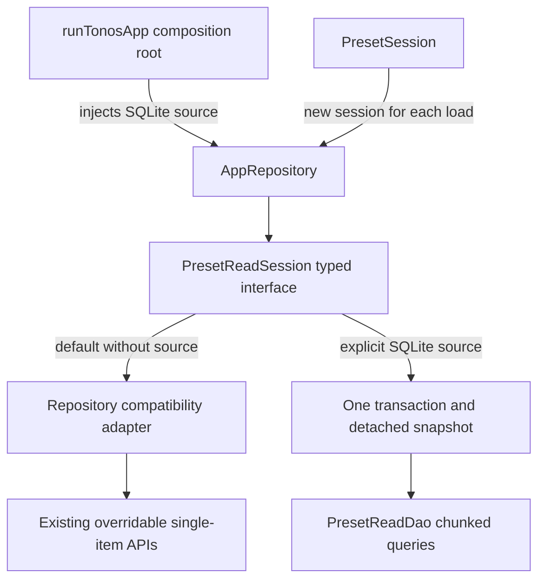

# Pass 4 — combined technical report

This report combines the P4-A inventory, P4-B typed boundary, P4-C extraction,
P4-D SQLite batching and qualification record. Start with the
[overview](README.md); the [baseline inventory](preset-loading-contracts.md)
retains the original per-field contracts and fake map at `efe3f22`.

## 1. Scope and architectural decisions

The implementation targets one complete preset-loading workflow rather than
changing all raw-map APIs at once. The old ten repository read contracts remain
available. Eight map-shaped results now have a typed presentation-loading
boundary; the existing `PresetDefinition?` and nullable stretch name remain typed.

No new packages, schema version, migration, persisted enum/key, exported JSON
shape, theme token, approved layout or animation specification was introduced.
There is no Train/Train2 presentation consolidation in this pass.

P4-A found 207 literal map-type occurrences in the data/repository directories,
not 206 independent public contracts. Its syntax scan found 169 named type
references; these counts are baseline observations, not completion targets.

## 2. Typed reads and explicit backend selection

`AppRepository.openPresetReadSession(presetId)` selects the injected source or
the compatibility adapter. The default constructor does not detect backend
types or treat the presence of a helper as evidence that SQLite should be used.
Production `runTonosApp` explicitly injects `SqlitePresetReadSource`; it and the
repository use the existing singleton helper. Tests may explicitly inject a
source with `DatabaseHelper.forTesting` to exercise the production path.

The default adapter dispatches each read through the public methods on the same
repository instance. Existing subclass overrides, failure gates, completers and
partial projections therefore keep working. No existing fake implementation was
rewritten to hide a missing backend seam.

### Read models

| Existing shape | Typed read projection |
| --- | --- |
| Preset exercise row | `PresetExerciseRow` |
| Definition name/equipment projection | `ExerciseDefinitionInfo` |
| Preset parent/child set row | `PresetSetRow` |
| Optional cardio details | `PresetCardioRow?` |
| Stretch item row | `PresetStretchRow`, producing an unchecked `StretchInstance` |
| Optional global editor settings | `PresetAutoSettingsRow?` |
| Optional exercise override | `PresetExerciseAutoRow?` |
| Optional parent/child set override | `PresetSetAutoRow?` |

The projections own unmodifiable copies of their source rows. Field casts are
deliberately lazy for the row-backed types: existing loading skips unknown
exercise types and orphan child sets before consuming some of their fields.
Eagerly validating all row columns would reject cases that were previously
ignored. Consumers now access typed named properties; string keys and casts are
confined to the read-model adapter. These are immutable read views, not a claim
that every stored value has been eagerly schema-validated.

`PresetDefinition.fromRow` centralizes the existing helper decoding, including
timestamp parsing and the draft default. It is shared by the helper and snapshot
loader. No new date/unit normalization is added.

`PresetAutoSettingsRow` retains the editor's existing policy. In particular,
`adjust_all_sets` uses nonzero in this path; progression's retained raw API still
uses equals-one. This existing difference is documented rather than silently
normalized. Optional/zero increments, one-based rotation fallback, nullable
equipment, invalid manual-selection JSON and unknown success-scope fallback
retain their established meanings.

## 3. SQL/transaction extraction

| Unchanged DatabaseHelper public method | New executable owner |
| --- | --- |
| `fetchWorkoutReportSessionsRaw` | `SessionDao` |
| `fetchExerciseOneRmTrendRows` | `ExerciseHistoryDao` |
| `fetchMostUsedExerciseDefinitionsRaw` | `DefinitionDao` |
| `fetchPresetSummariesRaw` | `PresetDefinitionDao` |
| `fetchPresetFocusSetCountsRaw` | `PresetDefinitionDao` |
| `updateSession` | `WorkoutTransactionDao` |
| `updateSet` | `WorkoutTransactionDao` |
| `deleteSet` | `WorkoutTransactionDao` |

The helper delegates while preserving its early empty-input/zero-limit guards.
Read DAOs take the caller's `DatabaseExecutor`; the three edit methods retain
their existing `Database.transaction` ownership, mutation ordering and
`WorkoutRecordEventsDao.rebuildForDefinitions` calls within that transaction.
No standalone set/session mutation was substituted for an atomic edit.

An analyzer token comparison checked all 313 public helper signatures and the
eight moved execution bodies. It ignores comments and formatting-only trailing
commas and removes only the original local `final db = await database` from
the moved body. SQL string tokens remain part of the comparison. All matched.
Two existing preset read DAO parameters were widened from `Database` to
`DatabaseExecutor` so the snapshot can reuse them within a caller transaction.

Some existing code in modified files was reflowed by the pinned formatter;
these reflows do not change executable behavior.

## 4. Snapshot query ownership and consistency

`SqlitePresetReadSource.open` creates a fresh lazy session. Its first read opens
one transaction on the injected helper connection and calls `PresetReadDao.load`
with that transaction executor. Every graph query uses that executor.
Subsequent reads on that session use its detached `PresetReadSnapshot`.

The DAO reads preset metadata, ordered exercises and optional global settings,
then chunked definition identities, weight sets, cardio details, stretch items,
exercise overrides, set overrides and needed first-item stretch names. It loads
only the requested preset's graph; it does not fetch whole tables or create a
cartesian join of exercises, sets and overrides.

All ID lists are deduplicated and use the existing 800-bind chunk helper. Owner
grouping keeps persisted IDs separate from provider list positions. Per-owner
sets/items retain `ORDER BY order_index`; no secondary tie-breaker was added.
The old tie order for equal indexes was unspecified and remains unspecified.

The production path now reads one coherent database snapshot rather than
potentially mixing independent read versions during concurrent edits. The
compatibility adapter retains individual reads for fake/legacy callers. This is
an intentional consistency improvement, not a claim of identical intermediate
read timing for those two backends.

The snapshot is scoped to a single load, not a global cache. A retry/discard
reload opens a new read session. Existing provider load-version and disposal
guards control publication; in-flight SQLite reads are not actively cancelled
on disposal. They are read-only and cannot overwrite persisted state.

### Measured reads

| Fixture | Reads |
| --- | ---: |
| Empty or missing preset | 3 |
| 1 weight exercise / 1 set, one definition | 7 |
| 40 weight exercises / 40 sets, one shared definition | 7 |
| 801 weight exercises / 801 sets, one shared definition | 10 |

The counter wraps a real in-memory SQLite executor, counting query/rawQuery
statements rather than mocked results. It also asserts no read binds more than
800 arguments. Transaction-control statements are excluded. Additional distinct
definition IDs, types or sets can introduce additional chunks. Work and memory
still scale with returned rows; no constant-time runtime or device speed claim
is made.

## 5. Changed implementation and test files

| Area | Files |
| --- | --- |
| Read models | `lib/models/preset_read_models.dart` (new), `preset_models.dart`, `models.dart` |
| Typed repository seam | `lib/repositories/preset_read_source.dart` (new), `parts/preset_read_repository_part.dart` (new), `app_repository.dart` |
| SQLite implementation | `lib/db/preset_read_dao.dart` (new), `lib/repositories/sqlite_preset_read_source.dart` (new) |
| Consumer/composition | `lib/providers/preset_session.dart`, `lib/main.dart` (backend wiring only) |
| Existing DAO/facade files | `lib/db/database_helper.dart`, `session_dao.dart`, `exercise_history_dao.dart`, `definition_dao.dart`, `preset_definition_dao.dart`, `preset_exercise_dao.dart`, `workout_transaction_dao.dart` |
| New regressions | `test/providers/preset_read_compatibility_test.dart`, `test/db/pass4_query_ownership_test.dart`, `test/db/preset_read_dao_test.dart` |
| Existing source contract | `test/repository_injection_contract_test.dart` |

The source contract now allows the explicit named backend argument while still
requiring exactly one production repository, its provider injection, and no
private repository/database construction in UI/state/services. It additionally
asserts the composition root's explicit SQLite source.

## 6. New regression cases and qualification

Sixteen new cases were added:

- **5 compatibility cases:** partial rows and child-before-parent/orphan
  handling; malformed consumed values fail safely; rows/lists detach from fake
  mutation; editor flag defaults and zero/null overrides; catalog stretch lookup
  dispatch and unchecked state.
- **5 extraction cases:** report/history aliases, bounds and parent-only 1RM;
  preset draft/profile filters and child-set counts; rollback on record-rebuild
  failure for each of session update, set update and set deletion.
- **6 SQLite cases:** bounded/chunked query counts; empty/missing presets;
  mixed-plan parity against the compatibility path; detached snapshot versus new
  reads after an edit; retry after a missing-definition failure; participation
  in a caller transaction without independent commit.

| Gate | Evidence/result |
| --- | --- |
| P4-B focused regression group | 37 passed. |
| P4-C existing DAO group | 21 passed. |
| P4-C new extraction cases | 5 passed. |
| P4-D + compatibility/lifecycle/extraction group | 22 passed. |
| Full Flutter suite | **2,531 passed**, zero failures; test-run clock 15m 13s. |
| Contract cases | 172 covered successfully by the full suite; isolated first run was 171 passed/1 stale constructor assertion, then all 4 injection cases passed on recheck. |
| Final affected-test recheck | 10 passed after the test-only brace cleanup. |
| Full analysis | **Zero errors, zero warnings, 75 existing deprecation infos**; the new test brace-style finding was corrected and the complete analysis rerun. |
| Theme inventory/ratchet | 4,382 candidates / 366 Dart files; counts by status unchanged; all 18 protected files unchanged and enforcement passed. |
| Content environment | Development and locked production passed. |
| Relay | 8 Node checks passed. |
| Compile-time variants | 3 passed: locked development content, explicit Neo release opt-in and malformed Neo opt-in. |
| Source comparison | 313 public helper signatures and eight moved execution bodies preserved. |
| Documentation and whitespace | Links, inventory consistency and `git diff --check` passed. |
| Physical Pixel 7 | Focused in-place debug smoke test passed; [device report](pixel7-validation.md) records coverage and data comparison. |

Full, contract, focused and variant results overlap and are not additive.
No executable production code changed after the full run started. The later
brace-only change in a test helper was followed by its 10-case affected recheck.

During development, one new test initially used the wrong existing parameter
name, a missing-definition fixture initially hit its enabled FK constraint, and
the first lexical extraction check was sensitive to formatting. The test fixture
was corrected within its disposable in-memory database; the extraction check
uses tokens. No production workaround, schema change, or test weakening was used.

Logs and comparison scripts are ignored scratch artifacts under
`.build/maintainability/p4*`. Full suite, final analysis, inventory, ratchet,
content and variant logs are separate. The 313-signature/eight-body comparison
uses `p4c-helper-outline.json` and `p4c_verify_moves.dart`.

## 7. Deferred work and qualification boundaries

- This is the completed agreed P4-A–D slice, not a claim that every raw-map
  contract or remaining SQL statement has been migrated.
- Existing progression/export/flow APIs retain their raw compatibility shapes.
  Further typed migrations should inventory those callers independently.
- Existing differences for noncanonical stored flag values remain documented.
  A stricter decoder or shared normalization policy deserves a separate change.
- There is no database migration or DTO-driven data rewrite. The later device
  check changed only routine metadata/derived cache records and diagnostics
  events; its before/after comparison is documented in the device report.
- The later physical Pixel 7 debug validation exercised the new backend. No iOS
  qualification, release build or device performance benchmark was run. The
  earlier report's FAB collision remains a separate issue.
- No dependency/deprecation sweep, Train tab removal, ViewModel migration or
  approved-screen redesign is included. The 75 deprecation infos remain a
  separate tooling task.
- At qualification, no staging, commit, push, reset, clean or destructive
  operation had run. Existing
  Pass 3 follow-up documentation and unrelated untracked paths were preserved.
