# Tonos Expressive: Combined Unapproved Review Dossier

> **Dashboard root and Customize Dashboard approval — 2026-10-19:** The user explicitly approves **Bottom navigation → Dashboard** and the **Customize Dashboard** editor as **A — Visually Approved / Frozen** for the current Expressive presentation. Dashboard root scope covers the assembled composition with the shared Expressive widgets and plan, workout, catalog, anatomy, nutrition, trends, and analytics modules. Customize Dashboard is an editor state of the same route, not an additional page archetype; its visual scope includes the visible/hidden widget grouping, visibility and restore controls, reorder affordances, completion action, and light/dark presentation. The master page-archetype totals move from **A43 / B6** to **A44 / B5**; the separate 24-route dossier remains **24 approved / 0 pending**. Six historical Dashboard/editor captures, eight coverage records, and two generated contact sheets are excluded from the active unapproved review outputs. Original PNG/XML files and manifest entries remain archived. The captures date from 2026-10-13 and predate the latest shared-widget/editor refinements, so they are not current-source proof. The user's review and explicit authorization establish visual approval; no new captures or checks were produced in this update. Responsive, accessibility, automated-test, technical, and release qualification remain separate; the historical full C/D crosswalk remains unresolved.

> **Placeholder review disposition — 2026-10-19:** The user marks **Unmapped Expressive Placeholder Screens** (Pantry Log and Plan Meal) **done for this review pass**, as neither has content to adapt yet. Their two screenshots, two coverage rows and generated contact sheet are excluded from the active gallery; original captures and manifest records remain archived. Both routes retain F placeholder status for future implementation/review. At that update, master page totals remained **A43 / B6**; after the later Dashboard approval the current totals are **A44 / B5**. The dossier remains **24 approved / 0 pending**. This is not approval of completed functionality or release qualification.

> **Selected Bodypart and Selected Muscle detail approval — 2026-10-19:** The user explicitly approves **Catalog → Target Anatomy → Bodyparts → selected bodypart** and **Catalog → Target Anatomy → Muscles → selected muscle** as **A — Visually Approved / Frozen**. Scope includes the current hero heatmap and set summaries, associated-muscle / related-bodypart links, exercise search where available, compact exercise rows, readable single-line equipment/anatomy summaries and tooltips, and Catalog-style exercise thumbnails opening the shared detail sheet. At that approval the master page tables recounted to **A43 / B6**; current totals are **A44 / B5** after the Dashboard approval above. All **24 dossier archetypes are approved, with 0 pending**. Four anatomy screenshot groups (14 captures), 12 coverage rows, and four generated contact sheets are excluded from the active unapproved gallery; all original PNG/XML files and manifest entries remain archived. The latest implementation-pass device evidence is light-mode Biceps with a thumbnail-to-sheet check. Fresh final dark-mode/Muscle-page captures, recommended-range editor, fallback, large-text, and exhaustive interaction coverage are not claimed. No source changes, device work, screenshots, or Flutter checks accompany this approval. All other classifications and caller scopes are preserved; visual approval remains separate from responsive, accessibility, automated-test, technical, and release qualification. Historical C/D discrepancies remain unresolved. Older dated counts below are historical snapshots superseded by this update.

> **Train2 approval — 2026-10-19:** The user explicitly approves **Bottom navigation → Train2 → Train** as **A — Visually Approved / Frozen**. The reviewed scope is the compact Train/History selector, outer shaped active-presets card, slim inset Exercise Presets header with its right-aligned manage pencil, active plan cards, centered Add button at 60% width, and the shared Start Workout / Optimize bar. The optional tab is enabled through Profile → UI & Appearance → Edit Bottom Tabs. Train2 moves from its former G legacy-route restriction into A; the recounted master page tables contain **A41 / B8**. The separate 24-route dossier remains **22 approved / 2 pending**. The latest refreshed device view is light mode; separate final dark-mode, History-content, and Add-popup confirmation is not claimed. The campaign contains no Train2 screenshot/coverage group, so its existing 48 active screenshots, 10 groups, and 50 coverage rows are unchanged. Visual approval remains separate from responsive, accessibility, automated-test, technical, and release qualification; historical C/D discrepancies remain unresolved.

> **Nutrition root approval — 2026-10-18:** The user explicitly approves the optional **Nutrition tab → Nutrition root** as **A — Visually Approved / Frozen**. Scope is the current root composition: Daily Nutrition summary and action bar, Health Trends, Data & records calendar, compact Current Metrics value card, and overall hierarchy and spacing. The latest refreshed device view was light mode; no separate dark-mode confirmation is claimed. Nutrition Goals, Manual Nutrition Goals, Today’s Records, Pantry Log, and Plan Meal retain their independent statuses. The master page-archetype totals move from **A39 / B8** to **A40 / B8**; the 24-route Profile dossier remains **22 approved / 2 pending**. Visual approval is separate from responsive, accessibility, technical, test, and release qualification. Historical full C/D accounting remains unresolved.

> **Train Plans Archived Plan Actions interaction approval — 2026-10-18:** The user approves **Train → Plans → archived plan card → Show menu → Delete confirmation** as **A — visually approved / frozen interaction state** in the reviewed light and dark presentations. This covers the menu and cancel-only confirmation appearance, not the results of Activate, Delete, or Rename. Four older screenshot/hierarchy pairs and four source coverage rows remain preserved but are excluded from the active unapproved gallery; they are capture-time evidence from 2026-10-13, not proof of the latest source. This is not a page archetype; at that time the master page totals were **A39 / B8** and the separate 24-route dossier was **22 approved / 2 pending**. The later Nutrition root approval above raises the current master total to **A40 / B8**. Functional, responsive, accessibility, technical, and release qualification remain separate.

> **Daily Nutrition summary widget approval — 2026-10-18:** The user explicitly approves the **Nutrition → Daily Nutrition summary widget** as an **A — visually approved / frozen component state**, including the Calories and Protein/Carbs/Fat tiles, ring/bar/summary presentations, and adjacent Pantry Log / Add Meal / Plan Meal action bar. At that point, this component approval did not approve the Nutrition root or Dashboard; the Nutrition root was approved separately in the newer addendum above, while Dashboard remains independently classified. The component approval did not change the master page-archetype totals (**A39 / B8**) or the 24-route dossier (**22 approved / 2 pending**) at that time. The supplied images show dark-mode Bar and Summary views; no fresh light-mode capture or broader theme/state coverage is claimed. Visual approval remains separate from behavior, responsive, accessibility, automated-test, technical, and release qualification.

> **Plan-Specific Flow Methods Editor approval — 2026-10-18:** The user confirms the **Profile → Training → Gym & Workout Settings → Workout Progress Rules → expand Plans → plan ⋮ → Add Rule or Edit** editor as **A — Visually Approved / Frozen**. Scope covers its current Expressive rule editor, including Last set / First set / Specific set Copy from choices, the one-based Set number field and guidance, anchored menus, and Cancel/Save actions. The six archived campaign captures and eight coverage records remain in the source folders and manifest but are excluded from active unapproved outputs; those screenshots predate the Copy from refinement and are not current-source proof. Editing an existing saved rule remains uncaptured because the retained preview data has no saved plan rule. This does not block the user's visual approval. Master page-archetype totals move from **A38 / B9** to **A39 / B8**; the 24-route dossier moves from **21 approved / 3 pending** to **22 approved / 2 pending**, with Selected Bodypart detail and Selected Muscle detail remaining pending. Historical C/D reconciliation remains unresolved. Responsive, accessibility, keyboard, automated-test, technical, and release qualification remain separate.

> **Premade Plans approval — 2026-10-17:** The user explicitly approves **Train → Plans → Browse Premade Plans — A — Visually Approved / Frozen** for the current Expressive page, including its duration and profile-equipment controls, plan groups/cards, exercise previews, concise plan descriptions, and Add actions. This moves the master page-archetype total from **A37 / B10** to **A38 / B9**; Premade Plans is outside this dossier's 24-route subset, which remains **21 approved / 3 pending**. Existing gallery captures predate the latest concise-description update and are retained as historical evidence. Empty/no-match and load-failure states remain evidence gaps; theme-specific, responsive, accessibility, test, technical, and release qualification are not inferred. Dashboard, onboarding, Preset Detail, and other callers keep their separate statuses. The active unapproved gallery now excludes this page while preserving its source images and manifest entries. Historical full C/D accounting remains unresolved.

> **Optimized Workout Settings approval — 2026-10-16:** The user explicitly approves **Train → Overview → Optimize → settings gear → Optimized Workout Settings** as **A — Visually Approved / Frozen**, including the workout budget and Reps & weights controls, Bodypart focus states, corrected Avoided prohibition indicator, and Start Now / Save actions. At this approval the explicit master page-archetype totals moved from **A35 / B12** to **A36 / B11**; the current totals are now **A37 / B10** after the later Plan Management approval. This page is outside the 24-route dossier, which remains **21 approved / 3 pending**. Its four campaign screenshot records and manifest entries remain archived and are excluded from the active unapproved gallery. Those captures predate the final Avoided-indicator fix; the latest refreshed device confirmation is light mode, with no fresh latest-source dark screenshot or exhaustive keyboard, validation, viewport, or technical qualification claimed. The historical full 55-archetype C/D crosswalk remains unresolved.

> **Health Trend Detail approval refresh — 2026-10-16:** **Progress → Health Trends → metric card → Measurement Trend Detail** is **A — Visually Approved / Frozen** for the latest polished page and reviewed entry actions (section 1.3). This refreshes an existing A baseline without double-counting it: at that refresh current explicit page totals were **A36 / B11**; the latest current total is **A37 / B10** following Plan Management approval. This dossier remains **21 approved / 3 pending**. Latest device confirmation is light mode; no fresh final-polish dark-mode or exhaustive dialog-state confirmation is claimed. Visual approval remains separate from technical and release qualification.

> **Current user approvals — 2026-10-16:** **Analytics Dashboard / Weekly Sets Overview**, **Train → Plans → Generate Custom Plans / Preset Generation QA**, **Train → Plans → Manage Plans**, **Train → Gym Profile / Equipment**, and **Train → Overview → Optimize / Optimized Workout Settings** are **A — Visually Approved / Frozen**. Weekly Sets Overview includes Bodyparts and Muscles, its heatmap/summary hero, reviewed interactions, and light/dark presentation. Generate Plans includes its setup page and four expandable sections with inset outlined headers. Plan Management includes the current Expressive page's active/archived plan groupings, plan rows, and inline plan actions. Gym Profile includes the reviewed light/dark profile and equipment presentation, inline Equipment / Reset / Select All actions, and conditional floating Save Profile button. Optimized Workout Settings includes the user's current approval of its setup controls, focus-selection states, and primary/save actions; the final indicator was last confirmed on device in light mode only. The explicit master page-archetype totals are now **A37 / B10**; the separate 24-route dossier remains **21 approved / 3 pending** because these Train routes are outside it. The full 55-archetype C/D crosswalk remains unresolved. Archived Generate Plans, Gym Profile, Optimized Workout Settings, and Plan Management captures predate their latest visual refinements and are not claimed as current-source evidence. Approval is based on the user's visual review and authorization, not technical qualification. Earlier dated addenda retain their historical counts and are superseded for these routes' current status.

> **Nutrition route refinement — 2026-10-14:** Diet & Nutrition Settings, Manual Nutrition Goals, and Today's Records are now individually tracked as **B — implemented, awaiting personal visual approval** in the master route ledger. Their light/dark visual review remains pending; this does not approve the broader optional Nutrition family. These three routes are outside this 24-route Profile dossier, which remains **19 approved / 5 pending**. The explicit master route-table A/B page-row count is now **A30 / B16**, excluding the navigation shell, Ongoing Workout Exit child state, and Catalog Exercise Details sheet. The full 55-archetype aggregate remains unresolved because of the historical C/D crosswalk discrepancy. Visual review remains separate from technical and release qualification.

> **Approval addendum snapshot — 2026-10-13 (superseded for current totals):** The user approved **Catalog → Target Anatomy library** (`MuscleFilterPage`, formerly Exercise Focus Library) as **A — visually approved / frozen** in both light and dark Expressive modes. Approval covers Bodyparts and Muscles tabs; the updated header, segmented tabs and search controls; compact list cards and anatomy thumbnails; muscle icon fallback; search and no-results states. Selected Bodypart and Muscle detail pages retain their existing B status and are not approved by this task. The 24-route dossier is now **19 approved / 5 pending**. The verified master route-table A/B page count at that approval was **A30 / B13**, excluding the navigation shell, Ongoing Workout Exit child state, and Catalog Exercise Details sheet; the 2026-10-14 Nutrition addendum above adds three independently tracked B routes. Historical C/D inconsistencies still prevent a verified full 55-archetype aggregate. Visual approval does not establish technical or release qualification; no new screenshots or tests were produced for the approval update.

> **Approval correction snapshot — 2026-10-13 (superseded for current totals):** The user has approved the Workout Progress Flow Editor (`AutoPresetFlowScreen`), Workout Progress Rules / Flow Methods (`FlowMethodsPage`), and the **Profile → Training → Gym & Workout Settings → Ongoing Workout Exit chooser** in light and dark Expressive modes. The chooser's current single-popup, three-option choice layout is frozen; it is a child UI state, not a separate page archetype. The user has also approved **Volume Boundaries**, the **Workout Settings main page**, **Body Part Rankings**, **Muscle Rankings**, **Body Part / Muscle Mapping (Anatomy Mapping)**, **Exercise Set Allocation**, **Exercise Editor**, **Database Settings**, the **Profile → Progress Settings landing page**, **Measurement Library / Measured Items (Profile caller)**, **Catalog Root**, and **Target Anatomy library**. Progress Settings and its Measurement Library navigation row are approved in both light and dark modes; Measurement Library is separately approved for its Profile caller only. Database Settings is visually approved in light mode; dark-mode confirmation remains an evidence limitation. Its accepted presentation includes the purple asymmetric hero; Backup & Restore, Health, Maintenance, Cloud Content, and Definition Exports; blue action cards, lavender icons, section headings, compact path and manifest URL displays, backup confirmations, manifest editor, and maintenance controls. The accepted minor text truncation is nonblocking. For Exercise Editor, the latest screenshot evidence confirms light mode; dark-mode visual confirmation remains an evidence gap, not a completed check. The approved Body Part Rankings baseline includes the extended floating Save Rankings button. Workout Settings is the user-facing title of the Analytics Settings destination and is one archetype, not two. Body Part Rankings, Muscle Rankings, Anatomy Mapping, Exercise Set Allocation, and Exercise Editor are separate child archetypes from Workout Settings. The last published 55-archetype aggregate **A25 / B14 / C10 / D1 / E0 / F5 / G0** is historical; the current route-table A/B page count is **A30 / B13**, while the C/D crosswalk still prevents a verified full aggregate. The separate 24-route dossier is now **19 approved / 5 pending**. Visual approval remains separate from technical, responsive, accessibility, test-suite, and release qualification. Older status summaries and queue snapshots below predate these updates.

**Review status:** This 24-route dossier has **24 visually approved/frozen archetypes and 0 pending personal visual approval**. Current explicit master page-archetype totals are **A44 / B5**, excluding the navigation shell, Ongoing Workout Exit child state, Browser Filters, Customize Dashboard, and image-viewer interaction states, but including the Catalog Browser-caller Exercise Details sheet, Nutrition root, Dashboard root, and Train2 once each. The five remaining B pages are Preset / Plan Detail, Onboarding, Diet & Nutrition Settings, Manual Nutrition Goals, and Today’s Records; their routes and review states are listed in the campaign [navigation index](../tonos-expressive-visual-evidence/unapproved-review-campaign-20261013/navigation-index.md). The historical full 55-archetype A/B/C/D/E/F/G aggregate remains unresolved. Browser and its Filters are approved within the Catalog route context; the detail-sheet and image-viewer approvals apply only to the Catalog Browser caller. Selected Bodypart and Muscle detail pages have their own explicit approval dated 2026-10-19. Other shared callers retain their existing statuses. Visual approval remains separate from responsive, accessibility, keyboard/focus, Reduced Motion, automated-test, technical, and release qualification.

## Snapshot and review boundary

- Branch: `feature/classic-m3e`.
- HEAD, upstream, and `origin/feature/classic-m3e`: `4d258b0cbac1f5b01caec99e38e8bd700eb7d28a`.
- Candidate history since the qualified Active Workout baseline: `2523a3b`, `a823077`, `a8707ad`, `b8379b4`, `93ef7a6`, `57b7aaa`, `4d258b0` (Progress, Logbook, Profile, then Catalog changes; commits may touch supporting packages too).
- Qualified and excluded from review: Train + shell (`a4974f1`, `9d50dae`) and Active Workout (`65f361f`). They may be used only as reference-system comparisons.
- The route audit found no fifth currently reachable, unapproved Expressive destination family.
- Nutrition remains an optional/default-off feature and is excluded from the 24-route Profile redesign inventory. Diet & Nutrition Settings, Manual Nutrition Goals, and Today's Records are separately tracked as B candidates in the master route ledger; this does not approve the wider Nutrition family. Gym profile and equipment editing belongs to adjacent Train/gym setup. Direct Database Settings and Diagnostics are maintenance routes; Analytics Settings is an adjacent analytics configuration route.
- Freeze evidence: `.dart_tool/tonos-expressive-review-audit/start-freeze.json` records 295 tracked `lib/**/*.dart` hashes and three additional protected files. The 295 tracked library hashes matched at this audit's read-only verification. The snapshot records 207 initial status entries, including existing uncommitted work and untracked review material. Preserve all of it.
- This README is the consolidated approval dossier; supplemental Pixel captures are stored under its `captures/` folder. The 2026-10-07 status-only update also reconciles the route-component ledger. No production source, screenshot, or existing evidence file was edited.

### Counting rule

An **archetype** here means one distinct user-facing full route or purpose-built detail/sheet layout. A section embedded in a route, a dialog opened by that route, and visual state variations do not create extra page counts. Thus a light and dark rendering count once; selected period/metric, query/no-results, expanded/collapsed, populated/empty, reduced-motion, and similar states remain states of their page. A component can host more than one archetype when it has a genuinely different full-page layout. This avoids inflating counts with themes and interaction variants.

| Family | Pages / archetypes | What the count includes |
|---|---:|---|
| Progress | 3 | Measurements & Trends root; exercise 1RM detail; measurement trend detail. |
| Logbook | 3 | Calendar root; Full History; Session Detail. |
| Profile | 12 | Profile root; User Information; UI Appearance; Navigation Editor; Guided Tutorials; Gym & Workout Settings; Workout Progress Flows; AutoPresetFlowScreen; Flow Methods selection; Flow Methods editor; Progress Settings; Measured Items Library. |
| Catalog | 6 | Catalog root; Exercise Catalog browser; Exercise Focus Library; Bodypart detail; Muscle detail; exercise Details sheet. |
| **Total** | **24** | Distinct route/detail archetypes. Modal layouts and states are catalogued within their parent archetype, not added to the total. |

### Evidence reading notes

The primary stills come from the isolated Expressive preview, not a release build. Pixel 7 images show a development `DEBUG` ribbon; it is a build marker, not part of the theme. Review stills establish visible states, not complete interaction, accessibility, or motion behavior. Evidence links are relative to this README. See each family section for which stills are current, which are incomplete, and which older images have been superseded.

## 1. PROGRESS

### Route and shared visual character

`TabItem.measurementsTrends → MeasurementsTrendsPage` in `lib/screens/measurement_trends_page.dart`. The root composes `WorkoutMetricChartCard`, `ExerciseProgressSection`, and `HealthTrendsSection`. Exercise cards open the private `_ExerciseProgressDetailPage` in `lib/widgets/exercise_progress_section.dart`; Health Trends entries open `MeasurementTrendDetailPage` from `lib/widgets/health_trends_section.dart`. Metric creation and measurement entry use dialogs from the Health Trends section.

The visual family is analytical and data-first: plum / lavender focal groupings and confident typographic hierarchy frame familiar charts and statistics. Existing chart series colors and semantic meanings remain. Teal appears in the established secondary/supporting roles; green remains semantically owned by the existing data system. Dark mode changes tonal surfaces and foreground contrast deliberately, while chart data colors preserve their mapping.

#### 1.1 Measurements & Trends root — Workout Report, Exercise Progress, Health Trends

- **A. Identity/access:** Root page; bottom navigation → Progress (`MeasurementsTrendsPage`). Workout Report is the first report module; scrolling reaches Exercise Progress and Health Trends.
- **B. Status:** `VISUALLY APPROVED AND FROZEN` — full Progress root page only. Exercise Progress / exercise 1RM detail and Measurement Trend detail have separate approvals in sections 1.2 and 1.3.
- **C. Purpose:** Review completed-workout summaries and trends, manage exercise-progress tiles, and inspect body-measurement trends from one Progress destination.
- **D. Current light look:** A light canvas supports a strong report focal surface, report title, metric/range controls, chart, and supporting details. Below it, Exercise Progress presents its title and accessible edit action with a prominent selected-exercise chart/summary treatment. Actual and estimated 1RM labels stay explicit, with an em dash for an unavailable actual value. Health Trends follows as a row/grid of measurement cards. The current fixture has no body-measurement entries, so these cards show honest empty states. The six-workout fixture reports **6 workouts, 2h24m, 7.1k lbs**.
- **E. Current dark look:** The dark canvas and deeper plum focal planes distinguish the report and exercise modules; lighter lavender foregrounds and tonal selection mark controls. Supporting surfaces have increased luminance over the canvas. Teal and existing chart-series hues retain their data role. Empty Health Trends cards remain readable as empty rather than fabricating a trace.
- **F. Major states:** Workout metric selector; All / 1M range selector and other currently supported ranges; selected metric and range; Additional Details collapsed/expanded; Exercise Progress normal/edit mode; selected exercise; actual-1RM-missing / estimated-1RM-present summary; Health Trends empty cards; `+ Metric` creation dialog; log-measurement entry dialog; Reduced Motion. The selected range/metric/expanded-detail variants are states of this root, not extra pages.
- **G. Interaction/motion:** Existing controls keep InkWell/tap responses and callbacks. Metric/range selection changes report content through duration-gated transitions; chart geometry and plotted values are not animated. Edit, selection, add/remove, and chart interactions remain. `appMotionDuration` uses the theme's reduced duration when system reduced motion is active; the immediate Time capture shows the selected state and chart update without waiting. No motion clip or performance profile was captured.
- **H. Classic departures:** Expressive changes the module grouping, focal hierarchy, filled tonal surfaces, asymmetric composition, and selector presentation. The report value/chart remain analytical and familiar; Exercise Progress becomes one stronger integrated module rather than isolated generic cards. This is a composition and hierarchy change, not a new data model.
- **I. Preserved:** Workout records, totals, chart painters/scales/coordinates/data colors, selector semantics, query/range logic, exercise tile state, edit/add/remove flows, measurement data and empty-value handling remain the existing behavior. No measurement values are inferred for the empty fixture.
- **J. Review notes:** Does the report feel bold enough while remaining easy to trust? Is the Exercise Progress summary rail coherent at narrow widths? Are actual and estimated 1RM clearly distinct? Does the empty Health Trends state feel intentional? Populated Health Trends, `+ Metric` and measurement-entry interactions are not represented in the current capture set. The current summary pair supersedes the earlier Exercise Progress home treatment.
- **K. Evidence:** Current paired root captures include both root modules and the empty Health Trends cards. The same images show Report and Exercise Progress, so these modules are not counted as separate pages.

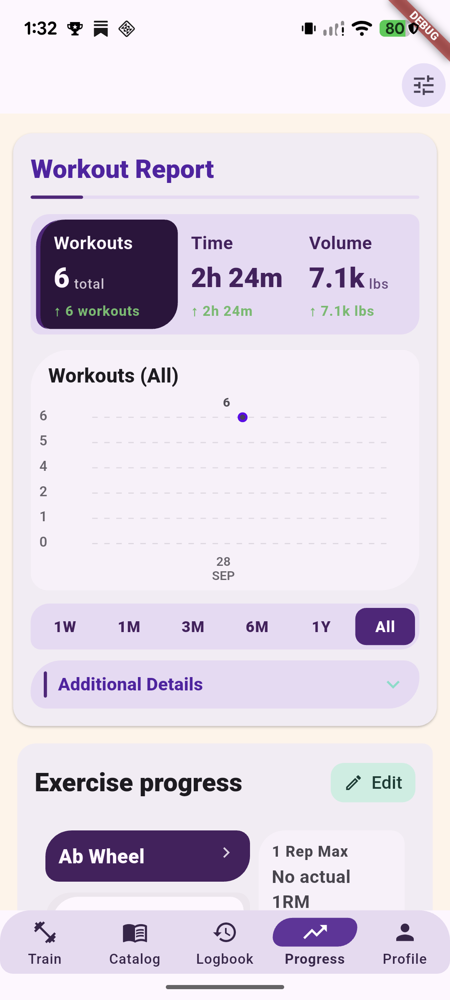

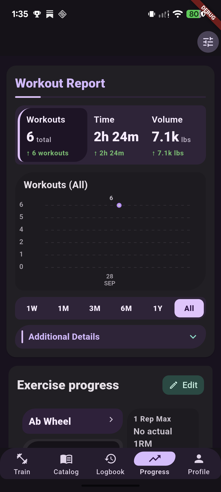

**Other current root evidence:** Exercise Progress + empty Health Trends: [light](../tonos-expressive-progress-proving-ground/amplified-review/20261003/exercise-health-light.png) · [dark](../tonos-expressive-progress-proving-ground/amplified-review/20261003/exercise-health-dark.png). Latest Actual / Estimated 1RM summary: [light](../tonos-expressive-progress-proving-ground/amplified-review/20261003/exercise-progress-summary-light.png) · [dark](../tonos-expressive-progress-proving-ground/amplified-review/20261003/exercise-progress-summary-dark.png).

**Report states:** Workouts is shown in the paired default captures; [1M range, light](../tonos-expressive-progress-proving-ground/amplified-review/20261003/support-workout-report-1m-light.png); [Time metric, light](../tonos-expressive-progress-proving-ground/amplified-review/20261003/support-report-time-metric-light.png); [Additional Details expanded, light](../tonos-expressive-progress-proving-ground/amplified-review/20261003/support-report-details-expanded-light.png). Volume-selected is not separately captured. Dark selected-metric / selected-point and expanded-details captures are **MISSING CURRENT EVIDENCE**.

#### 1.2 Exercise Progress — Ab Wheel 1RM detail

- **A. Identity/access:** Full-page child route, `_ExerciseProgressDetailPage`; Progress → Exercise Progress card (Ab Wheel) → chart/detail affordance.
- **B. Status:** `VISUALLY APPROVED AND FROZEN` — Exercise Progress / exercise 1RM detail route, including populated and empty states in light and dark mode. This approval is separate from the Progress root and excludes Measurement Trend detail.
- **C. Purpose:** Show the exercise's estimated-strength history and the underlying dated recordings that support it.
- **D. Current light look:** A page title identifies Ab Wheel. An asymmetric plum-toned chart focal surface contains the 1RM chart, axes, and legend. Beneath it, recordings appear as a cohesive list of date-led rows. Each row separately labels actual and estimated values and keeps the unavailable actual value explicit. The four current recordings show estimated **27 lbs** and no actual 1RM.
- **E. Current dark look:** Dark plum and inset plot surfaces separate chart, legend, and page canvas; text and the estimated series remain distinguishable. The same date/value rows are visible as tonal grouped records. Data-series hues remain mapped to the same measures.
- **F. Major states:** Default chart plus recording list; historical selected point with anchored date/value callout; no actual-1RM value; session navigation from a recording. There is no direct Progress-origin recording-detail page in current evidence; the row opens shared Session Detail.
- **G. Interaction/motion:** Chart point selection and recording navigation are retained. The callout describes the selected plotted point, and the existing chart geometry does not animate. Recording rows preserve the existing route callback. Reduced Motion keeps static Expressive styling and snaps selection interactions to the theme reduced duration.
- **H. Classic departures:** The chart becomes a designed focal block with a distinct heading/inset graph surface/legend; recordings become a flatter tonal group instead of nested generic outlined cards. Expressive styling increases hierarchy without changing the chart's coordinate system or values.
- **I. Preserved:** Existing points, dates, actual/estimated measures, axes, range logic, series colors, chart semantics, and session-navigation behavior remain. No actual value is synthesized from estimates.
- **J. Review notes:** Is the chart callout clear and anchored? Do the recordings remain scannable? A selected historical point is captured only in light; dark selected-point and expanded point-callout states are **MISSING CURRENT EVIDENCE**. No standalone Recording detail page is present in the route audit.
- **K. Evidence:** [Current default, light](../tonos-expressive-progress-proving-ground/amplified-review/20261003/exercise-detail-light.png) · [dark](../tonos-expressive-progress-proving-ground/amplified-review/20261003/exercise-detail-dark.png); [selected historical point, light](../tonos-expressive-progress-proving-ground/amplified-review/20261003/exercise-detail-selected-point-light.png). Dark selected-point evidence is missing.

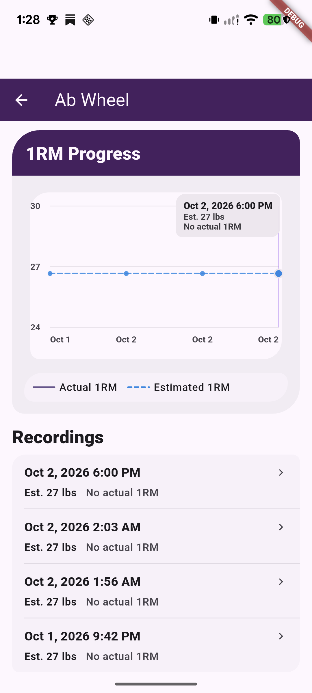

#### 1.3 Measurement Trend detail

- **A. Identity/access:** Full-page route `MeasurementTrendDetailPage`, opened from a Health Trends card.
- **B. Status:** **A — Visually Approved / Frozen** — Progress-origin Measurement Trend detail, refreshed by explicit user approval on 2026-10-16 for the current polished page and reviewed route-owned entry actions. Its existing populated/empty, light/dark, and Log Measurement dialog approvals are retained. Other callers' forms and parent pages keep their independent statuses.
- **C. Purpose:** Inspect an individual measurement definition's history and associated entries.
- **D. Current light look:** The compact plum Latest / Change / Records hero has a health icon and balanced padding. Matching page/app-bar surfaces frame the cool-blue chart with softened gridlines, date labels and no left-axis labels. Warm history rows have calendar-icon tiles and consistent corners; a plum Log entry action and reduced excess bottom padding complete the page. Existing Log Measurement dialog styling is retained.
- **E. Current dark look:** The same geometry and hierarchy use the existing dark Expressive destination tokens for the summary, chart, history rows and Log entry action. Existing dark approval is retained; the latest polish was not independently confirmed in a fresh dark-mode device screenshot.
- **F. Major states:** Approval includes the main summary/chart/history/action presentation, existing populated/empty states, Log Measurement styling, and reviewed Progress detail entry actions. The entry menu and its existing route-owned Edit / Delete presentation are interaction states of this page, not additional page archetypes. Other callers and unreviewed states remain separate.
- **G. Interaction/motion:** Tapping a trend card opens the route; logging an entry uses the shared styled measurement-entry dialog, stores the entry, then refreshes the root. No special route-specific motion is established by evidence. Reduced Motion interaction evidence for this page is absent.
- **H. Classic departures:** Freeze the current Progress-origin summary, analytical chart, history rows, primary action and reviewed entry-action presentation. Future functional, accessibility or responsive corrections should preserve this approved baseline. Other caller-specific forms remain independently scoped.
- **I. Preserved:** Measurement definitions, values, timestamps, units, notes/context, repository writes, and refresh callback remain.
- **J. Review notes:** The user explicitly approved the latest page refinements on 2026-10-16, completing this page's current visual review. This records visual approval only; responsive, accessibility, automated-test, persistence, technical and release qualification remain separate.
- **K. Evidence:** Original approval recorded on 2026-10-06; frozen baseline refreshed on 2026-10-16. The preceding implementation pass confirmed the current light-mode Weight page. Its six historical campaign menu/edit/delete PNG/XML pairs predate the final polish and remain archived, excluded from active unapproved outputs. No new screenshot, fresh final-polish dark-mode check or independent confirmation of every dialog state is claimed by the Health Trend documentation update. The existing A page is not counted twice: at that refresh, master totals were **A36 / B11**; after Plan Management approval, current totals are **A37 / B10**. This 24-route dossier remains **21 approved / 3 pending**.

#### Progress motion and reduced-motion evidence

The Report uses native interaction feedback and duration-gated state changes; no custom spring, ambient chart animation, or per-frame plotted-geometry rebuild is part of this candidate. Reduced Motion stills: [light](../tonos-expressive-progress-proving-ground/amplified-review/20261003/support-reduced-motion-light.png) · [dark](../tonos-expressive-progress-proving-ground/amplified-review/20261003/support-reduced-motion-dark.png) · [immediate Time response, light](../tonos-expressive-progress-proving-ground/amplified-review/20261003/support-reduced-motion-time-immediate.png). These are stills, not motion clips or performance evidence.

### Progress comparison: Classic to Expressive

Classic keeps the established more conventional report/card composition and selector hierarchy. Expressive gives the report and Exercise Progress modules a stronger plum focal hierarchy, filled tonal grouping, and a unified summary treatment. The date/series/metric semantics and measured values remain fixed. Existing teal and semantic colors remain data/support colors rather than being reassigned as decoration.

## 2. LOGBOOK

### Route and shared visual character

`TabItem.history → HistoryScreen → HistoryContent → WorkoutHistoryCalendar` in `lib/widgets/workout_history_calendar.dart`. A selected date/period surfaces session rows; a row opens `SessionDetailScreen` in `lib/screens/exercise/session_detail_screen.dart`. The full-history action opens Full History. Counting treats calendar, Full History, and Session Detail as the three distinct screen archetypes; Month/3M/Year/4Y and date selection are calendar states.

Logbook is chronological and scannable. The Expressive treatment emphasizes dates and selected sessions, uses plum for the date-led focal grouping and teal in a responsive metric rail, and keeps the heatmap and focused-set information as a compact supporting inset. Semantic green stays assigned to its existing record/positive role. In dark mode the date surfaces and session rows become deeper tonal layers; selected cues and dividers remain visible without relying only on hue.

#### 2.1 Logbook calendar root — Month, selected/empty dates, 3M, Year, 4Y, stress, Reduced Motion

- **A. Identity/access:** Root destination; bottom navigation → Logbook (`HistoryScreen` / `WorkoutHistoryCalendar`).
- **B. Status:** `VISUALLY APPROVED BY THE USER AND FROZEN` for this current Expressive Logbook root/calendar screen only: M / 3M / Y / 4Y period views, current compact 4Y selector, workout-count badges, date/range summary, anatomy + aggregate metrics placement, populated and empty period states, latest spacing refinements (including the reduced date-heading-to-summary gap and aligned fullscreen action), and current light/dark visual treatment. Full History / All Sessions is separately approved in section 2.2; Session Detail / Past Workout is separately approved in section 2.3.
- **C. Purpose:** Browse workout history chronologically across month, three-month, year, and four-year periods, then open sessions from a selected interval.
- **D. Current light look:** A date-led selected-period summary and calendar/range controls organize history. Selected period sessions appear first as rows; heatmap and workout-count, duration, and volume values form a smaller secondary grouping. Current fixture totals are six 2026 sessions, **2h24m** and **7.1k lbs**. Oct 2 has three sessions (**46m36s**, **2.5k lbs**); Oct 1–7 in 3M shows four sessions (**1h8m**, **3.7k lbs**). 2023 is an empty year. The retained stress fixture shows 15 sessions in 2026.
- **E. Current dark look:** Deep canvas and compact tonal calendar/session layers create hierarchy without flattening selected dates into plain text. Teal is used for supportive data accents; date and selection treatments use the Expressive plum family. Four-year dark evidence is paired with the current four-year light evidence. Current Month screenshots keep circular day cells; current 3M/Year screenshots show rounded-rectangle period selector tiles.
- **F. Major states:** Month selected, populated selected day (Oct 2), empty current day (Oct 3), 3M selected Oct 1–7, Year 2026, empty Year 2023, 4Y selected, long-history stress (15 sessions), selected-period session list, Reduced Motion selection. Week/month/year/date math and their values remain the same data states.
- **G. Interaction/motion:** Existing period selector and date selection update calendar, summary, and list. Reduced Motion selection was checked on device: selection state and rows appear immediately in the 40ms still. Only static stills exist; no animation clip or frame-time profile supports a repeated-motion claim.
- **H. Classic departures:** Expressive gives the date-led selected session list higher priority, date selection clearer tonal emphasis, and heatmap/metrics a smaller inset. Classic has a more traditional calendar/selected-range treatment with greater heatmap/summary prominence. In current Expressive, Month day cells remain circular; `57b7aaa` changed the separate 3M/Year/4Y period selector tiles from circles to rounded rectangles.
- **I. Preserved:** Month/3M/Year/4Y range behavior, date boundaries, selection semantics, workout counts, duration/volume aggregations, heatmap data, session ordering, and route actions are retained.
- **J. Review notes:** The user has visually approved the current root/calendar scope listed in Status. Month cells remain circular. Older 3M/Year/4Y captures with circular period selector tiles are stale for that selector treatment; the latest range captures use rounded rectangular period tiles. The new dark Month/3M/Year images add current fixture/theme evidence. These evidence caveats do not expand or reduce the approval scope.
- **K. Evidence:** Month current selected-day [light Pixel capture](captures/pixel-7-logbook-light/01-logbook-light-month.png) · [dark Pixel capture](captures/pixel-7-logbook-dark/01-logbook-dark-month.png); current dark empty selected day [Pixel capture](captures/pixel-7-logbook-dark/05-logbook-dark-empty-day.png). Older [Oct 2 light](../tonos-expressive-progress-logbook-review/captures/logbook-expressive-oct2-light.png), [Oct 2 dark](../tonos-expressive-progress-logbook-review/captures/logbook-expressive-oct2-dark.png), and [restored empty light](../tonos-expressive-progress-logbook-review/captures/final-restored-logbook-state.png) remain valid Month-circle evidence, but prefer the new Pixel stills for current fixture pairing. 3M: [current light](../tonos-expressive-progress-logbook-review/captures/temporal-polish-20261003/logbook-3m-light.png) · [current dark](captures/pixel-7-logbook-dark/02-logbook-dark-3m.png). Year: [current light](../tonos-expressive-progress-logbook-review/captures/temporal-polish-20261003/logbook-year-light.png) · [current dark](captures/pixel-7-logbook-dark/03-logbook-dark-year.png). 4Y: [current light](../tonos-expressive-progress-logbook-review/captures/temporal-polish-20261003/logbook-4y-light.png) · [current dark](../tonos-expressive-progress-logbook-review/captures/temporal-polish-20261003/logbook-4y-dark.png); stress-15 [light](../tonos-expressive-progress-logbook-review/captures/temporal-polish-20261003/logbook-4y-light-stress-15.png); empty 2023 [light](../tonos-expressive-progress-logbook-review/captures/logbook-expressive-2023-empty-light.png). The linked `temporal-polish-20261003` 3M/Year/4Y captures show current rounded-rectangle period tiles; pre-polish `logbook-expressive-4y-light.png` / `logbook-expressive-2023-empty-light.png` are stale for that geometry. Reduced Motion, immediate selection [light](../tonos-expressive-progress-logbook-review/captures/reduced-motion-oct2-immediate.png); dark Reduced Motion: **MISSING CURRENT EVIDENCE**.

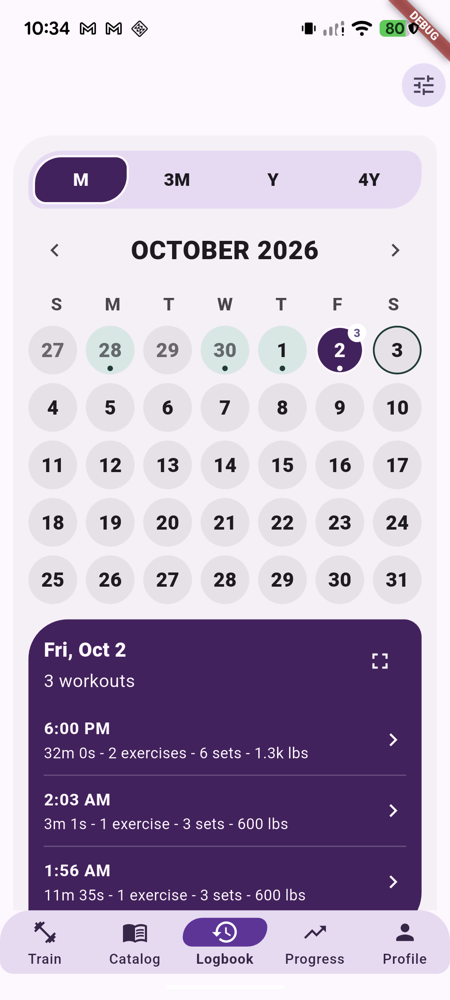

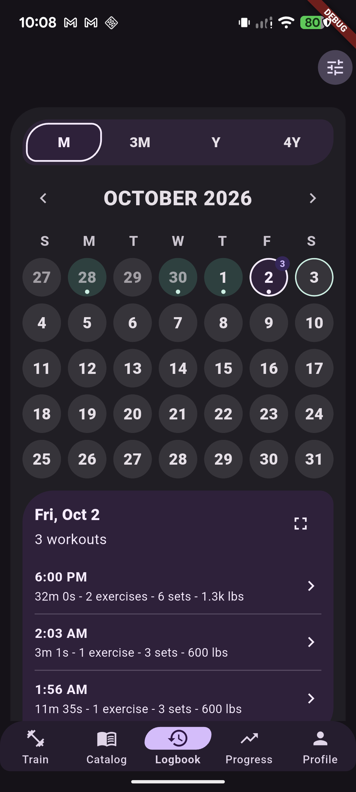

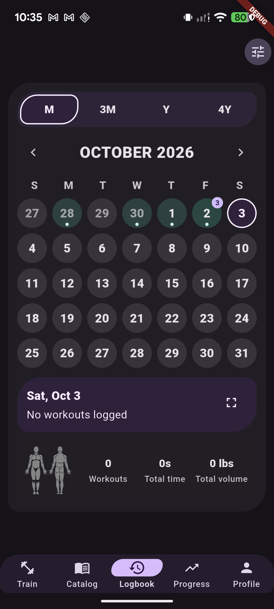

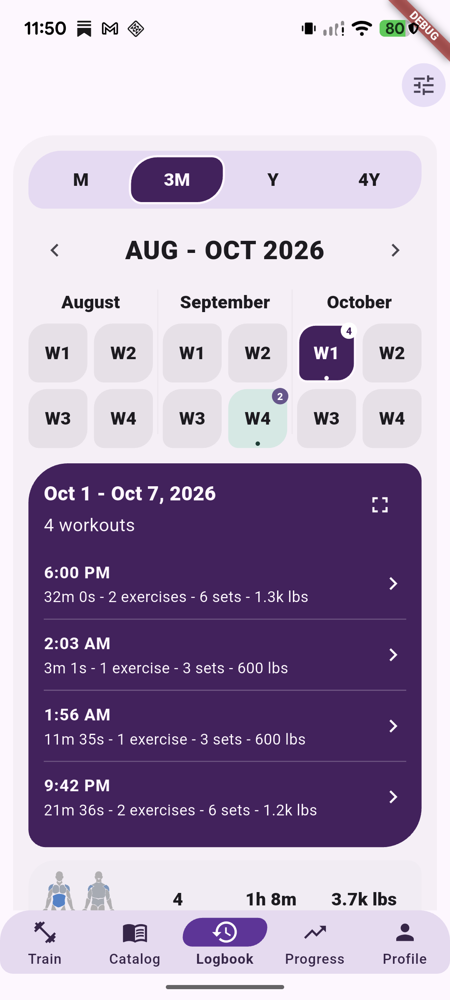

#### 2.2 Full History — All Sessions

- **A. Identity/access:** Full-page child route opened by the calendar's Full History / All Sessions action.
- **B. Status:** `VISUALLY APPROVED BY THE USER AND FROZEN` for the current Logbook Full History / All Sessions screen only: compact plum date group headers, shared warm session surfaces, denser session rows, time-first hierarchy, duration/exercise/set/volume metadata, subdued chevrons, and current light/dark treatment. Session Detail / Past Workout is separately approved in section 2.3. User approval recorded 2026-10-07; this is visual approval, not technical qualification.
- **C. Purpose:** Browse the workout archive as a date-led list independent of a single selected calendar range.
- **D. Current light look:** Localized dates organize rows of session identity and supporting workout metadata. Date wrapping is allowed; rows favor chronology and scannability over tile density.
- **E. Current dark look:** Deep surfaces distinguish date groups and row content with lighter date/text contrast. The dark capture pairs with the light route.
- **F. Major states:** Populated session list and empty/error states supported by source behavior; captures show a populated fixture. Tapping a row opens Session Detail.
- **G. Interaction/motion:** Standard route and tap responses; existing refresh/reload and detail navigation persist. No special spring/reveal animation is claimed. Separate Reduced Motion Full History capture is absent.
- **H. Classic departures:** Expressive emphasizes localized date headings and wrapping chronology; Classic uses the existing, more compact archive grouping and conventional card treatment.
- **I. Preserved:** Session ordering, date localization, workout identity and summary data, refresh behavior, and Session Detail navigation.
- **J. Review notes:** Only the captured populated list is evidenced; dense/long history and empty archive require direct review. No Reduced Motion or native screen-reader audit is represented.
- **K. Evidence:** [Light](../tonos-expressive-progress-logbook-review/captures/full-history-expressive-light.png) · [dark](../tonos-expressive-progress-logbook-review/captures/full-history-expressive-dark.png). Classic comparison: [light](../tonos-expressive-progress-logbook-review/captures/full-history-classic-light.png) · [dark](../tonos-expressive-progress-logbook-review/captures/full-history-classic-dark.png).

#### 2.3 Session Detail — Past Workout

- **A. Identity/access:** Full-page route `SessionDetailScreen`; open a past session from calendar or Full History.
- **B. Status:** `VISUALLY APPROVED BY THE USER AND FROZEN` for the current Logbook Session Detail / Past Workout route. The approval covers read-only presentation; the unified plum Past Workout summary; date, completed-sets badge, and compact metric tiles; Anatomy and Focused Sets; fractional allocation bars and zero-count behavior; historical exercise cards and thumbnails; the responsive horizontal Do workout again / Save as plan action row; historical workout editing presentation; Delete Session confirmation; Save as Plan dialog; and light and dark modes. The user accepts the current editing-state styling and dialog appearance. Approval recorded 2026-10-07. This is visual approval only and does not imply responsive/accessibility qualification, analyzer or style-inventory status, full-suite status, or release qualification.
- **C. Purpose:** Inspect a completed workout and its summary, anatomical focus, set distribution, and ordered exercise records.
- **D. Current light look:** A unified plum Past Workout summary groups the date, completed-sets badge, and compact metric tiles. Anatomy and Focused Sets form a supporting panel with fractional allocation bars and intentional zero-count display. Historical exercise cards retain their thumbnails and editing presentation. Do workout again and Save as plan share the responsive horizontal action row.
- **E. Current dark look:** The same approved hierarchy and content remain in dark mode, with the plum summary, Anatomy and Focused Sets panel, historical exercise cards, action row, and dialogs retaining their current Expressive treatment.
- **F. Major states:** Read-only past-workout summary and historical exercises; Anatomy and Focused Sets including fractional allocation and zero counts; historical workout editing; responsive Do workout again / Save as plan actions; Delete Session confirmation; Save as Plan dialog; light and dark appearances.
- **G. Interaction/motion:** Session rows and existing edit/delete/save/repeat callbacks remain. Standard route and dialog transitions; no special Expressive spring or repeated-motion proof is claimed. Reduced Motion screenshot is for calendar selection, not Session Detail.
- **H. Classic departures:** Expressive rearranges session hierarchy around the past-workout summary and compact anatomy/focus inset, with grouped tonal exercise surfaces. Classic retains its established summary and heatmap/metrics prominence. Expressive styling does not remove lower content or actions.
- **I. Preserved:** Session records, duration/volume/sets, optional heatmap, focused-set calculations, exercise and set ordering, record badges, estimated 1RM, edit/delete, dirty-save/back confirmation, repeat, Save as Plan, cardio and stretch rendering.
- **J. Review notes:** The user explicitly approved the current Session Detail implementation across the states listed above in both modes and accepts its editing and dialog styling. This closes its visual-review item; technical, responsive, accessibility, and release qualification remain separate.
- **K. Evidence:** Existing [light](../tonos-expressive-progress-logbook-review/captures/session-detail-expressive-light.png) and [dark](../tonos-expressive-progress-logbook-review/captures/session-detail-expressive-dark.png) captures are retained as supporting evidence; earlier captures show only the summary fold and do not represent the full approval scope. Classic comparison: [light](../tonos-expressive-progress-logbook-review/captures/session-detail-classic-light.png) · [dark](../tonos-expressive-progress-logbook-review/captures/session-detail-classic-dark.png). No screenshots were added for this documentation-only approval update.

### Logbook evidence caveats

Month day cells intentionally remain circular. The old Oct 2 light/dark and restored empty light Month images show the current Month geometry and remain valid; prefer new Pixel Month images for current fixture pairing. `57b7aaa` changes a different control: 3M/Year/4Y period tiles go from circles to rounded rectangles. Older 3M/Year/4Y range screenshots with circles are stale for that specific period-tile geometry; current 3M/Year captures are linked above. The 2023 empty 4Y image still illustrates no history but its period selector is stale. The new dark captures at `captures/pixel-7-logbook-dark/01..03` show current dark Month, 3M, and Year states; `05-logbook-dark-empty-day.png` shows the current dark empty-day state. `00-original-preview-state.png` is not Logbook: it is a Catalog muscle-detail screen. `04-catalog-root-restore-reference.png` is also Catalog, a dark scrolled root reference, not a Logbook capture.

## 3. PROFILE

### Route and scope

`TabItem.profile → ProfilePage` in `lib/screens/profile/settings/profile_page.dart`. The Expressive root has seven active user-facing destinations: User Information, UI & Appearance, Tutorials, Gym & Workout Settings, Progress Settings, Database Settings, Diagnostics. Nutrition is an eighth disabled / Later entry. This candidate includes the seven active destinations only where they are ordinary personal setup/preferences; Workout Progress Flows and its `AutoPresetFlowScreen` child editor are direct routes in the Gym & Workout Settings flow. Database Settings and Diagnostics are admin/maintenance; Analytics Settings is a separate analytics configuration route; Gym Profile / equipment editing is reached from Train/gym setup. These are explicitly outside the Profile redesign. No avatar picker, online-account editor, or profile-selector route is part of this family.

Profile's job is personal and configurable. Root and child pages use grouped filled surfaces and a clearer split between focal choices and supporting rows. Light uses lavender/lilac grouping on a light canvas; dark relies on raised tonal planes and higher-contrast type. The person glyph and actual Profile title/subtitle remain the identity signal; neither implies a network identity.

#### 3.1 Profile root

- **A. Identity/access:** Bottom navigation → Profile (`ProfilePage` / `_buildExpressiveProfile`).
- **B. Status:** `A — VISUALLY APPROVED BY THE USER AND FROZEN` for Profile → Profile root only, in both light and dark Expressive modes. The approved scope includes the hero (title, description, icon, decoration); the Account section's three navigation rows; Training and Data sections and their navigation rows; the disabled Nutrition section and Later indicator; section-specific plum, mint/teal, blue, and neutral treatments; typography, spacing, dividers, icons, shapes, and radii; bottom-navigation integration; and the overall scrollable composition. The optional observations about the sliders button, Nutrition wording, and Account visual weight are non-blocking and do not reopen review. Child Profile routes retain their independent approval statuses. This is visual approval only, not technical or release qualification.
- **C. Purpose:** Present personal information and route users to existing preference and setup destinations.
- **D. Current light look:** A real title/subtitle and person icon lead a grouped scroll of settings destinations. The root uses strong rounded/filled grouping and clearer focal/supporting roles; actual labels, disabled Nutrition state, and entry callbacks remain. A lower scrolled region continues the same hierarchy.
- **E. Current dark look:** Deep grouped surfaces and lilac accents support the same layout and destinations. The clean dark evidence is scrolled; the dark top-root image is obscured by the Preview Controls overlay and is **not** a clean root reference.
- **F. Major states:** Top root; lower/scrolled root; Nutrition disabled/Later; Reduced Motion. There is no invented profile selection or avatar-edit state.
- **G. Interaction/motion:** Ordinary taps navigate; no Profile-specific springs or elaborate route animations are claimed. Reduced Motion was captured only on the light root; interactions in child routes remain to be directly reviewed.
- **H. Classic departures:** Expressive groups the root into large rounded tonal panels with stronger heading and icon hierarchy. Classic root is more conventional and less regionally grouped. The actual content and route labels are preserved.
- **I. Preserved:** Existing profile fields, local preferences, callbacks, route ownership, disabled Nutrition behavior, and data persistence. Profile identity is not presented as online/social.
- **J. Review notes:** The user explicitly approved the current Profile root in both modes for the scope listed above. The sliders button, disabled Nutrition wording, and Account visual weight observations are non-blocking; no refinement is requested. Existing evidence limitations and technical qualification gaps do not reopen visual review.
- **K. Evidence:** [Light clean root](../tonos-expressive-progress-logbook-review/captures/profile/profile-expressive-light-root.png); [dark scrolled root](../tonos-expressive-progress-logbook-review/captures/profile/profile-expressive-dark-root-scrolled.png); [light scrolled](../tonos-expressive-progress-logbook-review/captures/profile/profile-expressive-light-root-scrolled.png); [light lower clean section](../tonos-expressive-progress-logbook-review/captures/profile/profile-expressive-light-root-lower.png); [Reduced Motion light](../tonos-expressive-progress-logbook-review/captures/profile/profile-expressive-light-reduced-motion-root.png). These existing stills are supporting evidence, not qualification; a clean dark top-root capture is not present in this dossier. No screenshots were added for this status-only update. Classic root [light](../tonos-expressive-progress-logbook-review/captures/profile/profile-classic-light-root.png) · [dark](../tonos-expressive-progress-logbook-review/captures/profile/profile-classic-dark-root.png).

#### 3.2 User Information

- **A. Identity/access:** Full-page child `UserInformationSettingsPage`; Profile → User Information.
- **B. Status:** `A — VISUALLY APPROVED BY THE USER AND FROZEN` for Profile → User Information in both light and dark Tonos Expressive modes. This route-specific approval includes the hero, icon, title, description; Identity, Body Metrics, and Activity Context sections and fields; section-label pills and descriptions; current field backgrounds, contrast, shapes, icons, and spacing; the current-weight floating label and unit; Save Changes and the overall form composition; and the shared Tonos Expressive selection dialogs for Gender, Body-fat % estimate, Weight trend, and Estimated avg steps, including selected and unselected option styling. Visual approval is separate from technical qualification.
- **C. Purpose:** Edit existing locally stored personal information used by the app.
- **D. Current light look:** A conventional editable form is regrouped with Expressive headings, filled input surfaces, clear labels, and an obvious save/apply hierarchy. Personal values visible in the preview are local fixture data.
- **E. Current dark look:** Dark tonal fields and contrast-aware type distinguish label, field value, and surrounding groups; the form structure remains the same.
- **F. Major states:** Existing values, text/field editing, save state. The current evidence does not claim every validation/error/keyboard state.
- **G. Interaction/motion:** Native fields and route behavior; no special page animation. Keyboard, focus order, screen reader, and Reduced Motion interactions are not qualified by screenshots.
- **H. Classic departures:** Filled/grouped input surfaces and stronger section hierarchy replace the earlier sparse/default-form treatment; field semantics and actions remain.
- **I. Preserved:** Existing fields, validation, local write path, and save/cancel workflow.
- **J. Review notes:** The user explicitly approved the current form and all four listed selection dialogs in both modes. Long-list density and dark-mode selected-row contrast observations are non-blocking and do not reopen this screen. The shared selection component is approved only in the User Information context; other callers retain independent review status. Personal fixture data is local and not an online account. Responsive/accessibility and technical qualification remain separate.
- **K. Evidence:** [Light](../tonos-expressive-progress-logbook-review/captures/profile/profile-expressive-light-personal-info.png) · [dark](../tonos-expressive-progress-logbook-review/captures/profile/profile-expressive-dark-personal-info.png). Classic child comparison: **MISSING CURRENT EVIDENCE**.

#### 3.3 UI Appearance and preferences

- **A. Identity/access:** Full-page `UIAppearanceSettingsPage`; Profile → UI & Appearance.
- **B. Status:** `A — VISUALLY APPROVED BY THE USER AND FROZEN` for Profile → UI & Appearance in both light and dark Tonos Expressive modes. Scope includes the hero and Display section with its supporting description; Theme Family row and Classic/Neo-Brutalism preview dialog; Dark Mode and Replay Onboarding settings and refined Expressive switch states; peach toggle-group surface; mint Weight Units / Language group; compact rounded Weight Units option rows and selected state; Language dialog with the shared Expressive selection treatment; Navigation section and updated spacing; blue Edit Bottom Tabs card; and the page's typography, colors, icons, corner radii, spacing, and scroll composition. The isolated Expressive preview remains separate from production theme-family choices.
- **C. Purpose:** Configure appearance, units/language, and bottom navigation preferences.
- **D. Current light look:** Grouped preference sections make appearance choices, unit/language settings, and navigation editing distinct. Controls use filled rounded surfaces and selected tonal treatments. The Weight Units choice is a modal state of this flow.
- **E. Current dark look:** Deep field/group surfaces and lilac selected state provide clear affordance; the Weight Units dialog has matched dark evidence.
- **F. Major states:** Appearance preference view; Theme Family dialog with Classic and Neo-Brutalism preview cards; Dark Mode and Replay Onboarding switches; Weight Units and Language dialogs; and the Navigation section / Edit Bottom Tabs card. The isolated Expressive preview is not a production Theme Family option.
- **G. Interaction/motion:** Existing preference controls and modal selection responses; route to navigation editor. No special spring motion. Reduced Motion child capture absent.
- **H. Classic departures:** Grouped surfaces and filled selector treatments replace plain preference rows; labels and actual options stay the same.
- **I. Preserved:** Existing units, locale, appearance settings, preference storage, and navigation settings route.
- **J. Review notes:** The user explicitly approved this current page in both modes, including switch ON/OFF appearances, Theme Family preview cards, Weight Units and Language dialogs, and the Navigation section/card treatment. No additional visual refinement is requested. This UI & Appearance approval does not include the separate Navigation Editor screen, which is independently approved and frozen in section 3.4, or other Profile child routes. The shared selection treatment is accepted only in this page's dialogs and the separately approved User Information context; other callers remain independent. Production theme-family choices remain Classic and Neo-Brutalism; the isolated Expressive preview is independent of the saved preference. Visual approval is not technical/release qualification; keyboard/focus and other qualification statuses remain separate.
- **K. Evidence:** [Appearance light](../tonos-expressive-progress-logbook-review/captures/profile/profile-expressive-light-appearance-preferences.png) · [dark](../tonos-expressive-progress-logbook-review/captures/profile/profile-expressive-dark-appearance-preferences.png); Weight Units dialog [light](../tonos-expressive-progress-logbook-review/captures/profile/profile-expressive-light-weight-units-dialog.png) · [dark](../tonos-expressive-progress-logbook-review/captures/profile/profile-expressive-dark-weight-units-dialog.png). Classic child comparison: **MISSING CURRENT EVIDENCE**.

#### 3.4 Bottom-tab Navigation Editor

- **A. Identity/access:** Full-page `NavBarSettingsPage`; Profile → UI & Appearance → navigation editor.
- **B. Status:** `A — VISUALLY APPROVED BY THE USER AND FROZEN` for Profile → UI & Appearance → Edit Bottom Tabs / Navigation Editor, in both light and dark Tonos Expressive modes. Approval includes the hero; Active Tabs section and instructions; row colors, spacing, icons and drag handles; ON/OFF switches; Profile's noninteractive lock-and-Required indicator; Inactive Tabs heading and muted rows; the Save Tabs action as shown for pending changes; overall scroll composition; and the first/last active-row corner correction that keeps those rows inside the outer border. Visual approval is separate from technical and release qualification.
- **C. Purpose:** Choose and order visible bottom navigation destinations using the existing navigation configuration.
- **D. Current light look:** A clear editor surface shows available/selected destinations and the existing reorder/selection actions. Grouping distinguishes choices without changing their meaning.
- **E. Current dark look:** Dark raised rows and selected lavender accents keep reorder/selection cues legible.
- **F. Major states:** Current selected configuration and editor choices; exact saved/dragging transient states are not separately captured.
- **G. Interaction/motion:** Existing selection/reorder callbacks and route persistence remain. Drag/reorder motion is not evidenced by a clip; reduced-motion behavior is unverified visually.
- **H. Classic departures:** A more explicitly grouped, tonal editing surface replaces generic list presentation; drag affordances and destination semantics are preserved.
- **I. Preserved:** Existing nav destination set, persistence, reorder rules, selection meaning, and back/navigation behavior.
- **J. Review notes:** The user explicitly approved the current Navigation Editor presentation in both modes, including the final active-row corner containment. Existing reorder, visibility, mandatory Profile, and Save Tabs behavior remain part of the approved workflow. This approval does not extend to Guided Tutorials, Gym & Workout Settings, other Profile child routes, or other screens using shared settings components. Responsive/accessibility and technical qualification remain separate.
- **K. Evidence:** [Light](../tonos-expressive-progress-logbook-review/captures/profile/profile-expressive-light-navigation-editor.png) · [dark](../tonos-expressive-progress-logbook-review/captures/profile/profile-expressive-dark-navigation-editor.png).

#### 3.5 Guided Tutorials

- **A. Identity/access:** Full-page `TutorialsSettingsPage`; Profile → Tutorials.
- **B. Status:** `A — VISUALLY APPROVED BY THE USER AND FROZEN` for Profile → Guided Tutorials in both light and dark Expressive modes. Approval covers the hero, typography, colors and layout; Tutorial controls, Reset All and explanatory card; all five expandable categories in collapsed and expanded states; individual tutorial rows, icons, descriptions and Reset buttons; updated wording and capitalization; spacing, borders, corner radii, and visual hierarchy. Visual approval is separate from technical and release qualification.
- **C. Purpose:** Review or launch the existing guided tutorials.
- **D. Current light look:** An organized light list presents current tutorial entries and their existing launch/reset actions.
- **E. Current dark look:** Dark variant is supported by shared theme behavior but has no current screenshot.
- **F. Major states:** Tutorial list, launch/reset actions, completion status as represented by existing product behavior.
- **G. Interaction/motion:** Tutorial launch follows existing overlay/step behavior. No dedicated Expressive motion evidence or Reduced Motion child image is available.
- **H. Classic departures:** Expressive uses grouped/list hierarchy consistent with Profile; no functionality change is claimed.
- **I. Preserved:** Tutorial IDs, completion state, launch callbacks, reset affordance.
- **J. Review notes:** The user explicitly approved the current Guided Tutorials presentation in both modes, including collapsed/expanded categories and updated tutorial wording/capitalization. Treat it as frozen unless the user reopens it; visual approval does not imply responsive/accessibility or technical qualification.
- **K. Evidence:** [Light](../tonos-expressive-progress-logbook-review/captures/profile/profile-expressive-light-tutorials.png). A dark capture is not included in this dossier; the user separately reviewed and approved the dark presentation. Classic child comparison: **MISSING CURRENT EVIDENCE**.

#### 3.6 Gym & Workout Settings

- **A. Identity/access:** Full-page Gym & Workout Settings page; Profile → Gym & Workout Settings. This settings page is in scope; `GymProfileScreen` and equipment editing reached from Train are adjacent and excluded.
- **B. Status:** `A — VISUALLY APPROVED BY THE USER AND FROZEN` for Profile → Training → Gym & Workout Settings, in both light and dark Expressive modes. Approval covers the plum hero, title, icon, description and page composition; mint/teal Workout Logic and blue Flow Tools sections; all four navigation rows with their current labels, descriptions, icons and chevrons; subtle dividers between sibling options in both sections; section spacing, rounded corners, typography, colors, light/dark treatment, existing navigation behavior and responsive layout. This approval is for this page only. Workout Settings remains a separate child screen. The Ongoing Workout Exit chooser has its own child-state approval below. Workout Progress Flows main page and Workout Progress Flow Editor are separately approved for their distinct scopes. Visual approval is separate from technical and release qualification.
- **C. Purpose:** Adjust existing workout behavior and access the workout-flow tools.
- **D. Current light look:** Grouped settings distinguish workout logic/behavior and flow-related entries. The workout exit choice is a modal within these settings/workflow paths.
- **E. Current dark look:** Dark tonal panels and selected controls remain coherent; the page has paired dark evidence. The user reviewed and approved the exit-choice popup in dark mode too; this dossier stores only a light-mode popup capture.
- **F. Major states:** Settings list, existing control selections, workout exit-choice modal, navigation to Workout Progress Flows and Flow Methods.
- **G. Interaction/motion:** Existing setting callbacks, route navigation, and dialog selection; no custom movement or spring claimed.
- **H. Classic departures:** Stronger grouping and rounded filled preference panels; the underlying workout settings remain the same.
- **I. Preserved:** Existing workout settings, values, persistence, exit choice outcomes, and routes.
- **J. Review notes:** The user approved the current page in both modes. Workout Settings remains an independent visual-review item. The Ongoing Workout Exit chooser has a separate child-state approval below; Workout Progress Rules / Flow Methods selection and Workout Progress Flows/editor have their own recorded approval scopes. Approval of this page and chooser records appearance only, not technical/accessibility behavior.
- **K. Evidence:** Settings [light](../tonos-expressive-progress-logbook-review/captures/profile/profile-expressive-light-gym-workout-settings.png) · [dark](../tonos-expressive-progress-logbook-review/captures/profile/profile-expressive-dark-gym-workout-settings.png). Exit choice [light](../tonos-expressive-progress-logbook-review/captures/profile/profile-expressive-light-workout-exit-choice.png); the user also reviewed the dark popup, but a dark capture is not stored in this dossier.

#### 3.6.1 Ongoing Workout Exit chooser — child state

- **Status:** `A — VISUALLY APPROVED / FROZEN` for the current Expressive popup-based choice in both light and dark modes.
- **Approved visual scope:** The single popup/modal containing its three existing options, including the current selection-row presentation, visual hierarchy, and light/dark appearance. The popup interaction style is intentional and frozen; do not convert it to a dropdown or another interaction pattern.
- **Boundary:** This is a child UI state, not a separate page archetype, and is excluded from both the 55-archetype master total and 24-route dossier count. Visual approval does not establish responsive, device, accessibility, behavior/wording, or release qualification. Any behavior or wording follow-up is nonblocking and must not reopen the approved visual design.
- **Evidence:** The dossier stores a light popup capture; the user separately reviewed and approved the dark appearance.

#### 3.7 Workout Progress Flows

- **A. Identity/access:** Full-page `WorkoutProgressFlowsPage`; Gym & Workout Settings → Workout Progress Flows.
- **B. Status:** `A — VISUALLY APPROVED BY THE USER AND FROZEN` for the Workout Progress Flows main page only, in both light and dark Expressive modes. Approval covers the current standardized asymmetric hero, icon, title, subtitle, colors and spacing; “How flows are copied”; App-wide defaults and its expanded/collapsed presentation; the App default flow row; Gym profiles heading, description, cards and expanded/collapsed states; Gym default rows; Active/Archived Plans groupings and plan rows; “Tap to configure” empty-flow descriptions; dynamic counts and zero-plan empty state; and current surfaces, icons, chevrons, spacing and tonal hierarchy. The AutoPresetFlowScreen editor is independently approved in section 3.8; Workout Progress Rules / Flow Methods selection is now separately approved in section 3.9, while its editor and other editing workflows remain separate review items.
- **C. Purpose:** View current workout-plan progression-flow configuration and open its editor.
- **D. Current light look:** The screenshot shows an App-default choice and an eight-plan-flow Gym Profile group. It is a configuration list, not the Gym Profile editor.
- **E. Current dark look:** The user has visually approved the current dark Expressive main-page appearance. This dossier still has no stored dark screenshot for the route; that evidence gap does not limit the user's visual approval.
- **F. Major states:** Approved main-page states include App-wide defaults and gym-profile/plan grouping, expanded/collapsed cards, configured and “Tap to configure” rows, dynamic counts, and zero-plan empty presentation. Transitioning into any editor is outside this approval.
- **G. Interaction/motion:** Existing row/toggle callbacks and editor navigation; no custom motion claimed.
- **H. Classic departures:** Current light styling uses the Expressive grouped settings treatment, but the screenshot is sparse; dark/interaction comparison is unavailable.
- **I. Preserved:** Flow configuration values, eight existing plan-flow associations shown, and existing editor route/callbacks.
- **J. Review notes:** The main page is visually approved and frozen. App-default, gym-default, and plan-flow editing, editor-specific forms/controls/dialogs, and Workout Progress Rules / Flow Methods retain independent review status. Visual approval does not establish technical, accessibility, test-suite, or release qualification.
- **K. Evidence:** [Light](../tonos-expressive-progress-logbook-review/captures/profile/profile-expressive-light-workout-progress-flows.png). Dark: user-reviewed and approved, with no stored screenshot in this dossier. Editor evidence remains separate and incomplete.

#### 3.8 Workout Progress Flow editor

- **A. Identity/access:** Full-page `AutoPresetFlowScreen` in `lib/screens/exercise/auto_preset_flow_screen.dart`, reached from `WorkoutProgressFlowsPage._openEditor`. It supports App Defaults, Gym Profile Defaults, and plan-target variants; these are configurations of the same page architecture, not separate archetypes.
- **B. Status:** `A — VISUALLY APPROVED BY THE USER AND FROZEN` for the current shared Expressive editor presentation in both light and dark modes, when opened for App Default Progression, Gym Default Progression, or plan-specific progression flows.
- **Approved visual scope:** Compact toolbar with flexible two-line title; back navigation, settings icon, and Save presentation; peach **Add a branch** and lavender **Attach a progression action** panels in collapsed and expanded states; asymmetric shapes, outlines, and clipping; Branch From, Apply action to, and Progression action fields; anchored Expressive dropdown menus; disabled-action guidance and button styling; Manage Actions dialog; node styling, labels, connection lines, graph grid, Fit flow to view control, graph framing, spacing, typography, icons, and light/dark colors. This approval is for the shared editor design and reviewed interaction patterns; it does not claim that every context-specific state was individually inspected.
- **C. Purpose:** Edit the selected preset progression flow for its target scope.
- **D. Current light look:** No light device screenshot of this full-page editor is stored in this dossier. The user reviewed and approved the current shared presentation in light mode; the missing still is an evidence gap, not a pending visual-approval item.
- **E. Current dark look:** A Pixel 7 dark still shows the App Defaults editor: a compact title/action row, two collapsed progression sections, and the flow graph on a grid. It is one app-default scope only; the user separately approved the shared presentation in dark mode without claiming every target-specific state was individually inspected.
- **F. Major states:** App-default editor; Gym Profile default editor; per-plan target editor; available selected/existing flow settings. The same page archetype takes a different scope/target.
- **G. Interaction/motion:** Reached by selecting an editor target from Workout Progress Flows; existing flow edits and callbacks remain. Visual approval does not establish motion, Reduced Motion, save/reopen, or graph-interaction technical qualification.
- **H. Classic departures:** The route is part of the candidate route family, but there is no image evidence to establish detailed Classic-to-Expressive page-level differences. This remains for review, not an inferred assessment.
- **I. Preserved:** Target scope (App, Gym Profile, or plan), existing preset-flow settings and current editor workflow.
- **J. Review notes:** The user accepts two nonblocking observations: (1) the Branch From floating-label treatment could receive minor polish later; and (2) when both editing panels are expanded, the lower panel may initially extend beyond the visible control-deck viewport, with scrolling intended to reveal the remaining controls. Full reachability should still be confirmed during technical qualification. Neither observation blocks visual approval. Confirmed inaccessible controls, broken interactions, or persistent clipping remain functional defects.
- **K. Evidence:** User visual approval recorded 2026-10-09 for the shared editor presentation in light and dark. Existing App Defaults [dark Pixel capture](captures/profile-flow-editor/app-default-flow-editor-dark.png) remains the stored device still. App Defaults light, Gym Profile Defaults light/dark, and plan-target light/dark captures remain **MISSING CURRENT EVIDENCE**; these gaps do not reverse or narrow the recorded shared-design approval.

#### 3.9 Flow Methods selection and editor

- **A. Identity/access:** Two distinct archetypes: `FlowMethodsPage` at Profile → Training → Gym & Workout Settings → Workout Progress Rules, and a separate method-editor route reached from its method choices.
- **B. Status:** `A — VISUALLY APPROVED / FROZEN` for the `FlowMethodsPage` selection/main page in both light and dark, including its Add Rule dialog and Rule type / Operation dropdown states. The plan-specific Flow Methods editor is a separate archetype and has its own A approval recorded on 2026-10-18; that approval does not derive from this selection-page scope.
- **C. Purpose:** Select how flow methods are applied and edit the chosen method's existing fields.
- **D. Current light look:** The approved selection page uses its Expressive hero and grouped rules surfaces; its reviewed scope includes App-wide defaults, gym-profile and profile-default groupings, plans/status groups, Add Rule dialog fields, and anchored rule selectors. The distinct method editor has its own approval recorded on 2026-10-18; its latest Copy from refinement is not represented in the older campaign captures.
- **E. Current dark look:** The selection page and its included Add Rule states are visually approved in dark mode. The plan-specific editor is also visually approved by explicit user authorization; the older dark capture predates its Copy from refinement, so current-source dark evidence remains incomplete.
- **F. Major states:** This section's approval covers the selection page's collapsed/expanded groups, empty states, rule-add affordances, Add Rule fields and dropdown selections in light/dark. The separately counted method-editor route has its own A approval and independent persistence/advanced-editing qualification.
- **G. Interaction/motion:** Existing selection and editor route; save/back behavior follows current page logic. No dedicated motion or reduced-motion evidence.
- **H. Classic departures:** Expressive grouping gives selection and editing more explicit surface hierarchy; no change to method semantics is asserted.
- **I. Preserved:** Existing method choice, parameters, and user flow.
- **J. Review notes:** The user approved the `FlowMethodsPage` appearance in both modes. Populated-rule variants, unusual viewport dimensions, enlarged text, persistence, and comprehensive rule editing remain technical qualification work. The separate method-editor route has its own visual approval; its evidence and qualification boundaries remain independent.
- **K. Evidence:** Selection [light](../tonos-expressive-progress-logbook-review/captures/profile/profile-expressive-light-flow-methods-selection.png); method editor [light](../tonos-expressive-progress-logbook-review/captures/profile/profile-expressive-light-flow-methods-editor.png). No new screenshots were captured for this status update. The editor's dark evidence remains **MISSING CURRENT EVIDENCE**.

#### 3.10 Progress Settings

- **A. Identity/access:** Full-page `MeasurementsTrendsSettingsPage`; Profile → Progress Settings.
- **B. Status:** `A — VISUALLY APPROVED / FROZEN` in both light and dark Expressive modes.
- **C. Purpose:** Configure measurement/progress definitions and open the measured-item library.
- **D. Current light look:** Grouped settings rows identify progress/measurement controls and a route to the local measured-item library.
- **E. Current dark look:** Dark surface hierarchy and type contrast retain the same grouping; paired image exists.
- **F. Major states:** Settings page and child library navigation; edit/add dialogs may exist in source but are not all captured.
- **G. Interaction/motion:** Existing settings and route callbacks; no special page animation claimed.
- **H. Classic departures:** Rounded tonal groups and clearer category hierarchy in place of plain rows; all underlying control meaning remains.
- **I. Preserved:** Existing Progress settings, definitions, and storage.
- **J. Review notes:** User approval covers the Progress Settings landing page only: its purple asymmetric hero, title/subtitle/icon, lavender Measurements section, Measurement Library navigation row, spacing, typography, colors, and card geometry. The row's destination is not included. This is not approval of the Measured Items Library, Measured Items route, Progress-tab root/detail routes, or any separate Measurements & Trends screen. Visual approval is separate from technical and release qualification.
- **K. Evidence:** [Light](../tonos-expressive-progress-logbook-review/captures/profile/profile-expressive-light-measurements-settings.png) · [dark](../tonos-expressive-progress-logbook-review/captures/profile/profile-expressive-dark-measurements-settings.png).

#### 3.11 Measurement Library / Measured Items (Profile caller)

- **A. Identity/access:** Full-page library reached from Progress Settings; actual library widget in settings route tree.
- **B. Status:** `A — VISUALLY APPROVED AND FROZEN` for **Profile → Progress Settings → Measurement Library** in both light and dark Expressive modes.
- **C. Purpose:** View/manage which measurement items are available to Progress/Health Trends.
- **D. Current light look:** Measurements / Tracked metrics layout with metric cards, sparklines, empty states, and the current Expressive forms and selectors.
- **E. Current dark look:** Deep row/surface tones and lighter labels preserve hierarchy; light and dark presentations, including the final Weight Variation dropdown and Height selector adjustments, were personally reviewed.
- **F. Major states:** Approval includes metric cards, sparklines, and empty states; Create Metric; Weight, Height, and body-measurement logging dialogs; rounded Expressive input fields; the anchored Weight Variation dropdown; Feet/Inches / Centimeters segmented selector; and date/time picker presentation. Focused tests passed in the earlier implementation batch; no tests were run for the final dropdown and selector adjustments.
- **G. Interaction/motion:** Existing selection and management callbacks; no special motion claims.
- **H. Classic departures:** Rounded grouping and tonal surfaces; same measurement definitions and management workflow.
- **I. Preserved:** Existing measured item identities, persistence, and management behavior.
- **J. Review notes:** This approval applies only to the Profile caller; the optional Nutrition caller and any separate Measurements & Trends route remain independently scoped. Visual approval is separate from technical, responsive, accessibility, automated-test, and release qualification.
- **K. Evidence:** [Light](../tonos-expressive-progress-logbook-review/captures/profile/profile-expressive-light-measured-items-library.png) · [dark](../tonos-expressive-progress-logbook-review/captures/profile/profile-expressive-dark-measured-items-library.png).

### Profile scope exclusions and evidence caveats

Excluded from the 24-route Profile redesign inventory: the Nutrition feature and its routes (disabled/deferred), Database Settings and Diagnostics as separate maintenance child routes, the Workout Settings main page (the same destination internally named Analytics Settings) as an adjacent analytics configuration route, `GymProfileScreen`/equipment editing and gym setup reached from Train, and broader Progress pages documented under Progress. The Workout Settings page is counted once in the separate 55-archetype master inventory. The disabled Nutrition section on the Profile root is included in the root's visual approval. No profile selector or avatar-edit surface is implied. Only Profile root has a Classic comparison; child routes have independent review and approval statuses. Root has the 320dp × light/dark × text-scale widget matrix; child forms and dialog screenshots do not represent native Android font scaling, TalkBack, full keyboard/focus order, or broad responsive qualification. Only the light Profile root has Reduced Motion evidence; no motion clips exist.

### Supplemental Profile hero-shape audit — 2026-10-08

This shape-only audit also checked reachable Profile descendants outside the narrower 24-archetype visual dossier, including analytics and maintenance destinations. It does not add archetypes to that dossier, change any route status, or create a visual approval. The canonical reference is the approved User Information `SettingsHeroCard`, whose Expressive `ExpressiveTrainShapes.focusHero` is `BorderRadius.only(topLeft: 36, topRight: 16, bottomLeft: 16, bottomRight: 36)`. Its fill and outline are painted by the same `BoxDecoration`; the content stays inset by the existing card padding, so no new clip is needed. Light/dark foreground, fill, and outline colors remain page-owned.

| Reachable unapproved Profile screen | Existing status retained | Audit disposition |
| --- | --- | --- |
| Workout Progress Flows | C — partially adapted | Corrected the `SettingsPageScaffold` hero to the canonical asymmetric shape; recent copy, flow grouping, and page content remain unchanged. |
| Workout Progress Rules / Flow Methods selection | C — partially adapted | Corrected its full-page `SettingsPageScaffold` hero. The method editor remains a dialog/editor state without a full title card. |
| Progress Settings / Measurements & Trends Settings | B — implemented, unapproved | Corrected the full-page settings hero. |
| Database Settings | B at the 2026-10-08 shape-audit snapshot; subsequently A — visually approved / frozen on 2026-10-12 (light mode reviewed; dark confirmation remains outstanding) | The full-page hero was corrected in the shape audit; the later approved presentation includes the compact path and manifest URL displays, Expressive manifest editor, backup confirmations, and maintenance controls. |
| Diagnostics & Privacy | B — implemented, unapproved | Corrected the full-page settings hero. |
| Workout Settings / Analytics Settings hub | B at this shape-audit snapshot; subsequently A — visually approved / frozen on 2026-10-09 | Corrected the shared Expressive `AnalyticsRouteHeader` silhouette. Its main page is now approved; child routes remain independent, and Volume Boundaries has separate approval. |
| Body Part Ranking; Muscle Ranking | B at this 2026-10-08 shape-audit snapshot; Body Part Ranking subsequently A — visually approved / frozen on 2026-10-09, with the FAB baseline refined on 2026-10-10; Muscle Ranking subsequently A — visually approved / frozen on 2026-10-10 | Corrected the shared Expressive `AnalyticsRouteHeader`; ranking rows and controls are unchanged. |
| Volume Boundaries; Body-part/Muscle Mapping; Exercise Set Allocation | B at this shape-pass snapshot; Volume Boundaries later approved/frozen on 2026-10-09 | Corrected the shared Expressive `AnalyticsRouteHeader`; tabs, fields, and editing behavior are unchanged. Body-part/Muscle Mapping and Exercise Set Allocation remain pending. |
| Exercise Editor | B at the 2026-10-08 shape-audit snapshot; subsequently A — visually approved / frozen on 2026-10-12 | The approved current Expressive presentation includes the hero, responsive actions, compact editing rows, dirty-state floating Save button, tabs, dialogs, dropdowns, Guide fields, and media controls. Latest screenshot evidence confirms light mode; dark-mode visual confirmation remains an evidence gap. |

No unapproved full title card found in this route audit already used the exact reference shape. Specialized or excluded headers were left alone: AutoPresetFlowScreen's compact back/title/actions toolbar; the Measured Items Library's app bar; Flow Methods' editor dialogs; the Ongoing Workout Exit chooser; and the reused Progress-origin Measurement Trend detail. Nutrition settings and Goal Manual Entry remain disabled/deferred; Gym Profile/equipment editing remains part of Train setup; App Settings has no current Profile route. The six visually approved Profile screens—Profile root, User Information, UI & Appearance, Navigation Editor, Guided Tutorials, and Gym & Workout Settings—were not opted into the change; their screen-specific call sites remain unchanged. All visual statuses and the 24-archetype approval totals remain unchanged; shape consistency is not visual approval or technical qualification.

#### Focused validation and Pixel handoff

- Focused Profile/shape regressions: **32 passed, 0 failed, 0 skipped** across the asymmetric-shape contract, compact/normal/landscape responsive matrix, Workout Progress Flows, analytics destinations, Exercise Editor, and approved Profile-page regression tests.
- Scoped Dart analysis: **exit 0**, with no errors or warnings and four informational deprecation notices for existing Radio `groupValue` / `onChanged` parameters in Database Settings and Flow Methods. Formatter check passed for all 11 touched Dart files; `git diff --check` exited 0 with only existing LF-to-CRLF notices.
- Pixel 7 `28021FDH200228` (`Pixel_7`): the isolated debug APK built in 176.8 seconds, its manifest was verified as `com.tonos.expressivepreview` with the `tonos_expressive_preview.db` define, and `adb install -r` succeeded. The preview DB remained present at 1,572,864 bytes; no reset was issued. The app is open at Profile → Gym & Workout Settings → Workout Progress Flows with its asymmetric title card visible and App-wide defaults expanded. No screenshot was captured.
- Validation used the dirty working tree at HEAD `ab18ed8cab5582c8449e13724afae3c4b74ebeea`. No visual approval, commit, push, or staging was performed.

## 4. CATALOG

### Route and scope

`TabItem.catalog → CatalogPage` in `lib/screens/catalog_page.dart`. The Catalog Browser, its Filters, and its Catalog-caller Exercise Details sheet and image viewer have explicit user visual approvals. The detail-sheet approval includes Details, Metrics, and Records; the viewer includes the expanded Form guide. Target Anatomy library and Selected Bodypart / Muscle detail pages have separate A approvals. Approval of these pages does not expand the shared sheet/viewer authorization to other callers or approve workout, planning, history, Profile, or picker destinations.

Expressive adds large rounded tonal root panels, an icon-only filter affordance and filled search field, calmer catalog result rows, rounded detail content, and grouped anatomy detail surfaces. Light uses a pale lavender canvas/panels with plum text accents; dark layers deep plum and charcoal tonal planes under lavender selection/primary accents. Semantic green and heatmap/data colors retain their meanings. Exercise names, order, links, media, filtering, retry, and navigation remain unchanged.

#### 4.1 Catalog root

- **A. Identity/access:** Root bottom-navigation destination `CatalogPage`.
- **B. Status:** **A — VISUALLY APPROVED AND FROZEN** for the Expressive Catalog Root in light and dark, recorded 2026-10-12. Browser, its Filters, and the Catalog Browser-caller detail sheet/image viewer now have separate scoped A approvals; Target Anatomy library is separately A-approved. Bodypart and muscle detail routes remain pending.
- **C. Purpose:** Provide entry to the exercise browser and show recent training focus by bodypart and muscle.
- **D. Current light look:** A pale canvas holds a large rounded lavender “Exercise Catalog” surface with four most-used exercise cards, equipment/use counts, thumbnails, and refined spacing. Below it, the mint Target Anatomy surface has no subtitle and contains equal-height Bodyparts and Muscles cards with Name/Sets headings, right-aligned numeric values, and single-line ellipsized muscle names with full-name tooltips. Pull-to-refresh is retained.
- **E. Current dark look:** Deep canvas; purple primary panel and dark exercise rows, lavender title/selected navigation; Target Anatomy uses its established dark-tonal raised surface with the same no-subtitle header and aligned equal-height anatomy cards. The user approved the current dark presentation; older dark captures show the lower root/anatomy summary and are not claimed as new evidence.
- **F. Major states:** Initial root; scrolled anatomy summary; empty recent-history text as supported; pull-to-refresh; tap Exercise Catalog to browser; tap Bodyparts or Muscles pane to the matching focus-library tab.
- **G. Interaction/motion:** Whole most-used card navigates; anatomy panes navigate into tab-selected focus library; refresh reloads. Standard Material route/tap transitions; no Catalog-root custom motion. Reduced Motion root capture is missing.
- **H. Classic departures:** The large lilac exercise panel and separate mint anatomy grouping establish a stronger focal hierarchy. Equal-height anatomy cards, explicit Name/Sets headings, aligned numeric values, and single-line truncated muscle names create a consistent summary treatment. Structure and routes remain recognizable.
- **I. Preserved:** Four exercise selection/order, count values, anatomy ranking/relationships, refresh and destination callbacks, localization, heatmaps, data semantics.
- **J. Review notes:** The current light/dark root composition is user-approved. Empty-history and pull-to-refresh interaction states were not independently reverified as part of the approval update; accessibility, responsive-matrix, and technical qualification remain separate.
- **K. Evidence:** User visual approval of the current root in light and dark was recorded 2026-10-12. Existing proposal captures remain available: [Light root](../tonos-expressive-catalog/review/02-catalog-root-light.png) · [dark root](../tonos-expressive-catalog/review/04-catalog-root-dark.png); anatomy scrolled [light](../tonos-expressive-catalog/review/03-root-anatomy-scrolled.png) · [dark](../tonos-expressive-catalog/review/05-root-anatomy-dark-scrolled.png); prior light anatomy [16](../tonos-expressive-catalog/review/16-root-anatomy-light-before-route.png); Pixel dark scrolled reference [04](captures/pixel-7-logbook-dark/04-catalog-root-restore-reference.png). No screenshots were captured for this documentation update; historical captures are not represented as new current-source evidence.

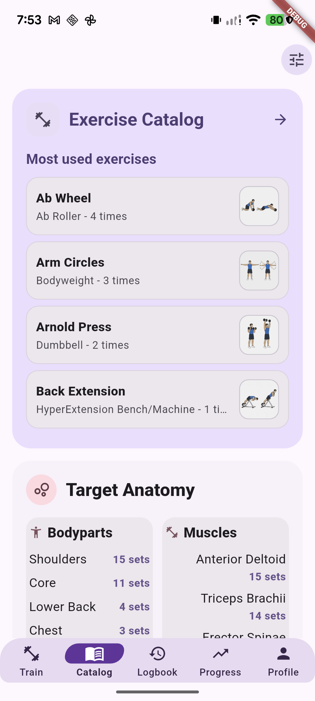

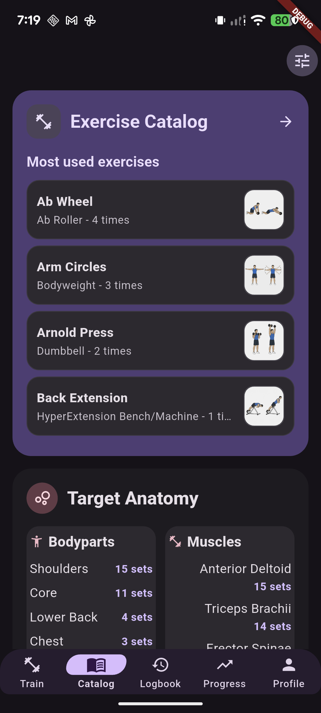

#### 4.2 Exercise Catalog browser — idle, search, filtered, empty, media

- **A. Identity/access:** Full-page `ExerciseCatalogPage`; Catalog root → Exercise Catalog card. The same page widget is reused by picker callers but its Expressive opt-in is off by default there.
- **B. Status:** **A — Visually Approved / Frozen** for the Catalog Browser's list, thumbnails, search/results, empty states, and light/dark layouts, by user review and explicit authorization on 2026-10-15. Its Filters are an approved interaction state, not an extra archetype; alternate picker callers are not implicitly approved.
- **C. Purpose:** Search and filter the exercise definition list, then open an exercise's details or return a selected exercise to a picker caller.
- **D. Current light look:** The accepted Expressive list uses periwinkle exercise-entry surfaces, exercise thumbnails, the current separated search container and field, and the existing filter control. Preserve current typography, spacing, geometry, results, and empty-state presentation.
- **E. Current dark look:** The current dark list, thumbnails, search/filter controls, results, and empty states were accepted by the user. Approval is of the current presentation; older screenshots are not asserted to show every final refinement.
- **F. Major states:** Inactive search; focused query; matching results; filter modal; open equipment menu; applied filter/search results; centered no-results string (“No exercises match filters.”); loading; selected item for picker caller; media loaded; heatmap/icon fallback; downloading, Wi-Fi-only blocked, retry. Search filters definition names after profile/equipment/bodypart/muscle constraints; 250ms debounce. No favorites affordance/state exists. There is no equipment drilldown page.
- **G. Interaction/motion:** Search typing, filter icon/modal Save/Cancel, row/item route and media/detail actions, picker selection/add remain. In normal browser the row's text body does not navigate; tapping the thumbnail/heatmap opens Details. Loading indicator/fallback/retry are media behavior; no custom spring or explicit list animation. Reduced-motion no-result/search page evidence is absent.
- **H. Classic departures:** Filled rounded search with separate circular icon instead of a text filter button; softer tonal/outlined rows rather than standard Card chrome; media gets a strong thumbnail footprint. Filtering/search/data remain as before.
- **I. Preserved:** Repository definition order, existing search/filter matching, profile compatibility, equipment/bodypart/muscle options, names, equipment metadata, media loading/cache/retry/heatmap fallback, tutorials, and `onExercisePicked` callback for picker paths.
- **J. Review notes:** The reviewed Browser and Filters visual baselines are accepted and frozen. Do not reopen optional cosmetic questions. Media loading, Wi-Fi blocking, retry/cache failures, keyboard/focus, large text, Reduced Motion, and full responsive/accessibility/technical qualification remain separately tracked; approval does not imply exhaustive coverage.
- **K. Evidence:** User personal visual review and explicit authorization recorded 2026-10-15; no screenshots or checks were produced for this approval update. Historical references: [light](../tonos-expressive-catalog/review/06-exercise-browser-light.png) · [dark](../tonos-expressive-catalog/review/06-exercise-browser-dark.png) · [dark](../tonos-expressive-catalog/review/07-browser-search-dark.png) · [dark](../tonos-expressive-catalog/review/10-filtered-results-dark.png) · [dark](../tonos-expressive-catalog/review/08-catalog-filter-dark.png) · [dark](../tonos-expressive-catalog/review/09-catalog-filter-equipment-menu-dark.png). Their current-source currency and complete per-theme/state coverage have not been re-audited here.

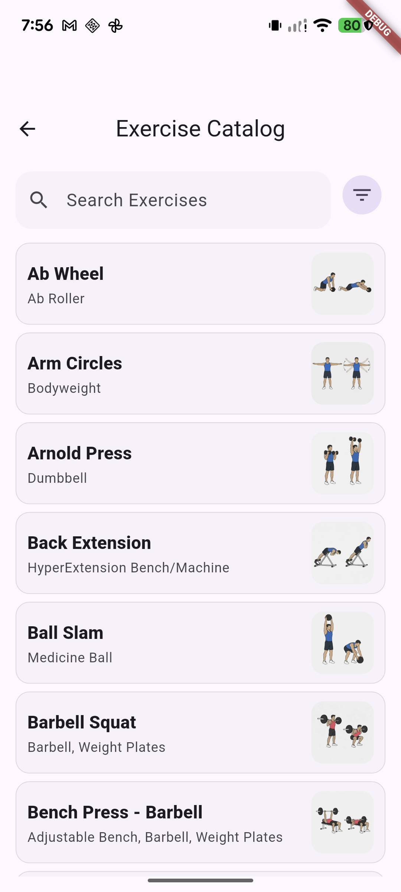

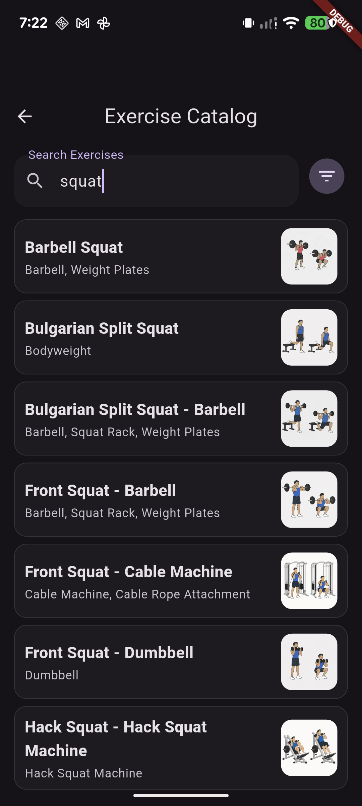

#### 4.2.1 Exercise Browser Filters — approved interaction state

**A — Visually Approved / Frozen**, 2026-10-15. Navigation: Catalog → Exercise Catalog → Filters. Includes the Filters dialog, workspace-profile controls, Equipment / Body Part / Muscle selectors and their anchored dropdowns, selected states, active-filter indicator, Apply / Reset actions, and filtered empty states. This approval is an interaction state of the Catalog Browser, not another page archetype or approval of alternate picker callers. It is based on the user's review and explicit authorization; screenshot completeness, keyboard/focus, accessibility, responsiveness, persistence, and release qualification remain separate.

#### 4.3 Target Anatomy library / Exercise Focus Library — Bodyparts / Muscles tabs

- **A. Identity/access:** Full-page `MuscleFilterPage`; Catalog root anatomy Bodyparts/Muscles pane enters with the matching tab selected. It has search and two tabs.
- **B. Status:** **A — VISUALLY APPROVED / FROZEN** in light and dark, recorded 2026-10-13. Includes Bodyparts/Muscles tabs, updated header/segmented tabs/search controls, compact list cards, anatomy thumbnails, muscle icon fallback, and search/no-results states. Selected Bodypart and Muscle detail pages have separate explicit A approvals dated 2026-10-19.
- **C. Purpose:** Browse anatomical areas or muscles, search those names, and open related definition lists.
- **D. Current light look:** A tab header separates Bodyparts and Muscles. A filled search control sits above rounded list rows with localized name, count of related exercises, heatmap/media thumb, and chevron. The Bodyparts list capture shows Biceps through Lower Back; content continues vertically.
- **E. Current dark look:** The user personally reviewed and accepted the updated dark library presentation. No new screenshot was produced by this documentation update.
- **F. Major states:** Bodyparts tab; Muscles tab; query results; empty query-match list; tappable list rows; anatomy media/heatmap fallback. This same two-tab route is one archetype, not two pages.
- **G. Interaction/motion:** Search filters both lists; tapping bodypart or muscle opens corresponding detail route; standard route and list tap feedback. Reduced Motion not captured.
- **H. Classic departures:** Rounded tonal list rows and coherent tab/search grouping replace the earlier conventional anatomy list. Counts, localized names, heatmaps, and detail routing stay intact.
- **I. Preserved:** Bodypart-muscle relationships, localized names, exercise counts, search, media fallback, and drilldown routes.
- **J. Review notes:** Both themes, both tabs, search/no-results states, and muscle icon fallback are visually approved and frozen. Stored screenshots may predate this baseline; automated responsive, accessibility, Reduced Motion, and technical/release qualification remain separate.
- **K. Evidence:** Historical Bodyparts list/search shell [light](../tonos-expressive-catalog/review/17-anatomy-filter-light.png); it is not proof of the latest implementation. Current approval comes from the user’s personal light/dark review, including tabs, search/no-results, and fallback presentation.

#### 4.4 Bodypart detail

- **A. Identity/access:** Full-page `DefinitionsByBodyPartPage`; focus library → choose bodypart (e.g. Chest).
- **B. Status:** **A — Visually Approved / Frozen**, explicitly authorized by the user on 2026-10-19 for the current Selected Bodypart detail presentation.
- **C. Purpose:** Show exercise coverage and recent/recommended volume for a bodypart, associated muscles, and linked exercises.
- **D. Current light look:** The bodypart title leads into a rounded heatmap/count hero with Done · 7 days and Recommended · weekly tiles. Associated-muscle chips and exercise search precede compact exercise cards. Equipment and muscle summaries use 10dp single-line text, ellipsis and full-text tooltips; exercise-specific 60dp thumbnails replace the former info icons. The hero uses `#E9DDF1` and exercise cards `#DED3EE`.
- **E. Current dark look:** The same composition uses a `#30243E` hero and `#382A49` exercise cards with theme-aware foregrounds, set tiles, chips, and neutral thumbnail frames. Existing dark screenshots predate the final row/thumbnail refinements; fresh final dark-device confirmation is not claimed.
- **F. Major states:** Bodypart page, recent volume, recommended range edit, associated-muscle drilldown, linked exercise list, exercise info sheet. Heatmap fallback is route-supported; no dedicated fallback capture.
- **G. Interaction/motion:** Muscle chips navigate to muscle detail; exercise thumbnails open the shared detail sheet; recommended bound edit uses the existing dialog/workflow. The latest implementation pass checked the Biceps thumbnail-to-sheet action in light mode. No exhaustive motion, editor, or Reduced Motion check is claimed.
- **H. Classic departures:** Expressive promotes the bodypart as a large tonal summary surface, groups metrics and anatomy, and uses rounded association chips/exercise surfaces. Existing volume and ranking meaning is unchanged.
- **I. Preserved:** Existing linked exercises and ordering, seven-day totals, recommended bounds, associations, equipment/muscle data, search, and detail navigation. Compact rows retain an 88dp minimum height and full-text tooltips.
- **J. Review notes:** The current page is approved and frozen by explicit user authorization. Latest implementation-pass evidence is light-mode Biceps; fresh final dark, fallback, range-editor, long-label, large-text and responsive/accessibility evidence remain incomplete. These limitations do not reopen visual approval or establish release qualification. No tests were run for the final typography/row/thumbnail adjustments.
- **K. Evidence:** Historical Chest [light](../tonos-expressive-catalog/review/18-bodypart-detail-light.png) · [dark](../tonos-expressive-catalog/review/20-bodypart-detail-dark.png), plus retained campaign originals. They predate the final refinements and are excluded from active unapproved gallery outputs. No new screenshots were captured for this approval update.

#### 4.5 Muscle detail

- **A. Identity/access:** Full-page `DefinitionsByMusclePage`; focus library → choose muscle or a Bodypart detail → associated muscle chip.
- **B. Status:** **A — Visually Approved / Frozen**, explicitly authorized by the user on 2026-10-19 for the current Selected Muscle detail presentation.
- **C. Purpose:** Show a muscle's linked exercises, related bodyparts, recent sets, and recommended volume.
- **D. Current light look:** A rounded muscle heatmap/count hero uses `#E9DDF1` with distinct Done / Recommended tiles. Related-bodypart chips precede ranked exercise cards using `#DED3EE`; the selected-muscle rank badge and explicit Bodyparts metadata preserve hierarchy. Equipment/bodypart summaries are compact single-line 10dp text with tooltips, and Catalog-style 60dp thumbnails open details. Exercise search appears for lists of ten or more and matches names/equipment.
- **E. Current dark look:** The same compact hierarchy uses a `#30243E` hero, `#382A49` exercise cards, and theme-aware foregrounds and thumbnail frames. Historical Pectoralis Major, Biceps Brachii and Adductor Brevis captures do not show the final typography/row/thumbnail baseline; no fresh final Muscle-page or dark capture is claimed.
- **F. Major states:** Opened from Chest vs standalone; recommended range edit; 7-day sets; related bodypart route; ranked exercise results; info/detail sheet. No actual muscle media/avatar upload flow is present in this captured state.
- **G. Interaction/motion:** Bodypart chips navigate to related bodypart detail; exercise thumbnails open the shared detail sheet; volume-bound editing retains the existing path. Standard tap/route transitions are preserved. No new exhaustive gesture, editor, search-state or Reduced Motion evidence is claimed.
- **H. Classic departures:** Tonal summary and prominent readable set cards replace conventional detail grouping; related bodypart chips and ranked exercise surfaces are rounded/Expressive. Exercise ranking and volume semantics stay unchanged.
- **I. Preserved:** Muscle/bodypart relationship links, 7-day set calculation, recommended-volume persistence, exercise ranking and detail route.
- **J. Review notes:** The current page is approved and frozen by explicit user authorization. Fresh final light/dark Muscle-page captures, editor/fallback, long-name, large-text, motion and exhaustive interaction evidence remain incomplete. No tests were run for the final typography/row/thumbnail adjustments. Visual approval is independent of technical and release qualification.
- **K. Evidence:** Historical Pectoralis Major detail [light](../tonos-expressive-catalog/review/19-muscle-detail-light.png) · [dark](../tonos-expressive-catalog/review/21-muscle-detail-dark.png) and [Pixel exercise-list capture](captures/pixel-7-logbook-dark/00-original-preview-state.png), plus retained campaign originals. These predate the final baseline; no separate equipment page or fresh capture is implied.

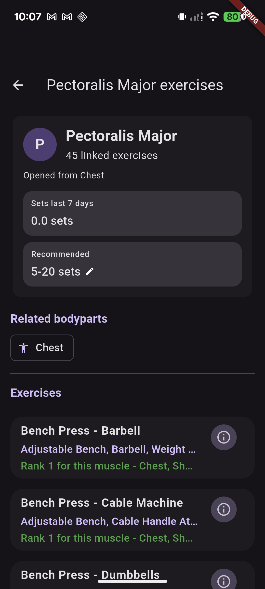

#### 4.6 Exercise Details sheet — Catalog Browser caller

- **A. Identity/access:** `ExerciseDetailSheet`; Catalog → Exercise Catalog → exercise thumbnail/information. This approval is specific to the Catalog Browser caller and counts its purpose-built detail layout once as a page archetype.
- **B. Status:** **A — Visually Approved / Frozen**, based on the user's visual review and explicit authorization on 2026-10-15.
- **C. Purpose:** Inspect exercise media, form instructions, equipment, target anatomy, metrics, performance history, and session records.
- **D. Current light look:** The accepted header/title/close treatment, media and anatomy overlay, compact tab selector, tonal Details sections, metrics cards, chart, legend/badges, and compact session records form the frozen current baseline.
- **E. Current dark look:** The current Catalog-caller dark presentation is included in this visual approval. No fresh paired screenshot set is asserted by this documentation-only update.
- **F. Major approved states:** Details / Metrics / Records; exercise media; Form guide; Equipment; Target anatomy; metrics cards; performance chart; session records; expanded/collapsed sections; sheet resizing and scrolling.
- **G. Interaction/motion:** Existing navigation, sheet/tab controls, expansion, chart behavior, and image/heatmap actions are preserved. Visual approval does not establish comprehensive gesture, focus, Reduced Motion, or accessibility qualification.
- **H. Classic departures:** The existing Expressive header, tonal surfaces, icon treatments, typography, and compact analytical composition remain frozen. No UI changes accompany this approval.
- **I. Preserved:** Media/cache behavior, instruction data/localization, equipment/anatomy metadata, workout history/calculations, callbacks, and other caller defaults.
- **J. Review boundary:** Anatomy and other shared sheet callers are not approved by the Catalog Browser-caller authorization. Selected Bodypart / Muscle parent pages have separate explicit A approvals dated 2026-10-19; that does not expand the sheet/viewer caller scope. Cache/failure states, unusual viewports, enlarged text, and comprehensive technical/release qualification remain separate.
- **K. Evidence:** Approval comes from the user's personal review and explicit authorization. Historical references: [light](../tonos-expressive-catalog/review/15-exercise-detail-light.png) · [dark](../tonos-expressive-catalog/review/11-exercise-detail-dark.png) · [scrolled](../tonos-expressive-catalog/review/12-exercise-detail-dark-scrolled.png) · [13](../tonos-expressive-catalog/review/13-exercise-detail-dark-lower.png) · [14](../tonos-expressive-catalog/review/14-exercise-detail-equipment-dark.png). These are retained links, not newly verified current-source evidence. No screenshots or checks were produced by this approval update.

#### 4.6.1 Exercise Image Media Viewer — Catalog caller, approved interaction state

**A — Visually Approved / Frozen**, 2026-10-15. Navigation: Catalog → Exercise Catalog → exercise Details → image/zoom action. Includes the enlarged image with zoom/pan, exercise title and close action, and the Expressive Form guide below the image, expanded to show Set-up, Execution, and Tips in one continuous scrolling layout. It reuses the Details guide presentation/data. This is an interaction state of the Catalog-caller detail sheet, not an extra archetype; Anatomy and other shared media viewers retain independent statuses. The latest full-guide device screenshot from the preceding implementation confirms light mode; no corresponding fresh dark-mode screenshot or exhaustive state coverage is claimed. Visual approval is separate from responsive, accessibility, gesture/keyboard, automated-test, technical, and release qualification.

### Catalog exclusions and route boundary

No exercise favorites feature/state or equipment drilldown page is implied by these approvals. Equipment remains metadata, a filter value/menu, and detail content. Details, Metrics, Records, and the expanded image/Form guide viewer are approved only for the Catalog Browser caller. Train/planning, Active Workout, Anatomy, Logbook, Progress, Profile, editor, picker, and other shared callers retain their existing independent approval boundaries.

## 5. CURRENT UNAPPROVED TONOS EXPRESSIVE SYSTEM

### Shared language

- **Canvas:** Families use the existing light/dark theme contexts. Light keeps a pale, quiet canvas around stronger grouping; dark uses a near-plum/charcoal canvas with distinct raised surfaces.
- **Focal surfaces:** Plummy or lilac focal areas draw attention to the active task—analytics/report, selected date or profile setting, or Catalog entry/content. The size and location vary by task; they are not all the same card recipe.
- **Purple / plum:** Identifies Expressive grouping, selected/focal surfaces, and headings. Light uses pale lavender and deeper plum foreground roles; dark raises contrast with deeper plum and lighter lavender.
- **Teal:** A structural secondary accent in report/metric and supporting contexts. It is not substituted for semantic categories.
- **Semantic green:** Existing success/positive/rank meaning remains owned by existing semantic/data roles. It is not a new brand accent in these candidates.
- **Shapes:** Large rounded focal panels, compact rounded row/card surfaces, and restrained outlines provide grouping. Catalog and Profile are more surface-led; Progress remains analytic; Logbook prioritizes calendar/date and row flow.
- **Typography:** Clear display/title hierarchy for page/focal labels; supporting totals, dates, equipment, and form labels keep secondary roles. Data labels remain explicit and localized.
- **Selected states:** Selected period, metric, exercise, setting, and anatomy tab use existing selection semantics plus stronger tonal/shape contrast. Selection is not color-only where current semantics provide a label/state.
- **Tactile motion:** Standard Material press/routes remain common. Local transitions include duration-gated selectors/expansions and Logbook date selection. No custom cross-family spring system is claimed.
- **Reduced Motion:** Expressive preserves static composition while using reduced durations for relevant interactions. Progress Report has light/dark stills and an immediate Time update; Logbook has an immediate-selection light still; Profile has only light-root still; Catalog has no Reduced Motion capture. There are no family-wide motion clips/performance results.
- **Density:** Progress intentionally carries dense data; Logbook orders chronology first and metrics second; Profile groups controls for scanning; Catalog gives names and media room and has long browse lists.
- **Lists:** Session and exercise lists keep date/name-first scanning; settings lists group preference actions; Catalog rows pair localized title/equipment with media; list-specific metadata remains secondary.
- **Detail pages:** Progress details retain precise chart/record data; Logbook session detail prioritizes the past-workout summary then anatomy/focused sets and exercise content; Profile detail routes are functional forms/editors; Catalog detail leads with exercise media and instructions.
- **Empty states:** Progress Health Trends and Logbook empty periods are truthful; Catalog has a localized no-matches state and anatomy/media fallbacks; Profile disabled Nutrition says Later. Current screenshot coverage is incomplete for several of these.

### Intentional family differences

| Family | Characterization | Product-job emphasis |
|---|---|---|
| Progress | Analytical, precise, data-first with Expressive chrome | Keep plotted values/labels trustworthy while making report modules feel grouped and intentional. |
| Logbook | Chronological, historical, scannable | Put selected dates and session rows ahead of supporting metrics and heatmap. |
| Profile | Personal, configurable, grouped settings | Make real local profile/preferences readable without implying an online social account. |
| Catalog | Visual, browsable, searchable, media-rich | Keep exercise names and media visible while exposing existing filters and anatomy navigation. |

These are four related candidates, not one identical surface recipe. Train + shell and Active Workout are only qualified reference baselines; they are not part of the candidate page count.

## 6. OPEN REVIEW ITEMS

All 24 page archetypes in this dossier are now visually approved and frozen. The older questions below remain historical design prompts or separate evidence/qualification follow-ups; they do not reopen approved pages. The current five B page archetypes outside this subset and their route-owned review states are listed in the campaign [navigation index](../tonos-expressive-visual-evidence/unapproved-review-campaign-20261013/navigation-index.md).

### Progress

1. **Workout Report composition (visual / density / user judgment):** Does the report focal area balance boldness with immediate trust in selected metric, range, chart, and summary?
2. **Exercise Progress summary (visual / responsive / user judgment):** Is the actual/estimated 1RM rail clear at 320dp and 2× text? Does the em dash convey unavailable actual data clearly?
3. **Health Trends (visual / evidence / user judgment):** Do empty cards read as intentional, and how does the module feel with populated trend data? The populated view is **MISSING CURRENT EVIDENCE**.
4. **Selected metrics, points, and details (visual / evidence / user judgment):** Is the point callout legible and anchored? Workouts is shown in the paired default; Time is captured light-only; selected Volume has no separate capture. Dark selected-metric, selected-point, and expanded-details evidence are missing.
5. **Measurement detail and `+ Metric` (evidence):** Current route/entry dialogs have no screen captures or paired themes. Review actual creation/logging before drawing a visual conclusion.
6. **Motion/accessibility (motion / accessibility):** Reduced Motion is evidenced by stills only; no TalkBack/keyboard/focus audit or motion clip exists.

### Logbook

1. **Calendar hierarchy (visual / density / user judgment):** Is chronology/date navigation clear, and are date tiles compact enough in Month and dense 4Y histories?
2. **List versus totals (visual / density / user judgment):** Is the selected-period session list sufficiently prominent while heatmap and metrics stay discoverable?
3. **Long history (density / evidence / user judgment):** Does the 15-session stress state remain scannable? Current stress capture is light only.
4. **Empty selections (evidence):** The current dark Month screenshot shows an empty selected day. A current light empty-day screenshot is missing. The older 2023 empty 4Y screenshot remains useful for its no-history fixture but has stale period-tile geometry.
5. **Session Detail qualification (not visual approval):** The user has approved its current read-only, edit, dialog, and light/dark visual states in section 2.3. Responsive, accessibility, analyzer, style-inventory, and test qualification remain separate and are not asserted by that approval.
6. **Reduced Motion and detail (motion / accessibility):** Calendar immediate selection is shown in light still only; dark state, motion clip, keyboard, and screen-reader behavior are not evidenced.

### Profile

1. **Profile root qualification (not visual approval):** The root is visually approved in light/dark, including Account, Training, Data, and disabled Nutrition. Native responsive/accessibility qualification is not implied by its widget matrix.
2. **Profile child routes (visual / evidence / qualification):** User Information and UI & Appearance have separate route-specific visual approvals in both modes and only for their recorded scopes. UI & Appearance approval includes its setting rows, switch states, Theme Family, Weight Units, and Language dialogs. Navigation Editor / Edit Bottom Tabs, Guided Tutorials, Gym & Workout Settings, the Workout Progress Flows main page, its Workout Progress Flow Editor, the Workout Progress Rules / Flow Methods selection page, the plan-specific Flow Methods editor, the Ongoing Workout Exit popup child state, Volume Boundaries (Body Parts and Muscles tabs), Body Part Rankings, Muscle Rankings, Anatomy Mapping, Exercise Set Allocation, Exercise Editor, Progress Settings, and the Measurement Library / Measured Items Profile caller have independent approval scopes. The plan-specific editor is A-approved by explicit user authorization on 2026-10-18; its current Copy from refinement is not shown in the older campaign screenshots. For Exercise Editor, the latest screenshot evidence confirms light mode; dark-mode visual confirmation remains an evidence gap. Other child pages and other callers of shared components remain separate review targets; none inherits another route's approval.
3. **Dark child-route evidence (qualification/evidence):** A dark screenshot artifact is absent for Guided Tutorials and Workout Progress Flows despite the user's visual approval of both pages in both modes. A dark capture is also absent for the exit-choice popup; the user has nevertheless reviewed and approved its dark appearance. Dark captures are absent for Gym Profile and plan-target AutoPresetFlowScreen variants. The plan-specific Flow Methods Editor is visually approved by explicit user authorization; its six older light/dark captures do not show the current Copy from refinement, so theme-specific current-source screenshot evidence remains incomplete. The Flow Methods selection page is user-approved in both modes despite no new captures being added for that status update. App Defaults has one dark editor capture. The user has approved the shared AutoPresetFlowScreen presentation in both modes; missing variant captures remain evidence gaps and do not reverse that visual approval.
4. **Flow settings (visual / workflow / user judgment):** Are App default and plan-flow assignments understood? Flow persistence/advanced editing is not fully qualified by the dossier.
5. **Preset-flow editor (evidence / qualification):** `AutoPresetFlowScreen` is visually approved in both modes for its shared presentation. Only the dark App Defaults state is captured; light App Defaults and both appearances for the Gym Profile and plan-target variants are **MISSING CURRENT EVIDENCE**. The user's approval does not claim those context-specific states were individually inspected.
6. **Child interaction (accessibility / evidence):** No child-wide keyboard/focus, TalkBack, native font-scale, or Reduced Motion review. Only root has a 320dp widget text-scale matrix and only light Reduced Motion evidence.
7. **Scope check (user judgment):** Is any user-facing Profile child missing? The explicitly excluded admin/Train/Analytics routes are listed above to confirm the boundary.

### Catalog

1. **Approved/frozen:** Catalog Root, Target Anatomy library, Selected Bodypart detail, Selected Muscle detail, Exercise Browser and its Filters, and the Catalog Browser-caller Exercise Details sheet and image/Form guide viewer have their independent scoped A approvals. Do not reopen their accepted designs for optional refinement.
2. **Pending page approvals:** None remain in this dossier's Catalog subset. Other caller-specific qualification boundaries are unchanged.
3. **Evidence gaps:** Stored browser/filter/detail captures may predate current source; complete theme/state coverage has not been re-audited here. Latest final anatomy-row device evidence is light-mode Biceps; fresh final Muscle-page/dark captures are not claimed. The latest full expanded-guide screenshot also confirms light mode only.
4. **Qualification:** Media loading/cache/failure/Wi-Fi/retry, long-content/large-text/viewport behavior, keyboard/focus, screen-reader access, Reduced Motion, persistence, and technical/release checks remain separate from user visual approval.

### Cross-system

1. **Family coherence (visual / user judgment):** Do all four candidates read as Tonos Expressive while keeping Progress analytical, Logbook chronological, Profile personal, and Catalog media-rich?
2. **Surface/shape variety (visual / user judgment):** Are focal surfaces, roundness, and plum roles varied appropriately by task rather than repetitive?
3. **Light/dark pairing (visual / evidence / user judgment):** Are dark surfaces as intentional and legible as light where paired? Which missing dark states are necessary before review can be complete?
4. **Accessibility (accessibility / user judgment):** What native TalkBack/keyboard/focus checks are needed beyond current widget semantics and text-scale tests?
5. **Motion (motion / user judgment):** Are reduced durations and immediate state changes sufficient? Current evidence is still-only; there are no cross-family clips/performance claims.

## Superseded or non-review evidence

- `../tonos-expressive-progress-logbook-review/README.md` is a prior combined guide. It predates the Catalog candidate and includes stale round-tile Logbook images and a former “do not begin Catalog” boundary. Use this dossier/current source and evidence map instead; do not treat that text as current review authority.
- `../tonos-expressive-combined-review/README.md` is an older index linking prior review packages. It is not the current consolidated dossier.
- `../tonos-expressive-progress-logbook-review/captures/logbook-expressive-oct2-light.png`, `../tonos-expressive-progress-logbook-review/captures/logbook-expressive-oct2-dark.png`, and `../tonos-expressive-progress-logbook-review/captures/final-restored-logbook-state.png` remain valid Month-circle geometry evidence; the newer Pixel captures are preferred for fixture pairing. Earlier 3M/Year/4Y range images with circular period selector tiles, including the 2023 empty state, are superseded for current period-tile geometry by `57b7aaa` and latest temporal polish. The current Month cells remain circular; only 3M/Year/4Y period tiles changed to rounded rectangles.
- `../tonos-expressive-progress-logbook-review/captures/profile/profile-expressive-dark-root.png` is obscured by Preview Controls; do not use as clean dark-root evidence. `profile-expressive-light-root-scrolled.png` includes a transient toast; use the clean light root/lower capture.
- Catalog review capture `captures/pixel-7-logbook-dark/00-original-preview-state.png` is correctly included here as current muscle-detail exercise-list evidence, despite the legacy filename. `04-catalog-root-restore-reference.png` is a Catalog root scrolled lower-panel reference only. Neither is a Logbook image.
- `../tonos-expressive-catalog/review/00-preview-start.png` is an Expressive Train screen from the preview setup, not part of the Catalog family. `01-preview-controls.png` shows the preview controls and reduced-motion toggle, not a Catalog reduced-motion state.
- Earlier Progress Exercise Progress summary captures are superseded by current paired captures `exercise-progress-summary-light.png` and `exercise-progress-summary-dark.png`; use the latest **Actual 1RM — / Estimated 1RM 27 lbs** treatment.

## Evidence completeness at a glance

| Family / archetype | Current light + dark | One-theme / state-only evidence | Missing current evidence |
|---|---|---|---|
| Progress root/report + Exercise Progress + empty Health Trends | Yes: Workouts report and exercise-health pairs; latest summary pair | 1M, Time metric, expanded details light; Reduced Motion light/dark + immediate Time light | Selected Volume; populated Health Trends; `+ Metric` and entry dialogs; dark selected metric/point and expanded details; measurement detail route |
| Progress Ab Wheel detail | Yes: default pair | Selected historical point light | Dark selected point; direct recording detail (no route identified) |
| Logbook calendar | Month selected-day pair; 3M paired; Year paired; 4Y paired | Current dark empty-day; 2023 empty light (stale 4Y period-tile geometry); stress-15 light; Reduced Motion immediate light | Light empty selected day; 4Y stress dark; Reduced Motion dark/clip |
| Logbook Full History | Yes | Classic light/dark comparators | Dense/empty/Reduced Motion variants |
| Logbook Session Detail / Past Workout | Existing pair shows summary fold; user explicitly approved the complete section 2.3 scope in light/dark | Classic light/dark comparators | No new captures requested; technical/responsive/accessibility qualification remains separate |
| Profile root | User approved full root composition in light and dark; existing stills include clean light and dark scrolled views | Light root lower/scrolled and light Reduced Motion; Classic root pair | No clean dark top-root still in this dossier; dark Reduced Motion and technical qualification remain separate |
| Profile User Information | User approved in both modes, including Gender, Body-fat % estimate, Weight trend, and Estimated avg steps selection dialogs | Existing User Information light/dark captures | Classic child comparison; edit/error/focus evidence remains separate from visual approval |
| Profile UI & Appearance | User approved in both modes, including Theme Family, Weight Units, Language, and switch states | Existing Appearance and Weight Units light/dark captures | Classic child comparison; keyboard/focus and technical qualification remain separate |
| Profile Navigation Editor, Gym Settings, Progress Settings, Measured Items Library | Yes, each paired | Navigation Editor is a separate screen from the UI & Appearance navigation card | Classic child comparisons; edit/error/focus variants |
| Profile Guided Tutorials | User visually approved in light and dark | Existing light capture; dark mode reviewed by user without a dossier screenshot | Responsive, accessibility, and technical qualification remain separate |
| Workout exit dialog, Workout Progress Flows, Flow Methods selection/editor | No; light only | Existing light captures | All corresponding dark states |
| Profile AutoPresetFlowScreen: App Defaults, Gym Profile Defaults, plan targets | User-approved shared editor presentation in both modes; App Defaults dark still stored | Source route supports all three target scopes; approval does not claim each context-specific state was individually inspected | Light App Defaults; light/dark Gym Profile Defaults and plan targets remain evidence gaps |
| Catalog root | Yes; scrolled anatomy also paired | New Pixel dark scrolled reference, plus current light pre-route root | Root Reduced Motion |
| Catalog browser | User visually approved current light/dark list, thumbnails, search/results, and empty states on 2026-10-15 | Historical list/search/filter captures remain references | Complete current-source per-theme/state screenshot coverage and technical/responsive/accessibility qualification are not claimed |
| Catalog Target Anatomy library / Exercise Focus Library | User visually approved in light and dark | Bodyparts/Muscles tabs, header/segmented tabs/search, compact cards/thumbnails, muscle icon fallback, search/no-results | Stored captures may predate the approved baseline; Reduced Motion and technical qualification remain separate |
| Catalog Bodypart + Muscle detail | User explicitly approved both current pages on 2026-10-19; fresh final paired screenshots are not claimed | Historical Chest/Pectoralis/campaign examples retained; latest implementation-pass device evidence is light Biceps and a thumbnail-to-sheet check | Fresh final Muscle-page/dark captures, fallback/edit dialog/long-name/large-text/Reduced Motion and technical qualification remain separate |
| Browser Filters — interaction state, no extra page | User-approved dialog, selectors/dropdowns, selected states, count, Apply/Reset and filtered empty state | Existing captures retained without a fresh currency audit | Accessibility, keyboard/focus, responsive, persistence and release qualification remain separate |
| Catalog image viewer — interaction state, no extra page | User-approved enlarged image/zoom/pan/title/close and expanded Set-up / Execution / Tips guide | Latest full-guide device screenshot confirms light mode | Matching fresh dark screenshot not claimed; other shared callers excluded; qualification remains separate |
| Catalog Exercise Details sheet — Catalog Browser caller | User visually approved Details / Metrics / Records, sections, chart/history, expansion and scrolling on 2026-10-15 | Historical light/dark sheet and scrolled captures remain references | Current exhaustive state coverage, media failures, Reduced Motion, and technical qualification remain separate; other callers not approved |

Some candidate README files record focused widget matrices and counts. Those are supporting implementation evidence; they do not replace missing screenshots or represent user approval. Existing notes state Progress 320dp at four text scales and a 420dp responsive case; Logbook 320dp light/dark at four scales; Profile root 320dp across light/dark and four scales; Catalog browser/detail/anatomy tested at stated 320/411dp and text scales. These are widget/device coverage claims as recorded in their source dossiers, not a native screen-reader pass.

## Freeze and disposition

> Older freeze/count paragraphs below are historical snapshots. The current dossier count is **24 approved / 0 pending**, and the current master page tables contain **A44 / B5**, as recorded in the current header and 2026-10-19 Dashboard approval update.

The full Measurements & Trends root page, the dedicated Exercise Progress / exercise 1RM detail route, and the Progress-origin Measurement Trend detail route are each **`VISUALLY APPROVED AND FROZEN`**, under separate approvals. The two detail-route approvals cover their stated populated/empty and light/dark scopes; Measurement Trend detail also includes the current Log Measurement dialog styling. The Logbook root/calendar, Logbook Full History / All Sessions, and Logbook Session Detail / Past Workout are separately **`VISUALLY APPROVED BY THE USER AND FROZEN`** for the exact scopes in sections 2.1, 2.2, and 2.3. Session Detail approval includes read-only and editing presentation, Save as Plan and Delete Session dialogs, and both modes. Profile → Profile root is separately **`A — VISUALLY APPROVED BY THE USER AND FROZEN`** for the exact both-mode scope in section 3.1. Profile → User Information is separately **`A — VISUALLY APPROVED BY THE USER AND FROZEN`** for its section 3.2 scope in both modes, including the four selection dialogs. Profile → UI & Appearance is separately **`A — VISUALLY APPROVED BY THE USER AND FROZEN`** for its section 3.3 scope in both modes, including its Theme Family, Weight Units, and Language dialogs and switches. The shared selection treatment is approved only in the User Information and UI & Appearance route contexts; other callers remain independently tracked. Navigation Editor and Guided Tutorials are separately approved and frozen for their sections 3.4 and 3.5 scopes. Gym & Workout Settings is separately **`A — VISUALLY APPROVED BY THE USER AND FROZEN`** for the exact both-mode page scope in section 3.6; Ongoing Workout Exit has a separate child-state popup approval, while other child routes remain independently tracked. Catalog Root is separately A-approved and frozen in section 4.1; the remaining Catalog candidate routes and other candidate routes remain **`FROZEN FOR COMBINED REVIEW`** unless separately approved. No full responsive/accessibility/analyzer/style-inventory/test/ratchet/release qualification is implied. Current production sources were not changed in this documentation lane. The freeze manifest currently records 295/295 `lib/**/*.dart` hashes matching its start values; the initial audit status also records three additional protected files and 207 initial status entries. Train + shell and Active Workout remain excluded/qualified references and were not edited by this dossier.

The remaining historical questions are evidence/qualification follow-ups, not pending page approvals within this dossier. The latest approval addendum and current status header supersede earlier queue snapshots. Evidence gaps are labeled rather than inferred from source behavior. Do not alter an approved design, qualify a slice, or begin another destination as part of reviewing this document.

Target Anatomy library, Selected Bodypart detail, Selected Muscle detail, Exercise Browser and its Filters, the Catalog Browser-caller Exercise Details sheet/image viewer, Dashboard root, and Customize Dashboard are separately **A — Visually Approved / Frozen** within their recorded scopes. The current dossier count is **24 approved / 0 pending**; master page totals are **A44 / B5**. Older snapshots below retain historical counts without overriding current approvals.

The dossier has **24 route archetypes: 15 visually approved/frozen and 9 pending**. The approved set now includes the Workout Progress Rules / Flow Methods selection page and its Add Rule dialog states; the separately counted Flow Methods editor remains pending. All prior route-specific approval scopes remain unchanged. Profile root approval does not approve child routes, and shared components/dialogs are approved only where their route scope says so. Visual approval is not technical qualification. No candidate design was changed as part of this status update.

## Profile family completion and consistency pass — 2026-10-08

This addendum records the implementation and validation pass on the dirty candidate tree at HEAD `ab18ed8cab5582c8449e13724afae3c4b74ebeea`. The six A-approved Profile screens above remained frozen during that implementation pass; the later Workout Progress Flows approval is recorded below. At the time of that pass, the 55-archetype master inventory was A14 / B22 / C13 / D1 / E0 / F5 / G0. These master counts differ from this dossier's 24-route subset.

### Profile route audit and disposition

| Route / state | Existing master status | This pass | Remaining review and qualification |
| --- | --- | --- | --- |
| Profile root, User Information, UI & Appearance, Navigation Editor, Guided Tutorials, Gym & Workout Settings | A — approved/frozen | Preserved. Test expectations were corrected where they still described older approved presentations; no approved production UI was restyled. | Existing visual approvals remain route-specific. Responsive, accessibility, analyzer, inventory, full-suite and release qualification remain separate. |
| Workout Settings / Analytics Settings entry | B at this implementation-pass snapshot; subsequently A — visually approved / frozen | Audited as the Gym & Workout Settings Workout Settings row's Analytics Settings destination. | The Workout Settings main page is now approved; its child routes remain independently pending except the separately approved Volume Boundaries screen. |
| Ongoing Workout Exit choice | Child state; not a separate page archetype | Added focused Expressive state coverage for its three options, selected/unselected surfaces, and persistence. No chooser UI or workout behavior changed. | Light/dark device and dialog accessibility review remain open; Gym & Workout Settings approval does not include this chooser. |
| Workout Progress Flows | C — partially adapted at the time of the implementation pass; subsequently approved as A for the main page only | Added paired light/dark warm/cool Expressive empty-state surfaces while preserving grouping, saved-flow content and navigation. Its later main-page visual approval is recorded in the approval update below. | AutoPresetFlow editor, its scope-specific editing interfaces, and technical/accessibility qualification remain separate review work. |
| Workout Progress Flow editor / AutoPresetFlowScreen | C — partially adapted at the implementation audit; subsequently A — visually approved/frozen on 2026-10-09 | No production change in this consistency pass. Pixel smoke navigation confirmed the App Defaults editor opens from the flow list; no values were edited or saved. | Shared presentation is visually approved in light and dark. Variant-specific captures and technical confirmation of scrolling/reachability, save/reopen, graph interaction, and Reduced Motion remain qualification evidence gaps; accepted floating-label and initial viewport observations are nonblocking. |
| Workout Progress Rules / Flow Methods selection and editor | C — partially adapted at that implementation pass; subsequently A for FlowMethodsPage only | Added paired light/dark warm/cool Expressive empty-state surfaces; retained the existing shared choice/dialog treatment and editing behavior. The Workout Progress Rules row opens FlowMethodsPage; its Add Rule dialog is a state of that page. | FlowMethodsPage is visually approved in both modes. The separate method-editor route remains pending; persistence, large-text and comprehensive rule qualification are separate technical work. |
| Progress Settings / Measurements & Trends Settings | B — unapproved | Audited; no production UI change. Existing Profile settings and measurement routes remain intact. | Light/dark edit, return, empty, deletion and dialog states still need review. Approval of Progress analytics routes does not transfer to this settings page. |
| Measured Items Library (Profile caller) | B — unapproved | No production UI change. Added focused assertions for Profile-scoped surface ownership, light/dark, 320 dp at 1.5× text, series colors and semantic activation. | Shared Nutrition caller treatment remains independent; empty/editor/dialog and native-device states still need review. |
| Database Settings and Diagnostics & Privacy | B — unapproved | Read-only route and action audit; no production UI change. | Import/export, permission, busy/error, consent, deletion, keyboard, dark-mode and accessibility states remain to review. |
| Analytics Settings | B at this implementation-pass snapshot; subsequently A — visually approved / frozen | Audited. No route shell redesign in that pass. | The main page is now approved; its child routes remain independently pending except Volume Boundaries, which has separate approval. |
| Body Part Ranking | B at this implementation-pass snapshot; subsequently **A — visually approved / frozen** on 2026-10-09, with its frozen baseline refined on 2026-10-10 | Added explicit Analytics destination zones/header and reusable ranking rows. The approved light/dark presentation includes compact 56 dp rows, Rank controls, drag handles, hero and the extended floating Save Rankings button. | Approval is specific to Body Part Rankings. Responsive, accessibility, automated-test and release qualification remain separate. |
| Muscle Ranking | B at this implementation-pass snapshot; subsequently **A — visually approved / frozen** on 2026-10-10 | Same Expressive Analytics destination zones and responsive ranking row as Body Part Rankings; independently approved in light and dark, including the matching extended floating Save Rankings button. | Visual approval is separate from reorder persistence, large-text/native-device, accessibility, and technical/release qualification. |
| Volume Boundaries, Body-part/Muscle Mapping, Exercise Set Allocation | B — unapproved at this 2026-10-08 audit snapshot | Volume Boundaries was subsequently approved and frozen on 2026-10-09; Body-part/Muscle Mapping and Exercise Set Allocation remain pending. | The current approval update records the reviewed Volume Boundaries scope. Entity selection, validation/save, persistence, empty/error and large-text review remain open for the other two routes; technical qualification also remains separate for Volume Boundaries. |
| Exercise Editor | B at this implementation-pass snapshot; subsequently A — visually approved / frozen on 2026-10-12 | Preserved the existing Analytics destination treatment and shared picker boundary; removed stale TODO/debug remnants only. | Latest screenshot evidence confirms light mode; dark-mode visual confirmation remains an evidence gap. Technical and release qualification remain separate. |
| App Settings, Goal Manual Entry, Gym Profile/equipment editing | E / deferred Nutrition / adjacent Train family | Audited as outside the active Profile family boundary: App Settings has no production caller; Goal Manual Entry is behind the disabled/deferred Nutrition feature; Gym Profile is reached through Train. No source or workflow was activated. | Remain excluded or independently tracked; no new archetypes or feature activation. |

### Shared components and behavior boundaries

The Analytics family now has a scoped `analytics_destination_surfaces.dart` boundary for Expressive-only destination token resolution, tonal zones, responsive headers and ranking rows. It branches on explicit Expressive preview identity and falls back to the existing settings tiles outside that family. Flow pages reuse the existing Profile destination surfaces and choice/dialog components. No global dialog or shared Profile selection style was changed. Classic and Neo paths were covered by the focused route/theme checks and were not intentionally restyled. Workout rules, flow persistence, measured-item data, analytics values, navigation, save/reset behavior and maintenance operations were not changed.

### Validation and unresolved qualification

- Focused Profile regressions: **207 passed, 0 failed, 0 skipped** in about 1m26s. Coverage included the six approved-route regressions, flow empty states, Ongoing Workout Exit selection, Analytics route/ranking/editor behavior, Measured Items Profile caller and responsive ranking labels. After formatting its touched test file, `expressive_navigation_presentation_test.dart` was rerun separately: **40 passed**. `settings_route_theme_test.dart` was excluded from the passing focused batch because its separate exact Navigation Editor ownership assertion expects 8 matches while the current dirty source yields 14; the same mismatch appears in the full suite.
- Full analyzer: **0 errors, 3 warnings, 78 informational notices** (81 findings; analyzer exit code 2; about 2m07s). The three unnecessary-null-assertion warnings are in the frozen Navigation Editor and UI & Appearance files. Informational notices include deprecated `onReorder` use in ranking routes and deprecated Radio parameters in Flow Methods. The dirty-tree scan does not establish whether each informational notice predates this pass; no approved page was changed to silence them.
- Full Flutter suite: one uninterrupted Flutter 3.47.5 / Dart 3.13.4 run completed in about 11m36s: **2,045 passed, 21 failed, 0 skipped; 2,066 total; exit code 1**. The failures are not presented as a green qualification. Two stale assertions still expect the old User Information `SettingsSaveBar`; one source-rule test finds hardcoded `Required` text in the frozen Navigation Editor; the remaining failures are style-owner/count, candidate-destination, or ratchet fingerprint mismatches. This run was against a heavily dirty tree without a clean-base comparison, so the failure set cannot be conclusively labeled pre-existing versus introduced. No inventory counts or ratchet fingerprints were rewritten.
- Scoped formatter check: **passed** for 13 touched Dart files. `git diff --check`: **passed**; Git emitted line-ending warnings for existing dirty files. Responsive checks cover the exercised compact ranking branch and the Measured Items 320 dp / 1.5× case; the requested full width, landscape and 2× text-scale matrix was not completed. Other open large-text, keyboard, dialog and native accessibility cases remain in the route table above.
- Pixel 7: verified device `28021FDH200228` (`Pixel_7`). Rebuilt and installed the isolated `com.tonos.expressivepreview` debug APK from `lib/expressive_preview_main.dart`; confirmed `tonos_expressive_preview.db` remained present (1,572,864 bytes). Smoke navigation reached Profile → Gym & Workout Settings → Workout Progress Flows → App Defaults editor, then returned to Workout Progress Flows. The app is left on Workout Progress Flows. No screenshot was captured and no production Tonos package/data was used.

The full suite's 21 failures are recorded here by test contract: hardcoded user-facing English copy (`active UI does not introduce hardcoded user-facing English copy`); two stale User Information save-bar assertions (`settings route slices retain shared ownership boundaries`, `settings residue routes retain explicit state owners`); and inventory/ratchet contracts (`Catalog overview recipes have exact four-mode ownership`, `Exercise Detail and Preset Generation styles have exact owners`, `N5 state categories have explicit route owners`, `production manifest retains exact qualified scopes`, `qualified onboarding and editor recipes stay source-limited`, `Expressive AddExerciseFab outline has exact opt-in geometry ownership`, `workout history calendar recipes have exact ownership`, `TonosBottomNavigationBar owns its exact migrated theme candidates`, `reviewed flow and Exercise Progress recipes have scoped rules`, `Food Customization recipes have exact, kind-limited ownership`, `UI Appearance family previews have exact recipe ownership`, `Gym Profile recipes have exact four-mode ownership`, `Food Logging recipes have exact four-mode ownership`, `Log Entry recipes have exact four-mode ownership`, `barcode scanner camera contrast stays a narrow one-off allowlist`, `premade plan route findings have an exact four-mode owner`, `every production style candidate has a measurable destination`, and `navigation and gym settings have exact scoped inventory ownership`). The final inventory mismatch expects 8 navigation/gym matches and observes 14. These failures require separate baseline/source-rule reconciliation; no approval-sensitive baseline was changed here.

### Prior visual-review queue — before Flow Methods selection approval

The Workout Progress Flows main page and the shared Workout Progress Flow Editor are now visually approved in light and dark. Recommended grouped review order:

1. Profile → Training → Gym & Workout Settings → Workout Progress Rules: review Flow Methods selection, editor, dialogs, changed/unsaved and destructive states in both modes.
2. Profile → Training → Gym & Workout Settings → Ongoing Workout Exit: review its chooser states in both modes.
3. Workout Settings / Analytics Settings and its Body Part Ranking, Muscle Ranking, Volume Boundaries, Mapping, Exercise Set Allocation, and Exercise Editor children.
4. Profile → Progress Settings and Measured Items Library.
5. Profile → Data → Database Settings and Diagnostics & Privacy, with their maintenance/confirmation states.

Visual review status, technical qualification and release readiness remain separate. The 55-archetype definitions are unchanged; see the approval reconciliation below for current counts.

## Visual approval update — Workout Progress Flows — 2026-10-08

The user visually approved **Profile → Training → Gym & Workout Settings → Workout Progress Flows** in both light and dark Expressive modes. It is now **A — VISUALLY APPROVED / FROZEN** for the main page only, including its current asymmetric hero, “How flows are copied” card, App-wide defaults and flow row, gym-profile cards in expanded/collapsed states, plan groupings and rows, configured and empty-flow descriptions, dynamic counts, zero-plan empty state, and current geometry, colors, typography, icons, chevrons, spacing, and tonal hierarchy.

At the time of this 2026-10-08 approval update, Workout Progress Flows approval did not include AutoPresetFlowScreen, App-default/Gym-default/plan-specific editing, editor forms, controls, dialogs, or Workout Progress Rules / Flow Methods. Those editor exclusions were subsequently updated by the 2026-10-09 approval below. Visual approval is separate from technical, accessibility, test-suite, and release qualification. At that earlier point the dossier had 13 approved / 11 pending archetypes and the master inventory was A15 / B22 / C12 / D1 / E0 / F5 / G0; no other route status changed in that update.

## Visual approval update — Workout Progress Flow Editor — 2026-10-09

The user visually approved **Profile → Training → Gym & Workout Settings → Workout Progress Flows → Workout Progress Flow Editor (`AutoPresetFlowScreen`)** in both light and dark Expressive modes. It is **A — VISUALLY APPROVED / FROZEN** for the shared editor presentation when opened for App Default Progression, Gym Default Progression, or plan-specific progression flows. Approval includes the compact toolbar and flexible two-line title; back navigation, settings icon, and Save presentation; peach Add a branch and lavender Attach a progression action panels in collapsed and expanded states; asymmetric shapes, outlines, and clipping; Branch From, Apply action to, and Progression action fields; anchored Expressive dropdowns; disabled-action guidance and button styling; Manage Actions dialog; graph node styling, labels, connection lines and grid, Fit flow to view control and framing; and current spacing, typography, icons, and light/dark colors. This approval is for the shared editor design and reviewed interaction patterns; it does not claim every context-specific state was individually inspected.

Accepted nonblocking observations: the Branch From floating-label treatment could receive minor polish later; when both editing panels are expanded, the lower panel may initially extend beyond the visible control-deck viewport, with scrolling intended to reveal remaining controls. Confirm full reachability during technical qualification. Confirmed inaccessible controls, broken interactions, or persistent clipping remain functional defects. Visual approval remains separate from responsive/accessibility, analyzer, save/reopen, graph-interaction, Reduced Motion, full-suite, and release qualification. Workout Progress Rules / Flow Methods and other unapproved Profile routes remain independently tracked.

The editor is included in the 24-route dossier, which at that update had **14 approved / 10 pending**. In the 55-archetype master inventory, AutoPresetFlowScreen was classified C before this approval; the totals at that update were **A16 / B22 / C11 / D1 / E0 / F5 / G0**. This is the prior status before the subsequent Flow Methods selection approval below. Classic and Neo are unchanged.

## Visual approval update — Workout Progress Rules / Flow Methods selection — 2026-10-09

This approval applies to the FlowMethodsPage and its Add Rule dialog states. The separately counted Flow Methods editor route remains pending visual review. Populated-rule states, unusual viewport sizes, enlarged text, persistence, and comprehensive rule behavior remain technical qualification work, not blockers to visual approval. Preserve existing functionality and Classic/Neo behavior. No UI code, tests, screenshots, or qualification status were changed by this approval record.

The 24-archetype dossier has **15 approved / 9 pending**, and the 55-archetype master inventory is **A17 / B22 / C10 / D1 / E0 / F5 / G0**. The Ongoing Workout Exit chooser is approved separately as a child state and does not alter either count. The next three Profile visual-review targets are: (1) the separate Flow Methods editor route; (2) Workout Settings / Analytics Settings and its child routes; (3) Progress Settings and Measured Items Library. Classic and Neo remain unchanged.

## Visual approval update — Ongoing Workout Exit chooser — 2026-10-09

The user approved **Profile → Training → Gym & Workout Settings → Ongoing Workout Exit** as **A — visually approved / frozen** for the current single-popup, three-option layout in both light and dark Expressive modes. Preserve the popup/modal choice pattern and its reviewed option presentation; do not convert it to a dropdown or another interaction style. Any possible behavior or wording follow-up is nonblocking and does not imply visual redesign.

This is a child-state approval, not a new page archetype. Therefore the verified inventory remains **A17 / B22 / C10 / D1 / E0 / F5 / G0** across 55 archetypes and **15 approved / 9 pending** across the 24-route dossier. Existing responsive, device, accessibility, behavior, and release qualification gaps remain separate. No production source or qualification status is changed by this record.

## Visual approval update — Volume Boundaries — 2026-10-09

The user approved **Profile → Training → Gym & Workout Settings → Workout Settings → Analytics Settings → Volume Boundaries** as **A — visually approved / frozen** in both light and dark Expressive modes. Both **Body Parts** and **Muscles** tabs are included as states of this single screen/archetype; the dropdown menus and their scrolling/selected states are also included, without separately counting tabs or menus.

The approved presentation includes the compact title/header and segmented control; Body Part Volume and Muscle Volume heroes; selection sections and fields; anchored Body Part and Muscle menus, selected highlights/checkmarks, scrolling and sizing; Recommended Range cards; Maintenance, Min Effective, Max Adaptive, and Max Recoverable numeric inputs; current tonal fills, labels, borders, spacing, Save Boundaries button, typography, icons, asymmetric corners, overall layout, and both color modes.

Accepted nonblocking visual observations: expanded Body Part and Muscle menus are relatively tall; numeric labels sit across the upper field outlines; and the open menu and selected field can appear close together. These are accepted in the reviewed design and do not create further polish tasks. Visual approval does not certify full responsive viewport coverage, keyboard-open editing, accessibility, numeric validation/persistence, every menu position, full-suite status, or release readiness. Preserve Classic and Neo behavior and appearance.

Volume Boundaries moved from B to A in the 55-archetype inventory, yielding **A18 / B21 / C10 / D1 / E0 / F5 / G0** at that update. It is not part of the 24-route dossier, whose totals remain **15 approved / 9 pending**. The next three Profile review targets were then the separate Flow Methods editor, Analytics Settings and its children, and Progress Settings / Measured Items Library; the current queue is updated in the following approval record.

## Visual approval update — Workout Settings main page — 2026-10-09

The user approved **Profile → Training → Gym & Workout Settings → Workout Settings** as **A — visually approved / frozen** in both light and dark Expressive modes. The visible page title is **Workout Settings**; this is the same single destination historically associated with the internal Analytics Settings route/family, not a second archetype.

Approval covers the compact back-navigation header; the single Workout Settings title in the teal hero; the hero icon, description, and asymmetric shape; Training Bias and Exercise Definitions; all six navigation rows (Body Part Rankings, Muscle Rankings, Volume Boundaries, Body Part / Muscle Mapping, Exercise Set Allocation, and Exercise Editor), including icons, arrows, descriptions, corner geometry, tonal colors, typography, spacing, scrolling, and bottom safe-area presentation. The accepted generous top spacing and subtle dark-mode row separation are nonblocking. Preserve the reviewed appearance unless the user requests a visual change or a verified functional, responsive, or accessibility defect requires a narrow correction.

This approval is for the main navigation page only. Body Part Rankings, Muscle Rankings, and Anatomy Mapping have since received separate approvals below. Exercise Set Allocation was independently pending at the time and has since been approved in its own entry; Exercise Editor was also pending at that time and is approved in the 2026-10-12 update below. Volume Boundaries retains its separate approval. Visual approval does not imply technical qualification, full responsive/accessibility qualification, full-suite success, or release readiness.

Workout Settings moved from B to A in the 55-archetype master inventory, yielding A19 / B20 / C10 / D1 / E0 / F5 / G0 at that update. It is outside the 24-route dossier, which remains 15 approved / 9 pending. At that point, the next three targets included the Flow Methods editor, remaining Analytics Settings children, and Progress Settings / Measured Items Library. Body Part Rankings has since moved from B to A; the updated totals and current next target are recorded below.

## Visual approval update — Body Part Rankings — 2026-10-09

The user approved **Profile → Training → Gym & Workout Settings → Workout Settings → Training Bias → Body Part Rankings** as **A — visually approved / frozen** in both light and dark Tonos Expressive modes. The approved presentation includes the single in-page back arrow and Expressive hero without a duplicate title app bar; correct title and supporting description; compact 56 dp ranking rows with 8 dp vertical gaps; alternating peach, lavender, and teal row surfaces with asymmetric corners; six-dot drag handles; body-part icons and labels; one shared Rank heading; centered editable Rank controls approximately 80 dp wide × 52 dp visible high and vertically centered in the rows; and the Save Rankings button and dirty-state visibility. Existing ranking, drag-to-reorder, manual editing, saving, and persistence behavior are preserved.

This approval applies to **Body Part Rankings only**. At the time of this approval, Muscle Rankings remained pending; its separate approval is recorded in the subsequent update. The 55-archetype master inventory moved once from B to A, yielding **A20 / B19 / C10 / D1 / E0 / F5 / G0** on 2026-10-09. Body Part Rankings is outside this 24-route dossier, which remains **15 approved / 9 pending**. Visual approval is separate from technical, responsive, accessibility, automated-test, and release qualification. No application code, tests, builds, screenshots, or device data changed, and nothing was staged, committed, or pushed.

## Visual approval update — Body Part and Muscle Rankings — 2026-10-10

The user has approved **Body Part Rankings** and **Muscle Rankings** as **A — visually approved / frozen** in both light and dark Tonos Expressive modes. Muscle Rankings is newly approved. The frozen Body Part Rankings baseline is updated to include the accepted extended floating Save Rankings button.

Both approved screens include their Expressive title hero and screen-specific icon; compact 56 dp ranking rows with 8 dp gaps; alternating peach, lavender, and teal surfaces; asymmetric corners; six-dot drag handles; readable labels, including clean wrapping for long muscle names; the shared right-aligned Rank heading; and centered Rank inputs approximately 80 × 52 dp. Their matching extended floating Save Rankings buttons have bottom-right placement, pill shape, save icon and label, subtle elevation, purple light-mode and lavender dark-mode colors, and appear only while rankings have unsaved changes. The user accepts their temporary overlap with scrolling content; bottom scroll clearance keeps the final row accessible. Existing ranking, reorder, editing, save, persistence, and data behavior remain unchanged.

The 55-archetype master inventory changes once for Muscle Rankings, from B to A: **A21 / B18 / C10 / D1 / E0 / F5 / G0** (55 total). Body Part Rankings was already included in A and is not counted again. Both ranking routes are outside the separate 24-route dossier, which remains **15 approved / 9 pending**. Visual approval is distinct from technical, responsive, accessibility, test-suite, style-ratchet, and release qualification; outstanding qualification work remains separate. No other route classification changes. The next visual-review target is **Body Part / Muscle Mapping** at the time of that update.

## Visual approval update — Anatomy Mapping — 2026-10-11

The user approved **Profile → Training → Gym & Workout Settings → Workout Settings → Exercise Definitions → Body Part / Muscle Mapping**, displayed in the app as **Anatomy Mapping**, as **A — visually approved / frozen** in both light and dark Tonos Expressive modes.

The approved baseline includes the single back-navigation control and asymmetric Anatomy Mapping hero; teal Selected Body Part and peach Linked Muscles sections; improved light-mode heading contrast; simplified selector; the anchored, rounded, scrollable dropdown with selected-item highlight and checkmark, preserving the approved Volume Boundaries dropdown treatment; read-only linked-muscle count; floating Edit action; editing rows with right-aligned checkboxes; muscle search and clear action; Selected only filter and dynamic count; and the sticky Cancel and Save actions. The accepted selected-count punctuation/wrapping observation is nonblocking. Approval is limited to Anatomy Mapping; Exercise Set Allocation and Exercise Editor remain separate review items. Visual approval does not establish responsive, accessibility, technical, automated-test, or release qualification.

Anatomy Mapping moved once from B to A in the 55-archetype master inventory, changing **A21 / B18 / C10 / D1 / E0 / F5 / G0** to **A22 / B17 / C10 / D1 / E0 / F5 / G0** (55 total) at that update. It is outside the 24-route dossier, which remained **15 approved / 9 pending**. Exercise Set Allocation was the next review target at that time and is approved in the following update.

## Visual approval update — Exercise Set Allocation — 2026-10-11

The user approved **Profile → Training → Gym & Workout Settings → Workout Settings → Exercise Definitions → Exercise Set Allocation** as **A — visually approved / frozen** in both light and dark Tonos Expressive modes, after the two requested corrections were implemented and verified.

The approved scope includes the Exercise Set Allocation hero and explanation card; Selected Exercise card; Muscle Credit and Body-Part Credit tabs; allocation rows and fields; the shared Credit heading; the Expressive-only removal of the redundant section-level **Existing allocation** badge and its reserved space while retaining row-level allocation statuses; the Body-Part Credit **Automatic calculation** indicator; and the current Save changes FAB. The existing Exercise Catalog is reused for the Selected Exercise picker with its Expressive/Material presentation, search, filters, thumbnails, list scrolling, selection, and return-to-allocation behavior. Choosing another exercise returns to this screen and loads its allocation values. This approval covers only the allocation screen and its picker entry/return experience, not the full Catalog module.

## Visual approval update — Exercise Editor — 2026-10-12

The user has approved **Profile → Training → Gym & Workout Settings → Workout Settings → Exercise Definitions → Exercise Editor** as **A — visually approved / frozen** for the current Tonos Expressive presentation. The approved scope includes the hero, responsive actions, compact editing rows, the floating Save changes button with dirty-state visibility, tabs, dialogs, dropdowns, Guide fields, and media controls. Preserve existing editor data, validation, persistence, navigation, and Classic/Neo behavior.

The latest screenshots confirm light mode. Dark-mode visual confirmation remains an evidence gap and is not recorded as completed. Visual approval is separate from technical, responsive, accessibility, automated-test, full-suite, and release qualification.

Exercise Editor moves once from B to A in the 55-archetype master inventory, updating **A23 / B16 / C10 / D1 / E0 / F5 / G0** to **A24 / B15 / C10 / D1 / E0 / F5 / G0** (55 total). It is outside the separate 24-route dossier, which remains **15 approved / 9 pending**. No other classification changes.

## Visual approval update — Database Settings — 2026-10-12

The user approved **Profile → Data → Database Settings** as **A — visually approved / frozen** for the current Tonos Expressive light-mode presentation. Approval includes the purple hero and asymmetric corners; Backup & Restore, Health, Maintenance, Cloud Content, and Definition Exports sections; blue action cards, lavender icons, and section headings; compact database-path and manifest-URL displays; backup confirmations; the manifest editor; and maintenance controls. The remaining minor text truncation is accepted for this approval.

Dark-mode visual confirmation remains an outstanding evidence limitation and is not recorded as completed. This is visual approval only; technical, responsive, accessibility, automated-test, and release qualification remain separate. Database Settings is outside the 24-route dossier, so its 15 approved / 9 pending count is unchanged.

Database Settings moves once from B to A in the 55-archetype master inventory, updating **A24 / B15 / C10 / D1 / E0 / F5 / G0** to **A25 / B14 / C10 / D1 / E0 / F5 / G0** (55 total). No other route classification changes.

## C/D remediation and route classification note — 2026-10-12

This pass does not change any visual approval. It records five implementation-ready but unapproved routes at B: **Onboarding**, **Dashboard root**, **Analytics Dashboard / Weekly Sets Overview**, **Preset Generation QA**, and the plan-specific Flow Methods editor (`AddPresetMethodDialog`). The Flow Methods editor is part of this dossier's existing 24-route pending set, so the dossier remains **15 approved / 9 pending**. The other four are outside the 24-route subset. The separate `FlowMethodsPage` selection screen remains A-approved only within its existing scope.

The 55-route ledger's old C10/D1 aggregate is not used as a verified post-pass total: its detailed C entries group multiple interaction states and omit the distinct plan-specific editor, while its D table names three distinct pages despite counting one. Dashboard, Analytics Dashboard / Weekly Sets Overview, and Preset Generation QA are individually recorded as B based on current Expressive source review and 23 focused tests; they are outside this 24-route dossier. Onboarding's equipment recap and Skip setup dialog received Expressive-only polish; 13 focused tests passed. The plan-specific Flow Methods editor remains B with no confirmed defect requiring further code changes; its Flow Methods/Health focused batch passed 31 tests. Caller-specific Health dialog/menu states are tracked as non-page interaction candidates and are not added to the 55-route denominator. The combined focused total is **67 passing tests across seven files**. Exact unique 55-archetype status totals remain unresolved pending a route-by-route crosswalk; no A status was changed and no candidate was marked visually approved.

This is an implementation/readiness record, not technical, responsive, accessibility, full-suite, or release qualification. Current-source device screenshots were not captured in this pass. Historical Dashboard, Analytics Dashboard, Preset Generation QA, and onboarding captures must not be treated as proof of the exact current source; the onboarding capture predates the new equipment-summary and Skip dialog changes.

## Visual approval update — Diagnostics & Privacy — 2026-10-12

The user approved **Profile → Data → Diagnostics & Privacy** as **A — visually approved / frozen** in both light and dark Tonos Expressive modes. The approved presentation includes the purple hero and shield icon; App Information; the unified Anonymous Diagnostics group; compact Content Sync History and its empty state; the unified Your Data group; privacy explanations; the disabled-toggle presentation; and the reviewed Clear Sync History confirmation.

The Delete Shared Diagnostics confirmation and Content Sync History expand/collapse states were not independently visually confirmed and are not claimed as reviewed. Accepted nonblocking imperfections are the Delete Shared Diagnostics subtitle truncation and missing-value formatting in failed sync records. Visual approval remains separate from technical, responsive, accessibility, automated-test, and release qualification.

Diagnostics & Privacy is outside the 24-route dossier, which remains **16 approved / 8 pending**. The 55-archetype route ledger moves this route from B to A; the exact aggregate remains unresolved because the existing historical C/D crosswalk groups interaction states and reports conflicting route counts. The last published aggregate of **A25 / B14 / C10 / D1 / E0 / F5 / G0** remains a snapshot, not a verified current total; no replacement aggregate is asserted here.

## Visual approval update — Measurement Library / Measured Items (Profile caller) — 2026-10-12

The user approved **Profile → Progress Settings → Measurement Library** (`Measured Items`, Profile caller) as **A — visually approved / frozen** in both light and dark Expressive modes. The approved scope includes the Measurements / Tracked metrics layout; metric cards, sparklines, and empty states; Create Metric; Weight, Height, and body-measurement logging dialogs; rounded Expressive input fields; the Weight Variation anchored dropdown; the Feet/Inches / Centimeters segmented selector; and date/time picker presentation. The user personally reviewed the final dropdown and selector adjustments in both themes. Focused tests passed in the earlier implementation batch; no tests were run for these last two adjustments.

This approval applies only to the Profile caller, not the optional Nutrition caller or a separate Measurements & Trends route. At the time of that update, the 24-route dossier moved from **16 approved / 8 pending** to **17 approved / 7 pending** and the route-table page count became **A28 / B15**. The subsequent Catalog Root update below changes these current counts to **18 approved / 6 pending** and **A29 / B14**, respectively. The full A/B/C/D/E/F/G aggregate remains unresolved because the historical C/D route crosswalk is inconsistent. Visual approval is separate from technical, responsive, accessibility, automated-test, and release qualification. No other approval classification changed.

## Visual approval update — Catalog Root — 2026-10-12

The user approved **Catalog Root** (bottom navigation → Catalog; `CatalogPage`) as **A — visually approved / frozen** in the current Tonos Expressive light and dark presentations. The approved scope includes the Exercise Catalog hero and most-used exercise cards; exercise thumbnails and refined spacing; the Target Anatomy header without the unnecessary “Allocated set credit across completed workouts” subtitle; equal-height Bodyparts and Muscles cards; Name/Sets headings and right-aligned numeric values; single-line ellipsized muscle names with full-name tooltips; refined card colors and thumbnail frames; existing navigation; and the overall responsive composition.

Approval applies only to Catalog Root. Exercise Browser, Exercise Focus Library, bodypart and muscle detail routes, filters, and the Exercise Details sheet retain their independent pending review statuses. The user's light/dark visual approval does not establish full responsive, accessibility, interaction-state, automated-test, technical, or release qualification. Empty-history and pull-to-refresh behavior were not separately reverified in this documentation update. No new screenshots or tests were produced.

The 24-route dossier moves once from **17 approved / 7 pending** to **18 approved / 6 pending**. Recounting the ledger's explicit A/B page rows before this approval gives **A28 / B15** after excluding the main-navigation shell and Ongoing Workout Exit child state from A, and the Catalog Exercise Details sheet from B; moving Catalog Root from B to A yields **A29 / B14**. The full 55-archetype A/B/C/D/E/F/G aggregate remains unresolved because the historical C/D route crosswalk is inconsistent. Visual approval remains separate from technical and release qualification.

## Visual approval update — Target Anatomy library — 2026-10-13

The user personally approved **Catalog → Target Anatomy library** (`MuscleFilterPage`, formerly Exercise Focus Library) as **A — visually approved / frozen** in both light and dark Expressive modes. The scope includes Bodyparts and Muscles tabs, the updated header and segmented tabs, search controls, compact list cards and anatomy thumbnails, muscle icon fallback, and search/no-results states. Preserve this visual baseline. Selected Bodypart and Muscle detail pages remain **B — pending personal visual approval**; this approval does not extend to those routes or other callers.

The verified explicit page-row recount moves this library once from B to A: **A29 / B14 → A30 / B13**, excluding the navigation shell and Ongoing Workout Exit child state from A and the Catalog Exercise Details sheet from B. The separate 24-route dossier becomes **19 approved / 5 pending**. The full 55-archetype aggregate remains unresolved because of the existing historical C/D crosswalk discrepancy; no other classification changes. Visual approval is separate from technical and release qualification. No source changes, screenshots, tests, builds, or device operations were performed for this approval update.

## Nutrition route readiness — 2026-10-14

Three optional Nutrition destinations have individual **B — implemented, awaiting personal visual approval** status in the master ledger. This does not approve the wider Nutrition family or change the 24-route Profile dossier.

| Screen | Navigation path | Review boundary |
| --- | --- | --- |
| Diet & Nutrition Settings | Optional Nutrition tab → drawer → Nutrition Goals. | Current goals and compact Goals entry presentation; light/dark visual review is still pending. |
| Manual Nutrition Goals | Nutrition → drawer → Nutrition Goals → Manually Set Nutrition Goals. | Localized start date, optional nutrient inputs, keyboard/scroll reachability, and persistent Cancel / Save Goals. The date picker and save/cancel state are included as route states, not separate archetypes. |
| Today's Records | Nutrition → drawer → Today's Records; Nutrition calendar date cells open the same route for a selected date. | Summary goal semantics/order, empty-day message with timeline, grid and FAB accessibility. The speed dial is an interaction state, not a separate archetype. |

The master route-table A/B row count is now **A30 / B16** (after excluding the shell, Ongoing Workout Exit child state, and Catalog Exercise Details sheet); the 24-route dossier remains **19 approved / 5 pending**. The historical C/D mapping remains unresolved, so a complete current 55-archetype aggregate is not asserted. Focused checks do not constitute visual approval or release qualification. Personal light/dark visual review and fresh device evidence remain pending.

## Visual approval update — Exercise Browser and Catalog-caller details/media — 2026-10-15

The user explicitly authorizes the following current Expressive baselines as **A — Visually Approved / Frozen**:

- **Exercise Catalog / Exercise Browser — page archetype:** Bottom navigation → Catalog → Exercise Catalog. Includes the main exercise list, thumbnails, search field, search results, empty states, and light/dark layouts. Alternate picker and non-Catalog callers retain their existing independent approval boundaries.
- **Exercise Browser Filters — interaction state of Browser:** Exercise Catalog → Filters. Includes workspace-profile controls, Equipment / Body Part / Muscle selectors and anchored dropdowns, selected states, active-filter indicator, Apply / Reset actions, and filtered empty states. This is not an additional page archetype.
- **Catalog Exercise Details Sheet — Catalog Browser caller page archetype:** Exercise Catalog → exercise thumbnail/information → Details / Metrics / Records. Includes the header, exercise media, Form guide, Equipment, Target anatomy, metrics cards, performance chart, session records, expanded/collapsed sections, and scrolling. Anatomy, workout, planning, history, Profile, and other shared callers are not approved by this authorization.
- **Exercise Image Media Viewer — Catalog Browser caller interaction state:** Catalog-caller Details → exercise image/zoom action. Includes the enlarged image, zoom/pan, exercise title, close action, and the continuously scrolling Expressive Form guide beneath the image with Set-up, Execution, and Tips expanded. Other shared media viewers/callers retain their existing statuses. This is not an additional page archetype.

The explicit ledger page-row total is **A32 / B15**. Before this update there were 30 approved page rows and 17 pending rows when the Catalog Exercise Details sheet is included; moving Browser and the Catalog-caller detail sheet to A gives 32 approved and 15 pending. Earlier **A30 / B16** summaries excluded that sheet; this update counts its purpose-built Catalog detail layout once as a page archetype, as explicitly authorized by the user. Browser Filters and the image viewer are interaction states and add no page counts. The existing 24-route dossier moves from **19 approved / 5 pending** to **21 approved / 3 pending**. Its remaining pending archetypes are Selected Bodypart detail, Selected Muscle detail, and the plan-specific Flow Methods editor. The historical full 55-archetype A/B/C/D/E/F/G crosswalk remains unresolved; no replacement full aggregate or unrelated classification is inferred.

Approval is based on the user's personal visual review and explicit authorization on 2026-10-15. This documentation update creates no screenshots or technical-check results. The latest expanded-image/full-guide device screenshot from the preceding implementation pass confirms light mode; a corresponding fresh dark-mode screenshot is not claimed. Complete current-source screenshot coverage of every filter, empty, expanded, and media-failure state has not been re-audited here. Those evidence limits do not reverse the user-authorized approval. Responsive, accessibility, keyboard/focus, Reduced Motion, automated-test, technical, and release qualification remain separate.

Preserve these four scoped visual baselines. This approval does not authorize further cosmetic changes or approve Selected Bodypart / Muscle detail pages. No UI/source, tests, data, other approval decisions, or Git staging/commit/push actions are part of this status update.

### Shared-sheet clarification — 2026-10-15

Approval scope is not a license for caller-specific sheet designs. The user requires one Expressive exercise detail-sheet presentation throughout the app: the approved Browser presentation. Current production Browser, Anatomy, plan/workout, History and Progress entry points all use `ExerciseDetailSheet.show`, which enables that same refinement and installs the Catalog destination palette. Classic and Neo retain their respective presentation paths. The old Anatomy/Plan-caller screenshots depict superseded layouts and have been excluded from the unapproved gallery rather than presented as alternative designs needing approval. Parent Anatomy/Plan pages retain their existing statuses; caller navigation, data and technical qualification remain separate. No page-archetype counts or approval decisions changed in this clarification. Existing `exercise_detail_expressive_media_layout_test.dart` passed all 18 focused cases, including six Expressive caller contexts in both themes, missing-media cases, and Classic/Neo regressions. No new device capture or build was performed.

## Visual approval update — Weekly Sets Overview — 2026-10-15

**Analytics Dashboard / Weekly Sets Overview — A — Visually Approved / Frozen.** Navigation: Train → Overview → Focused Sets; alternate entry Dashboard → Weekly Overview / Focused Sets. The user has reviewed and approved the current light and dark Expressive main screen, Bodyparts and Muscles tabs with ranked rows and anatomy thumbnails, hero heatmap and Total sets / Time / Volume cards, segmented control, selected-row styling, spacing, proportions, and existing reviewed interactions/states. Preserve this visual baseline; no further cosmetic changes are requested.

Only this page moves from B to A. The authoritative page tables now contain **A33 / B14**, excluding the navigation shell and Ongoing Workout Exit child state. Weekly Sets Overview is outside this dossier's 24-route membership, so its totals remain **21 approved / 3 pending**; Selected Bodypart detail, Selected Muscle detail, and the plan-specific Flow Methods editor remain pending. Dashboard main, anatomy detail destinations, and all other Progress/Analytics pages retain their existing classifications. No repair to the unresolved historical 55-archetype crosswalk is implied.

The active [unapproved evidence campaign](../tonos-expressive-visual-evidence/unapproved-review-campaign-20261013/README.md) excludes this page's four Bodyparts/Muscles light/dark screenshots and four coverage rows. Original PNG/XML captures and manifest entries are retained as historical evidence. Those 2026-10-14 captures predate the latest refinements; no fresh screenshot coverage or unverified viewport, text-scale, empty, or interaction state is claimed. Approval is based on the user's explicit current visual review. Responsive, accessibility, automated-test, technical, and release qualification remain separate. This task changes documentation and generated gallery outputs only; Classic/Neo and application data are untouched.

## Visual approval update — Generate Plans — 2026-10-15

The user explicitly approved **Train → Plans → Generate Custom Plans / Preset Generation QA** as **A — Visually Approved / Frozen** for the current Expressive presentation. Approval covers the setup page and the Workout setup, Training focus, Reps & weights, and Set allocation sections, including the current expanded inset-header treatment and its visible outline. Preserve the approved appearance. This route is outside the separate 24-route dossier, which remains **21 approved / 3 pending**. The explicit master page-row count changes once from **A33 / B14** to **A34 / B13**; the unresolved full 55-archetype C/D crosswalk is not reconciled by this approval.

The archived campaign has 12 Generate Plans captures (six light and six dark) and four coverage rows. They remain in the source folders and manifest for history but are excluded from the active unapproved gallery and generated contact sheets. The captures predate the latest inset-header outline and are not presented as evidence of that final detail. Generated-plan output was not captured because Generate persists presets; that interaction-state evidence limit and responsive, accessibility, technical, automated-test, and release qualification remain separate from the page's visual approval. No UI source, tests, builds, device data, or Git commits were changed for this approval/gallery update.

## Visual approval update — Gym Profile / Equipment — 2026-10-16

The user explicitly approved **Train → Gym Profile / Equipment — A — Visually Approved / Frozen** in light and dark Expressive modes. Scope is the reviewed profile/equipment page: profile hero and name field, equipment search, Equipment heading and same-row Reset / Select All actions, category cards and equipment rows, and the conditional floating Save Profile button with its asymmetric shape. The page is outside the separate 24-route Profile dossier, which remains **21 approved / 3 pending**. The explicit master page-archetype count changes from **A34 / B13** to **A35 / B12**; historical 55-archetype C/D crosswalk discrepancies remain unresolved.

The 10 archived Gym Profile captures (five per theme) and six coverage rows are excluded from the active pending-page gallery. Their original PNG/XML files and manifest entries remain intact; the captures predate the final page refinements and are not presented as current-source proof. Create/empty-profile evidence remains missing but does not block this user-authorized visual approval. No technical, responsive, accessibility, automated-test, or release qualification is implied.

## Visual approval update — Plan Management — 2026-10-16

The user explicitly approved **Train → Plans → Manage Plans** as **A — Visually Approved / Frozen** for the current Expressive page, including its active and archived plan groupings, plan rows, and inline plan actions. This is one page archetype and is outside the separate 24-route dossier, which remains **21 approved / 3 pending**. The explicit master page-archetype totals move from **A36 / B11** to **A37 / B10**; the unresolved historical 55-archetype C/D crosswalk is unchanged.

The campaign's four archived light/dark PNG/XML captures and twelve manifest coverage records are excluded from the active unapproved gallery and generated contact sheets; original screenshot files, hierarchy files, and manifest entries remain preserved. Captures date from 2026-10-14 and predate the latest visual refinement, so they remain historical evidence rather than fresh current-source proof. The empty-plan state remains uncaptured because reaching it requires altering protected preview data. Dashboard remains independently classified. This approval does not imply responsive, accessibility, automated-test, technical, or release qualification.
