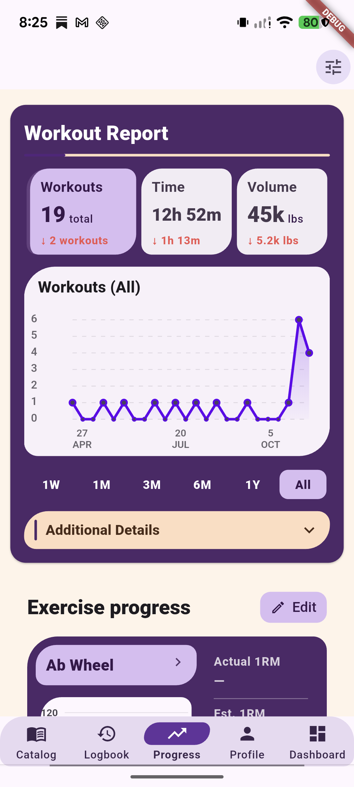
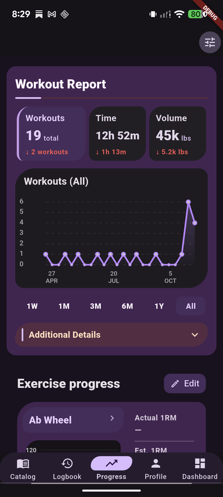

# Tonos Expressive Progress root review

**Status: VISUALLY APPROVED AND FROZEN — Progress root / full page only.** The dedicated Exercise Progress / exercise 1RM detail route has since received a separate visual approval covering populated and empty states in light and dark mode. Measurement Trend detail remains a separate review item. This root visual approval is not a full qualification.

The Progress information order remains **Workout Report → Exercise Progress → Health Trends**. Metrics, chart series, date ranges, calculations, actions, navigation, semantics, data colors, and Reduced Motion behavior remain in place.

## Source and device

- Branch: `feature/classic-m3e`
- Source HEAD: `ab18ed8cab5582c8449e13724afae3c4b74ebeea`
- Checkout was already heavily dirty; this preview is uncommitted and no files were staged.
- Flutter 3.47.5 / Dart 3.13.4
- Pixel 7: `28021FDH200228`, 1080 × 2400 px, 420 dpi
- Preview package: `com.tonos.expressivepreview`
- Isolated preview database: `tonos_expressive_preview.db`
- APK: `build/app/outputs/flutter-apk/app-debug.apk`
- Built from the current source with the isolated preview runner; its manifest and Dart defines were checked before installation.
- No normal `com.tonos` process was running at the end. The preview was returned to Light mode and OS/app-default text scale.

Use the `final2-*` captures below as the final-source evidence. Older PNGs in this folder are earlier captures retained for context.

## Light mode

- [Alternate Time KPI](pixel7-current-source/final2-light-report-time.png)
- [3-month range](pixel7-current-source/final2-light-report-3m.png)
- [Additional Details expanded](pixel7-current-source/final2-light-report-details.png)
- [Exercise Progress](pixel7-current-source/final2-light-exercise-progress.png)
- [Health Trends](pixel7-current-source/final2-light-health-trends.png)

## Dark mode

- [Alternate Time KPI](pixel7-current-source/final2-dark-report-time.png)
- [3-month range](pixel7-current-source/final2-dark-report-3m.png)
- [Additional Details expanded](pixel7-current-source/final2-dark-report-details.png)
- [Exercise Progress](pixel7-current-source/final2-dark-exercise-progress.png)
- [Health Trends](pixel7-current-source/final2-dark-health-trends.png)

The dark Progress warm accent is rosewood `#572C43` with cream foreground `#FFE0BD`. Health Trends' warm Weight/Chest cards now use this Progress-owned accent; the alternating lavender cards and mint actions remain as before. The tested foreground contrast is about **9.02:1**.

## Large-text check

- [Dark Workout Report at 2× text](pixel7-current-source/final-dark-report-2x.png)

At 2× on the Pixel's normal 411 dp width, KPI controls reflow vertically and remain scrollable. The 320 dp layout and text scales are also covered by the focused responsive widget tests; no device-width override was used.

## Visible refinement

- Workout Report keeps its plum focal shell. Resting KPIs share a quieter family; the selected KPI leads in lavender. The chart sits on a restrained neutral analytical surface, the range rail is quieter, and Additional Details stays warm and supporting.
- Exercise Progress uses the page canvas around one plum analytical module that joins the selected exercise, chart, and 1RM summary. The former mint-dominant outer panel no longer competes with the data.
- Health Trends keeps its airy horizontal rail, partial next-card peek, peach/lavender light alternation, and mint add actions. Only the Progress dark warm lane changed from the shared muddy-brown fallback to Progress rosewood.
- Chart/data colors and semantic increases/decreases remain data-owned. No motion recipe or Reduced Motion behavior changed.

## Validation

- Focused Progress / chart / Exercise Progress / Health Trends / Classic-Neo ownership suite: **72 passed, 0 failed**, exit 0.
- Scoped analysis of 16 source/test files: **No issues found**.
- `git diff --check`: passed; Git reported existing LF-to-CRLF working-copy warnings.
- Check-only `dart format --output=none --set-exit-if-changed`: exit 1 because five already-dirty Progress files would be reformatted. It made no edits; no broad formatting rewrite was applied.
- Full repository suite intentionally deferred for this visual-review pass.

## Review boundary

The screenshots document the visually approved and frozen current-source Progress root / full page only. The dedicated Exercise Progress / exercise 1RM detail route is separately approved for populated and empty states in light and dark mode; Measurement Trend detail remains a separate review item. The checkout remains dirty on `feature/classic-m3e`; nothing was committed or pushed. The preview uses its separate package/database and does not write to normal Tonos data.
